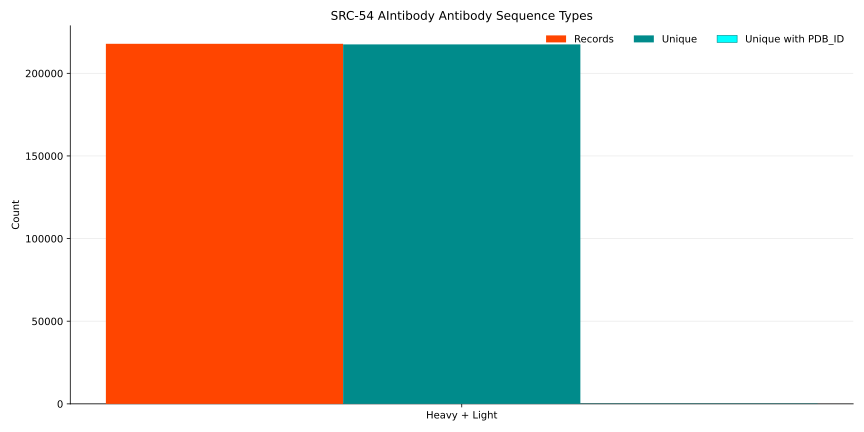
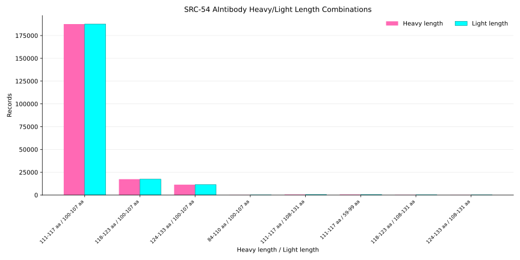
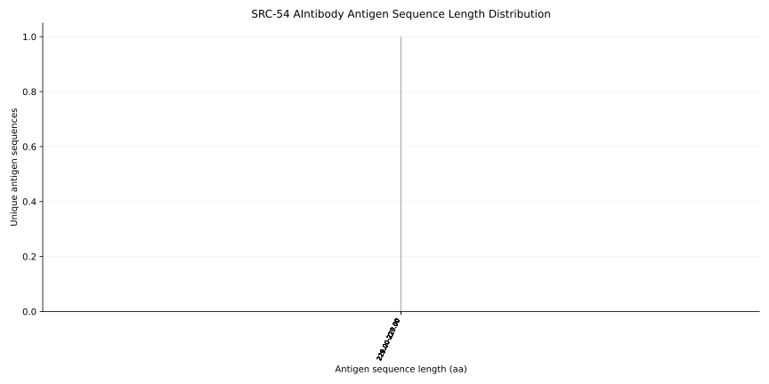

---
- tags:
  - context
---

# SRC-54 AIntibody

> 每条 data 统一建模为 `((ab, ag), label, assay, condition, replicate, source)`.
> 本地快照 `G:\abag-datasets\SRC_R54_AINTIBODY\snapshot-2026-08-19`, 两个工作簿: `MOESM4` 的 Dataset 1 / 2 / 3 分别 185,097 / 32,059 / 715 行, 共 217,871 行; `MOESM3` 是 5 张组织级排名汇总表, 不计入本表.
> `Unique` 为 `(heavy, light)` 二元组精确去重, 三表合计 217,520 个唯一序列对; Dataset 3 的 715 行只对应 686 对.

## Antibody

> 有 Heavy 和 Light 的 `Unique` 字段是 `(heavy, light)` 二元组精确去重. `Unique with PDB_ID` 是按 Unique 后的 sequence 计数.
> Total Unique 计数方式为统一转 string, 如果有 Heavy 和 Light 用 `/` 拼接成 string.

| Key | 含义 | 说明 |
| --- | --- | --- |
| Sequence Type | 抗体序列类型 | 根据原始数据字段、链槽位及已有构建体标签划分的类别. |
| Records | 原始记录数 | 原始数据中的记录数量, 同一序列可能重复出现. |
| Unique | 唯一序列数 | 按对应数据集定义的去重规则统计. |
| Unique with PDB_ID | 关联 PDB 的唯一序列数 | 去重后具有关联 PDB_ID 的序列数量, 不等同于具有可用实验结构监督的序列数量. |
| Description | 类型说明 | 描述分类依据、序列槽位特征及分类限制. |

| Sequence Type | Records | Unique | Unique with PDB_ID | Description |
| --- | --- | --- | --- | --- |
| Heavy + Light | 217,871 | 217,520 | 0 | 三个 Dataset 的可变区序列对; 表内无构建体标注, 序列含源内星号与 `X` 字符, 原样保留不当作标准氨基酸. |
| Total | 217,871 | 217,520 | 0 |  |

> 表内只有轻/重链可变区序列与 CDR / 框架切片, 没有完整链或恒定区; 构建体类别在数据表内没有标注, 因此记 `Heavy + Light`, 不据论文所述的 IgG 合成流程升级为 `IgG`.
>
> 三个 Dataset 有交叉而非互斥: Dataset 3 的 686 对里 302 对也出现在 Dataset 2、20 对出现在 Dataset 1, Dataset 1 与 2 之间只重叠 1 对. 同一序列可由多个组织提交或以对照出现, Dataset 3 的 25 组重复序列对即由此而来.
>
> Dataset 1 的序列原样含 13,415 个星号与 217 个 `X` 字符, 属源内既有字符, 不当作标准氨基酸, 也不在计数时剔除.
>
> `Unique with PDB_ID` 为 0: 表内没有 PDB 字段, 快照内的参考结构不含本批任何设计抗体.

| Heavy Length | Light Length | Records | Description |
| --- | --- | --- | --- |
| 111-117 aa | 100-107 aa | 187,577 | 主簇 86.1%: 可变区量级双链. 轻链长度分布窄 (59-131 aa), 重链 84-133 aa. 长度不用于判定构建体. |
| 118-123 aa | 100-107 aa | 17,389 | 8.0% 的记录. |
| 124-133 aa | 100-107 aa | 11,392 | 5.2% 的记录. |
| 84-110 aa | 100-107 aa | 96 | 96 行重链短于 111 aa, 最短 84 aa; 表内无构建体差异标注. |
| 111-117 aa | 108-131 aa | 554 | 0.3% 的记录. |
| 111-117 aa | 59-99 aa | 550 | 0.3% 的记录. |
| 118-123 aa | 108-131 aa | 197 | 0.1% 的记录. |
| 124-133 aa | 108-131 aa | 116 | 0.1% 的记录. |

## Antigen

> Antigen 统计以 source-native antigen entity 为核心单位. 优先使用原始 antigen ID/name、construct 和 antigen chain 定义实体; 存在可靠序列时再统计唯一抗原序列.
> 结构、序列和数据库注释压缩到同一张表中, `PDB / UniProt` 采用唯一抗原实体粒度统计 2 × 2 覆盖结果.
> 长度图基于唯一抗原序列, 按该源实际范围平均切分 20 bins.

> 三个 Dataset 共用同一 SARS-CoV-2 RBD 靶点, 表内无抗原序列字段; 快照内唯一参考结构 `6M0J` 给 RBD 与 ACE2 的复合物, 属靶点代表锚点.

| Records | Unique ag entity | Unique ag sequence | PDB / UniProt coverage | Antigen Length | Antigen Evidence / Provenance | Description |
| --- | --- | --- | --- | --- | --- | --- |
| 217,871 | 1 | 1 | Reference PDB: 1; UniProt=unavailable | 229 aa | Reference PDB / PDB-derived sequence | 唯一实体是 SARS-CoV-2 RBD, 三个 challenge 共用. 表内无抗原序列列, 序列取 `6M0J` entity 2 (Spike protein S1, author chain B/E, 229 aa), 属派生数据. 论文的 SPR/KinExA 使用不同 RBD 构建体 (含 RBD+SD1 319-591 等), 与 229 aa 的 6M0J 链不严格相同, `6M0J` 也不是本批任何设计抗体的复合物. 表内无 UniProt 字段. |

## Affinity

> 去重口径: 按 **(light 序列, heavy 序列)** 去重, 每个 label 内按该口径计唯一对; Dataset 3 的重复序列对来自多组织提交与控制行, 不是重复测量.
>
> 测量分三层, 标签不与来源混: Dataset 3 的 `KD_SPR` (n=581 行) 与 `KD_KinExA` (99 行) 是实验平衡亲和力, `mean_kd`/`mean_ka` 是 SPR 速率 (117 行, 与 `KD_SPR` 同批但不总自洽: 114 行 `mean_kd/mean_ka` 与 `KD_SPR` 相对偏差 >10%, 且这些都是 `mean_ka < 1` 的行, 疑为上游列值反置, 原值保留不交换); Dataset 2 的 `affinity` (142 行) 是同一批候选的早期表征值, 与 Dataset 3 的 `KD_SPR` 有 116 对重合, 其中 113 对数值完全相同; `Mean KD (M)` (390 行数值 + 128 行 `No binding`) 是外部实验样品的重复汇总.
>
> `No binding` 是源内显式判定, 记 `binary` 阴性, 不当 0 也不当缺失; 它出现在 128 行, 其中 21 行同时有 `KD_SPR` 数值. `relative_abundance_10nM` / `_1nM` 是测序筛选比例, 不是亲和力, 不另立 label.
>
> 五项成药性 (HIC RT、BVP、Tm、Tagg、AC-SINS) 与 `total_developability_score` 不在亲和力词表内, 不计入本表.

| Label | Assay | Condition | Replicate | Record pairs | Unique pairs | Description |
| --- | --- | --- | --- | --- | --- | --- |
| `Kd_M` | `SPR` | Dataset 3 `KD_SPR` | n=1:3; n=2:34; n=3:348; n=4:18; n=6:8; n=8:2; unknown:168 | 581 | 554 | `KD_SPR` (M) 2.20e-11-2.05e-04; `n_spr` 只覆盖 413 行 (1-8), 另 168 行无重复计数, 记 `unknown`. |
| `Kd_M` | `KinExA` | Dataset 3 `KD_KinExA` | unknown:99 | 99 | 94 | `KD_KinExA` (M) 2.92e-12-1.90e-07; 全部 94 对都有配对 `KD_SPR`; 无重复数字段. 同表 `KinExA_Screen_KD_Estimate` (95 行) 是 screening 估计, 与平衡 `KD_KinExA` 只有 1 行同值, 不并入本行. |
| `Kd_M` | `SPR` | Dataset 2 `affinity` | unknown:142 | 142 | 142 | `affinity` (M) 2.67e-11-2.05e-04; 与 Dataset 3 `KD_SPR` 有 116 对重合, 113 对数值相同, 3 对不同 (7.94e-10/4.10e-10, 1.41e-09/2.80e-10, 1.00e-08/1.27e-08). 同一测量的早期表征层, 跨表合并须去重. |
| `Kd_M` | `SPR` | Dataset 3 `Mean KD (M)` | unknown:390 | 390 | 368 | `Mean KD (M)` 2.20e-11-2.90e-06; 外部样品的重复汇总, 287 行与 `KD_SPR` 数值相同. 与上两行同批候选, 不独立相加. |
| `binary` | `SPR` | Dataset 3 `Mean KD (M) = No binding` | unknown:128 | 128 | 127 | 源内显式 `No binding` 字符串, 不是 0 也不是缺失; 其中 21 行同时有 `KD_SPR` 数值, 二者并存保留. |
