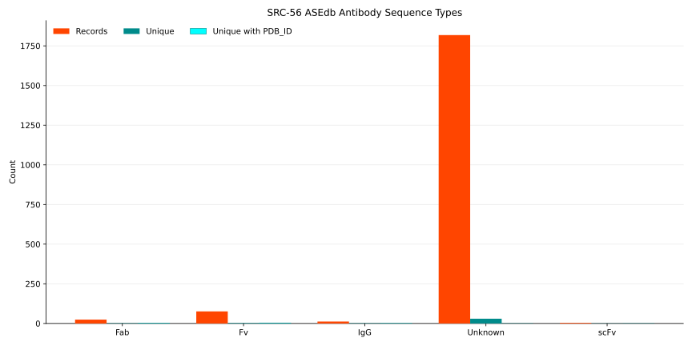
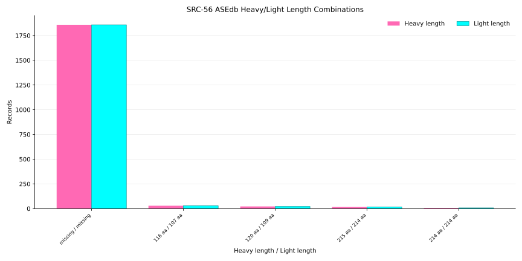
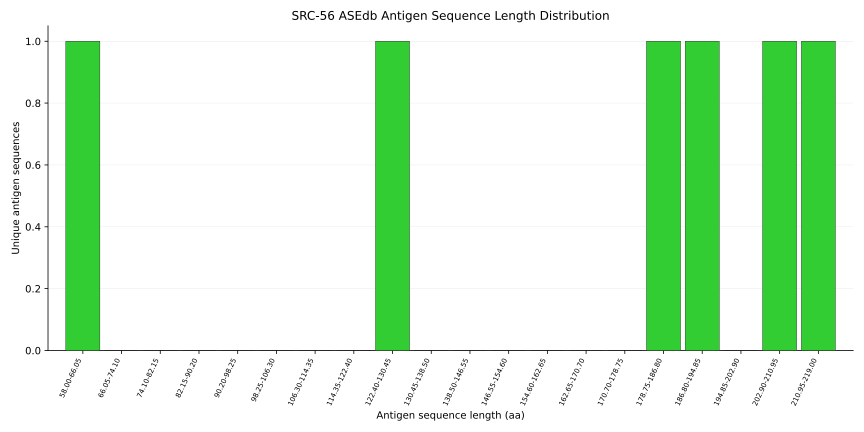

---
tags:
  - context
---

# SRC-56 ASEdb

> 每条 data 统一建模为 `((ab, ag), label, assay, condition, replicate, source)`.
> 本地快照 `G:\abag-datasets\SRC_R56_ASEDB\snapshot-2010-07-21`, 主载荷 `ASEdb/ASEdb_2010-07-21_Wayback-MySQLDump.mysql` 三个表 (mutation 3,043 行 / system 101 行 / reference 74 行), 加 32 个冻结 RCSB entry 的 FASTA 与 mmCIF.
> `Unique` 为抗体参与者的 source-native 名称精确去重: dump 没有抗体序列列、没有链槽位列、也没有构建体列, 名称是源内唯一能区分抗体对象的字段.

## Antibody

> 有 Heavy 和 Light 的 `Unique` 字段是 `(heavy, light)` 二元组精确去重. `Unique with PDB_ID` 是按 Unique 后的 sequence 计数.
> Total Unique 计数方式为统一转 string, 如果有 Heavy 和 Light 用 `/` 拼接成 string.

| Key | 含义 | 说明 |
| --- | --- | --- |
| Sequence Type | 抗体序列类型 | 根据原始数据字段、链槽位及已有构建体标签划分的类别. |
| Records | 原始记录数 | 原始数据中的记录数量, 同一序列可能重复出现. |
| Unique | 唯一序列数 | 按对应数据集定义的去重规则统计. |
| Unique with PDB_ID | 关联 PDB 的唯一序列数 | 去重后具有关联 PDB_ID 的序列数量, 不等同于具有可用实验结构监督的序列数量. |
| Description | 类型说明 | 描述分类依据、序列槽位特征及分类限制. |

| Sequence Type | Records | Unique | Unique with PDB_ID | Description |
| --- | --- | --- | --- | --- |
| Fab | 24 | 2 | 2 | 5G9 (1AHW entity `IMMUNOGLOBULIN FAB 5G9 (LIGHT / HEAVY CHAIN)`) 与 HYHEL-10 (3HFM entity `HYHEL-10 IGG1 FAB`) 两个亲本, 构建体名来自冻结 entry 的 entity 描述. |
| Fv | 76 | 3 | 3 | D1.3 (1VFB entity `IGG1-KAPPA D1.3 FV`), E5.2 (1DVF entity `FV E5.2`), Ab hu4D5-5 (1FVC entity `IGG1-KAPPA 4D5 FV`) 三个亲本; entity 显式写 `FV`. |
| IgG | 12 | 2 | 1 | `IgG1` (system 84) 与 `IgG2b` (system 81) 两个亲本, 名字即源内显式亚类标注. 1FC2 只冻结了 entity `IMMUNOGLOBULIN FC` (224 aa), 结构覆盖的是 Fc 段而不是完整 IgG; system 81 没有 entry. |
| Unknown | 1818 | 30 | 0 | 31 个 `mAb ...` / `Mab N` 名称 (30 个唯一名, `mAb A4.6.1` 在两个 system 里出现), 只有名称没有构建体措辞, 也没有链槽位. 其中 27 个指向 3HHR, 该 entry 只有 hGH 与 hGHbp 两条链, 没有免疫球蛋白实体; `mAb8` 指向 1IL6, 同样没有免疫球蛋白链; 其余 3 个的 PDB 为 NULL. |
| scFv | 4 | 1 | 0 | system 89 的 `scFv FITC-E2`, 名称自带 `scFv`; PDB 字段为空字符串, 没有冻结结构. |
| Total | 1934 | 38 | 6 |  |

> ASEdb 是丙氨酸扫描结合自由能的文献汇编, 不是抗体库. 101 个 system 里只有 42 个的某一方是显式命名的抗体 (`mAb ...` / `Mab N` / `Fab 5G9` / `HYHEL-10` / `D1.3` / `E5.2` / `Ab hu4D5-5` / `scFv ...` / `IgG1` / `IgG2b`), 涉及 1,934 条 mutation 行; 其余 59 个 system 是无抗体参与者的普通蛋白–蛋白、蛋白–DNA 与蛋白–小分子体系.
>
> 判定只认 system 的 `mutated_protein` / `partner_protein` 两列里出现的名称, 不按 PDB 编号反查. 1GC1 (system 41, CD4 × gp120) 的 entry 里冻结了 `ANTIBODY 17B` 的 Fab 两条链, 但 17B 不是这个 system 的任何一方, 按名称判则它不属于本节 — 若按 entry 含抗体措辞判, 41 会被错算成抗体记录.
>
> 31 个 `mAb ...` / `Mab N` system 里有 27 个的 PDB 列指向 3HHR, 而 3HHR 只冻结了 hGH (190 aa) 与 hGHbp (205 aa) 两条链, 没有任何免疫球蛋白实体: 这些名称的 `Unique with PDB_ID` 记 0, 不把共享的受体参考结构当作抗体结构.
>
> `Unique with PDB_ID` 的判定是: 该名称所在 system 的冻结 entry 含免疫球蛋白 entity. 命中 6 个 — Fab 5G9 (1AHW)、HYHEL-10 (3HFM)、D1.3 (1VFB / 1DVF)、E5.2 (1DVF)、Ab hu4D5-5 (1FVC)、IgG1 (1FC2 的 `IMMUNOGLOBULIN FC`). scFv FITC-E2 的 PDB 字段是空字符串, 记 0.
>
> 长度只取冻结 entry 里字面写出 `HEAVY` / `LIGHT` 的 entity: 1AHW 214 / 214 aa、3HFM 215 / 214 aa、1VFB 116 / 107 aa、1FVC 120 / 109 aa, 共 75 行. 其余 1,859 行的 entry 没有链角色措辞 (1DVF 的 entity 只写 `FV D1.3` / `FV E5.2`, 3HHR 没有免疫球蛋白链), 记 `missing`, 不从长度反推构建体.
>
> `D1.3` 在 system 24 / 44 (1VFB) 与 system 55 (1DVF) 都出现, 1VFB 与 1DVF 给出的链长不同 (116 / 107 与 121 / 108 aa). 按名称去重后它是一个抗体, 这两套链长差异记在此处而不拆成两行.

| Heavy Length | Light Length | Records | Description |
| --- | --- | --- | --- |
| missing | missing | 1,859 | 没有可用的链角色: 1DVF 的 entity 只写 `FV D1.3` / `FV E5.2`, 3HHR 与 1IL6 没有免疫球蛋白链, system 13 / 14 / 34 / 81 / 89 没有可用 entry. 记 missing, 不按长度补. |
| 116 aa | 107 aa | 29 | 1VFB 的 D1.3 Fv 重链 116 aa, 轻链 107 aa; 仅可变区, 由 entity 的 `FV` 措辞定, 不由长度定. |
| 120 aa | 109 aa | 22 | 1FVC 的 4D5 Fv 重链 120 aa, 轻链 109 aa; 同上. |
| 215 aa | 214 aa | 16 | 3HFM 的 HYHEL-10 Fab 重链 215 aa, 轻链 214 aa. |
| 214 aa | 214 aa | 8 | 1AHW 的 Fab 5G9 重链 214 aa 配轻链 214 aa, 双链都到 CH1 / CL 量级. |

## Antigen

> Antigen 统计以 source-native antigen entity 为核心单位. 优先使用原始 antigen ID/name、construct 和 antigen chain 定义实体; 存在可靠序列时再统计唯一抗原序列.
> 结构、序列和数据库注释压缩到同一张表中, `PDB / UniProt` 采用唯一抗原实体粒度统计 2 × 2 覆盖结果.
> 长度图基于唯一抗原序列, 按该源实际范围平均切分 20 bins.

> 抗原取每条抗体 system 的对侧参与者, 以 system 的名称字符串为实体; 序列只取冻结 entry 里能对上的链.

| Records | Unique ag entity | Unique ag sequence | PDB / UniProt coverage | Antigen Length | Antigen Evidence / Provenance | Description |
| --- | --- | --- | --- | --- | --- | --- |
| 1,909 | 10 | 6 | PDB=1/UniProt=0: 9; PDB=0/UniProt=0: 1; PDB=1/UniProt=1: 0; PDB=0/UniProt=1: 0 | 58-219 aa | Reference PDB / PDB-derived sequence | 抗原取每条抗体 system 的对侧参与者, 按 system 的名称字符串定义实体: hGH 1,603 行、VEGF 165 行、hGHbp 48 行、HEL 45 行、p185HER2 22 行、Complement C1q 9 行、Tissue Factor 8 行、fluorescein 4 行、Protein A 3 行、IL-6 2 行, 共 10 个实体. 两条 system (7 与 55, E5.2 × D1.3) 两侧都是抗体, 不产生独立抗原, 其 25 行不计入本节. 只有 6 个实体能在冻结 entry 里找到对应链: HEL 129 aa (1VFB chain C)、Tissue Factor 219 aa (1AHW chain C)、hGHbp 205 aa (3HHR chain B)、hGH 190 aa (3HHR chain A)、IL-6 185 aa (1IL6 chain A)、Protein A 58 aa (1FC2 chain A); 其余 4 个 (VEGF、p185HER2、Complement C1q、fluorescein) 没有可用序列 — system 13 / 14 / 34 的 PDB 为 NULL, system 42 的 1FVC 只冻结了 4D5 的 Fv 两条链、没有 HER2, system 81 无 entry, system 89 的 PDB 是空字符串且对侧是荧光素小分子. 长度记的是冻结链全长, 不是源内的被测构建体; 源内没有任何抗原序列字段, 也不从参考链反推构建体. 表内无 UniProt 字段, 记 0 覆盖而不是否定的生物学结论. |

## Affinity

> 去重口径: 按 **(抗体名称, 抗原名称)** 名称对去重, 全表 37 个唯一配对; 无 replicate 字段, 全记 `unknown`.
>
> 主表 `mutation` 的亲和力列只有 `ddG` (float(6,3), kcal/mol, 相对野生型的结合自由能变化, 正值为结合减弱) 与 `min_ddG` (enum `>`, 下界标记). 数值范围 -0.940 到 6.380 kcal/mol. 表内没有 Kd、没有温度、没有 buffer、没有重复次数、没有实验方法列, 所以 `Assay` 一律记 `unknown`, 不从 reference 的题名反推方法.
>
> 三行按 `ddG` 的三种状态分开: 点是普通数值, 零是 schema 默认值 (字段 `NOT NULL default 0.000`, 全库没有测量状态列, 零既可能是精确测得的无效应, 也可能是缺省填充, 不能二选一), 边界是 `min_ddG` 写 `>` 的删失下界. 三者不是阴性, 也不是彼此可加的测量次数. 拆开后每行的 `Unique pairs` 是该状态内的名称对数, 同一个 (抗体, 抗原) 名称对可以同时出现在两行, 因此三行相加会大于全表的 37.
>
> `kon_ratio` / `koff_ratio` 是原库的动力学比值, 原说明没有写分子分母, 不当 Kd 用, 也不进本表. `system.dG` 是体系级汇总自由能, 不是逐突变 ddG, 同样不进本表.
>
> 两条 system (7 与 55) 的双方都是抗体, 其 25 行没有独立抗原, 不进本表; 它们出现在 Antibody 一节.

| Label | Assay | Condition | Replicate | Record pairs | Unique pairs | Description |
| --- | --- | --- | --- | --- | --- | --- |
| `ddG` | `unknown` | `ddG` 普通数值, `min_ddG` 空 | unknown:400 | 400 | 36 | `ddG` 范围 -0.940 到 5.900 kcal/mol; 正值为结合减弱. |
| `ddG` | `unknown` | `ddG` = 0.000, schema 默认值 | unknown:1,463 | 1,463 | 30 | schema 写 `NOT NULL default 0.000`, 全库又没有测量状态列: 这些零既可能是精确测得的无效应, 也可能是缺省填充. 保留原值, 不当作 `not_recorded`, 也不当作阴性. |
| `ddG` | `unknown` | `min_ddG` = `>`, 删失下界 | unknown:46 | 46 | 20 | `min_ddG` 字段写 `>` 的 46 行是下界, ddG 值 1.970 到 6.380; 不能当点估计, 也不能与普通数值行混排. |
