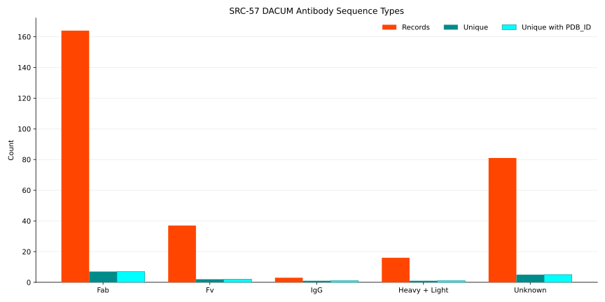
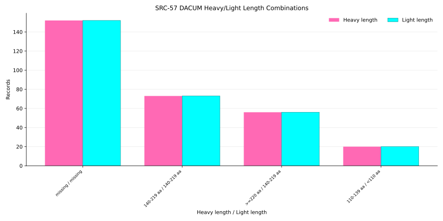
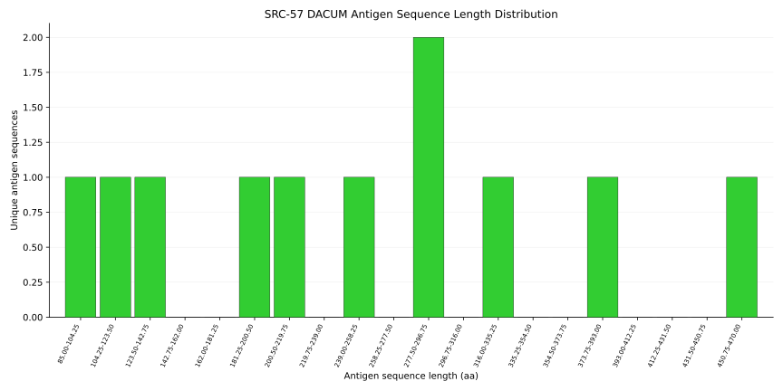

---
tags:
  - context
---

# [SRC-57 DACUM](../2026-10-29-3a-src-readme/src-57-dacum-readme.md)

> 每条 data 统一建模为 `((ab, ag), label, assay, condition, replicate, source)`.
> 本地快照 `G:\abag-datasets\SRC_R57_DACUM\snapshot-2019-03-08`, 主表 `DACUM/DACUM_1.1.csv` (分号分隔, 1,872 行、147 个复合物), 同目录 `DACUM_1.0.csv` 是同一批突变的 6 列原始版, 加 147 份 RCSB entry FASTA.
> `Unique` 按抗体链序列集合去重: 同一条链在 label 与 auth 两个链号下重复出现时只计一次. 147 个复合物里只有 17 个含免疫球蛋白链, 共 301 行; 其余 130 个是普通蛋白-蛋白复合物, 不出现在抗体侧.

## Antibody

> 有 Heavy 和 Light 的 `Unique` 字段是 `(heavy, light)` 二元组精确去重. `Unique with PDB_ID` 是按 Unique 后的 sequence 计数.
> Total Unique 计数方式为统一转 string, 如果有 Heavy 和 Light 用 `/` 拼接成 string.

| Key | 含义 | 说明 |
| --- | --- | --- |
| Sequence Type | 抗体序列类型 | 根据原始数据字段、链槽位及已有构建体标签划分的类别. |
| Records | 原始记录数 | 原始数据中的记录数量, 同一序列可能重复出现. |
| Unique | 唯一序列数 | 按对应数据集定义的去重规则统计. |
| Unique with PDB_ID | 关联 PDB 的唯一序列数 | 去重后具有关联 PDB_ID 的序列数量, 不等同于具有可用实验结构监督的序列数量. |
| Description | 类型说明 | 描述分类依据、序列槽位特征及分类限制. |

| Sequence Type | Records | Unique | Unique with PDB_ID | Description |
| --- | --- | --- | --- | --- |
| Fab | 164 | 7 | 7 | entity 显式写 `IMMUNOGLOBULIN FAB` / `Fab fragment` / `E2 Fab` / `Antigen binding fragment`, 重链 214-257 aa 配轻链 211-218 aa. |
| Fv | 37 | 2 | 2 | entity 显式写 `FV`; 只有可变区. 1VFB 给出槽位 (116 / 107 aa), 1DVF 的 4 条链只写 `FV D1.3` / `FV E5.2`, 无槽位, 长度记 missing. |
| IgG | 3 | 1 | 1 | entity 写 `IMMUNOGLOBULIN (IGG1, LAMBDA)`, 链长 210 / 221 aa; 2VIR 与 2VIS 两条链完全相同, 故 unique = 1. |
| Heavy + Light | 16 | 1 | 1 | entity 写 `ANTIBODY HYHEL-63 (HEAVY CHAIN)` 与 `(LIGHT CHAIN)`, 有槽位无构建体措辞. |
| Unknown | 81 | 5 | 5 | 只写抗体名 (`ANTIBODY 17B` / `ANTIBODY A6` / `MONOCLONAL ANTIBODY D1.3`), 无槽位也无构建体措辞; 有两条链但不据此判构建体. |
| Total | 301 | 16 | 16 |  |

> 构建体按 RCSB entity 描述判定, 与共享分类器同一顺序: `Fab` 由 `IMMUNOGLOBULIN FAB` / `FAB FRAGMENT` / `E2 Fab Heavy Chain` / `Antigen binding fragment` 措辞给出, `Fv` 由 `FV D1.3` / `IGG1-KAPPA D1.3 FV` 给出, `IgG` 由 `IMMUNOGLOBULIN (IGG1, LAMBDA)` 单独给出.
>
> `Unknown` 的 81 行来自 5 个只写抗体名而没有任何构建体措辞的复合物: `ANTIBODY 17B`、`ANTIBODY A6`、`MONOCLONAL ANTIBODY D1.3` (1KIP / 1KIQ / 1KIR 三条 identical 链对). 它们有重链和轻链两条链, 但源内没有 Fab / Fv / IgG 字样, 按词表只能落 `Unknown`; 不按链长把它们提升为 Fab 或 Fv.
>
> `Heavy + Light` 只有 1 个单元: `ANTI-LYSOZYME ANTIBODY HYHEL-63 (HEAVY CHAIN)` / `(LIGHT CHAIN)` 显式给出槽位而没有构建体措辞.
>
> `Unique with PDB_ID` 等于 `Unique`: 16 个抗体单元各自来自一个具名 entry, 都是抗体-抗原复合物的晶体结构, 不是亲本代理结构.
>
> 长度表只列显式给出槽位的单元: `1DVF` 的 4 条链写作 `FV D1.3` / `FV E5.2` 而不写 H / L, `1GC1` / `1JRH` / `1KIP` 系 / `2JEL` / `1NMB` / `2VIR` / `2VIS` 只给抗体名, 都没有槽位措辞, 长度记 `missing`.
>
> 源内没有任何 scFv / Nanobody / VHH / 单域条目, 因此这四类不出现, 也不写 0 行.

| Heavy Length | Light Length | Records | Description |
| --- | --- | --- | --- |
| missing | missing | 152 | 5 个单元只有抗体名, 无 H / L 槽位措辞, 长度不可取. |
| 140-219 aa | 140-219 aa | 73 | Fab 的主簇: 重链 210-215 aa 配轻链 211-214 aa (1DQJ / 1AHW / 3HFM). |
| >=220 aa | 140-219 aa | 56 | 重链超过 220 aa 的 Fab: 1NCA 221 / 3NPS 226 / 3BN9 257 aa. |
| 110-139 aa | <110 aa | 20 | 1VFB 的 Fv: 重链 116 aa 配轻链 107 aa. |

## Antigen

> Antigen 统计以 source-native antigen entity 为核心单位. 优先使用原始 antigen ID/name、construct 和 antigen chain 定义实体; 存在可靠序列时再统计唯一抗原序列.
> 结构、序列和数据库注释压缩到同一张表中, `PDB / UniProt` 采用唯一抗原实体粒度统计 2 × 2 覆盖结果.
> 长度图基于唯一抗原序列, 按该源实际范围平均切分 20 bins.

> 抗原侧是 17 个抗体复合物里非免疫球蛋白链给出的 source-native 实体; 源表没有抗原字段, 实体由 RCSB entity 名与 RCSB entry 共同确定.

| Records | Unique ag entity | Unique ag sequence | PDB / UniProt coverage | Antigen Length | Antigen Evidence / Provenance | Description |
| --- | --- | --- | --- | --- | --- | --- |
| 301 | 13 | 11 | PDB=1/UniProt=0: 13; PDB=0/UniProt=0: 0; PDB=0/UniProt=1: 0; PDB=1/UniProt=1: 0 | 85-470 aa; 11 unique lengths | PDB-derived sequence | 13 个实体: CD4, ENVELOPE PROTEIN GP120, HEMAGGLUTININ, HEN EGG WHITE LYSOZYME, HISTIDINE-CONTAINING PROTEIN, INFLUENZA A SUBTYPE N9 NEURAMINIDASE, INTERFERON-GAMMA RECEPTOR ALPHA CHAIN, LYSOZYME, Membrane-type serine protease 1, N9 NEURAMINIDASE, Suppressor of tumorigenicity 14 protein, TISSUE FACTOR. 实体键是 (entity 名, 链序列), 序列直接取自 17 个冻结抗体复合物的非免疫球蛋白链. 两处合并解释了 13 个实体只有 11 条序列: `LYSOZYME` (1DQJ / 1KIP / 1KIQ / 1KIR) 与 `HEN EGG WHITE LYSOZYME` (1VFB / 3HFM) 是同一段 129 aa 序列的两个名字; `Membrane-type serine protease 1` (3BN9) 与 `Suppressor of tumorigenicity 14 protein` (3NPS) 是同一段 241 aa 序列的两个名字. 反过来, `HEMAGGLUTININ` 在 2VIR 与 2VIS 里是两条不同的 282 aa 序列, 差异分布在 10-138 与 257-282 两段, 因此按 (名, 序列) 计为 2 个实体、2 条序列. 长度 85-470 aa 是完整链, 不是被测构建体的长度: `HISTIDINE-CONTAINING PROTEIN` 85 aa、`INTERFERON-GAMMA RECEPTOR ALPHA CHAIN` 108 aa、`INFLUENZA A SUBTYPE N9 NEURAMINIDASE` 389 aa、`N9 NEURAMINIDASE` 470 aa 各一条. 每个实体都有对应 PDB entry, 共 16 个; 1DVF 是 Fv-Fv 二聚体, 没有抗原侧链, 因此不贡献实体. 源内没有 UniProt 字段. |

## Affinity

> 去重口径: 按 **(复合物, 突变)** 去重, 即 `SKEMPI_ID`; 1,872 行 / 1,872 个唯一键. 无 replicate 字段, 全记 `unknown`.
>
> `DACUM_1.1.csv` 每行一个单点突变, 同时给 `Kd_mut` / `Kd_wt` (M) 与由两者导出的 `ddG` (kcal/mol); `ddG = RT ln(Kd_mut/Kd_wt)` 用该行自己的 `Temperature` 逐行核对, 最大偏差 < 0.05 kcal/mol, 所以 `ddG` 是本源的派生量而不是第二套测量, 但它是源内直接给出的列, 单列一行 `ddG`, 不与 `Kd_M` 相加.
>
> `DACUM_1.0.csv` 是同一批 1,872 个 `SKEMPI_ID` 的 6 列版本 (`SKEMPI_ID` / `∆∆G(kcal/mol)` / `Position` / `Method` / `Rerference` / `Comments`), 两边 ID 集合完全一致, `∆∆G` 与 1.1 的 `ddG` 逐行相等 (差 < 1e-6), 是同一批测量的两次导出, 不叠加.
>
> 温度按行给 (273-323 K, 11 个值, 298 K 991 行 / 294 K 737 行); `Method` 是 15 个 SKEMPI 方法代码, 只把 `SPR` / `ITC` / `ELISA` 三个直接对应的码映射到全局 `Assay`, 其余 12 个 (`SP` 564 / `FL` 312 / `IASP` 190 / `SFFL` 113 / `RA` 102 / `IARA` 50 / `CSPRIA` 43 / `IAFL` 27 / `SFSP` 10 / `ELFA` 9 / `IAGE` 7 / `EMSA` 6) 记 `unknown` 并把代码写在 `Condition` 里, 不从代码猜方法.
>
> `Hold_out_type` / `Hold_out_proteins` 是论文做交叉验证时的划分 (`PI` 844 / 空 727 / `AB` 222 / `PI,AB` 79), 属分析划分而非实验条件, 不写进 `Condition`.
>
> 与本表同源的跨源副本: 731 个 `SKEMPI_ID` 与 R15 SKEMPI 2.0 的 `#Pdb + Mutation(s)_cleaned` 完全相同, 是同一批突变; 1,141 个是 DACUM 自己补的. 跨源汇总按 `(复合物, 突变)` 去重, 不与 R15 相加.

| Label | Assay | Condition | Replicate | Record pairs | Unique pairs | Description |
| --- | --- | --- | --- | --- | --- | --- |
| `ddG` | SPR | `Method = SPR` | unknown:357 | 357 | 357 | `ddG (kcal mol^(-1))` 值域 -4.91-6.89, 中位数 0.69; 每行一个单点突变, 同表配 `Kd_mut` / `Kd_wt` 两个绝对 Kd. 357 行属于这一组, 去重键 `(复合物, 突变)` 全表唯一. |
| `ddG` | ITC | `Method = ITC` | unknown:58 | 58 | 58 | `ddG (kcal mol^(-1))` 值域 -2.53-6.20, 中位数 0.36; 每行一个单点突变, 同表配 `Kd_mut` / `Kd_wt` 两个绝对 Kd. 58 行属于这一组, 去重键 `(复合物, 突变)` 全表唯一. |
| `ddG` | ELISA | `Method = ELISA` | unknown:24 | 24 | 24 | `ddG (kcal mol^(-1))` 值域 -0.13-1.30, 中位数 0.00; 每行一个单点突变, 同表配 `Kd_mut` / `Kd_wt` 两个绝对 Kd. 24 行属于这一组, 去重键 `(复合物, 突变)` 全表唯一. |
| `ddG` | `unknown` | 12 个代码: CSPRIA, ELFA, EMSA, FL, IAFL, IAGE, IARA, IASP, RA, SFFL, SFSP, SP | unknown:1,433 | 1,433 | 1,433 | `ddG (kcal mol^(-1))` 值域 -12.20-12.20, 中位数 0.59; 每行一个单点突变, 同表配 `Kd_mut` / `Kd_wt` 两个绝对 Kd. 1,433 行属于这一组, 去重键 `(复合物, 突变)` 全表唯一. |
