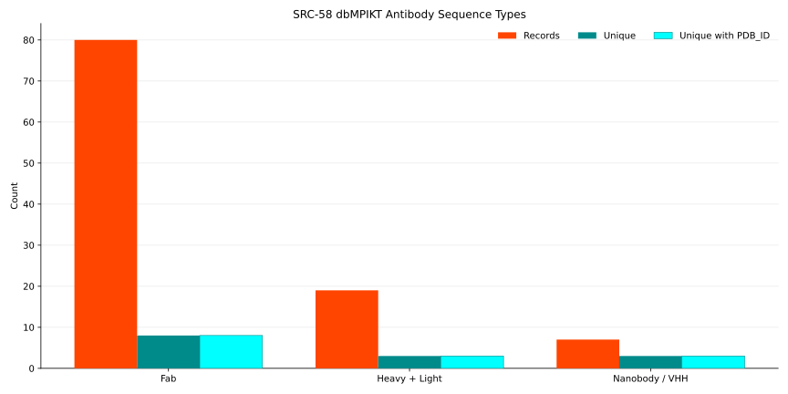
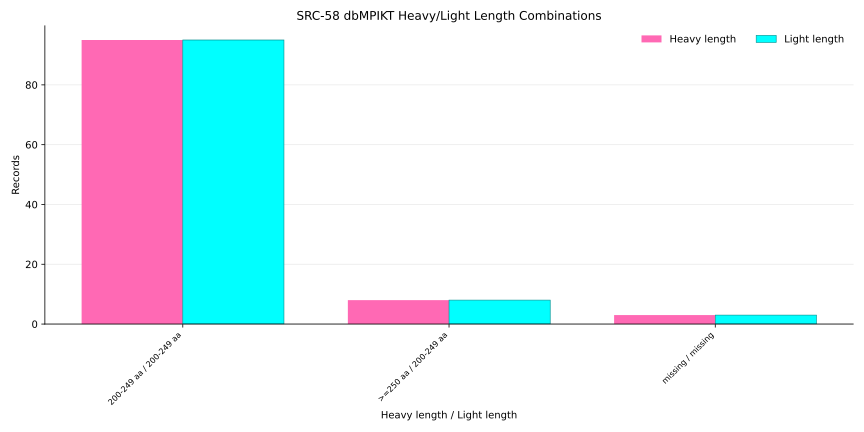
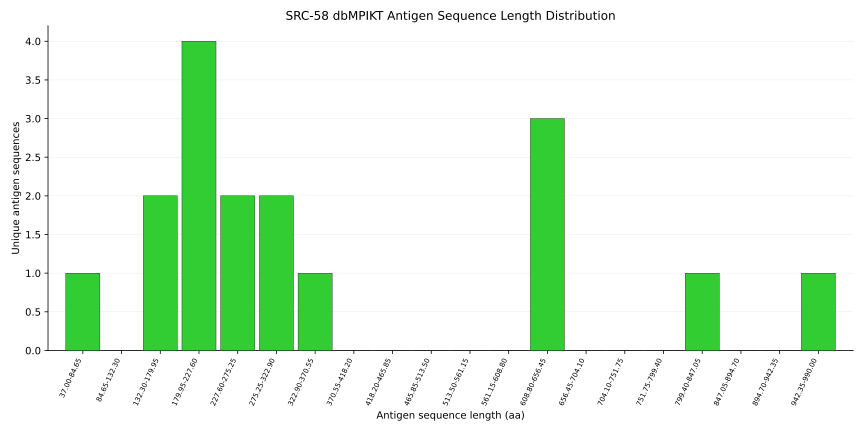

---
- tags:
  - context
---

# SRC-58 dbMPIKT

> 每条 data 统一建模为 `((ab, ag), label, assay, condition, replicate, source)`.
> 本地快照 `G:\abag-datasets\SRC_R58_DBMPIKT\snapshot-2018-11-27`, 主表 `dbMPIKT/dbMPIKT_2018-11-27_BMC-AdditionalFile1.xlsx` (124 条记录, 1,123 个突变条目), 另有复合物-链表 (241 个复合物) 与论文的汇总表, 加 229 份冻结 RCSB entry FASTA.
> `Unique` 按抗体链序列集合去重: 同一条链在 label 与 auth 两个链号下重复出现时只计一次. 1,123 个突变条目里只有 106 个落在含免疫球蛋白链的 14 个复合物上; 其余 977 个是普通蛋白-蛋白复合物.

## Antibody

> 有 Heavy 和 Light 的 `Unique` 字段是 `(heavy, light)` 二元组精确去重. `Unique with PDB_ID` 是按 Unique 后的 sequence 计数.
> Total Unique 计数方式为统一转 string, 如果有 Heavy 和 Light 用 `/` 拼接成 string.

| Key | 含义 | 说明 |
| --- | --- | --- |
| Sequence Type | 抗体序列类型 | 根据原始数据字段、链槽位及已有构建体标签划分的类别. |
| Records | 原始记录数 | 原始数据中的记录数量, 同一序列可能重复出现. |
| Unique | 唯一序列数 | 按对应数据集定义的去重规则统计. |
| Unique with PDB_ID | 关联 PDB 的唯一序列数 | 去重后具有关联 PDB_ID 的序列数量, 不等同于具有可用实验结构监督的序列数量. |
| Description | 类型说明 | 描述分类依据、序列槽位特征及分类限制. |

| Sequence Type | Records | Unique | Unique with PDB_ID | Description |
| --- | --- | --- | --- | --- |
| Fab | 80 | 8 | 8 | entity 显式写 `Fab` / `FAB FRAGMENT` / `Antigen binding fragment`; 重链 222-282 aa 配轻链 213-239 aa. |
| Heavy + Light | 19 | 3 | 3 | entity 只写 `antibody ... heavy chain` / `light chain`, 无构建体措辞; 重链 219-230 aa, 轻链 214-220 aa. |
| Nanobody / VHH | 7 | 3 | 3 | entity 显式写 `Nanobody/VHH domain`; 单域 136-138 aa, 无轻链槽位. |
| Total | 106 | 14 | 14 |  |

> 主表一行不是一次测量, 而是一组做过的突变: `Mutation(s)_PDB` 列出该记录用到的突变串, 分号分隔, 斜杠表示同一行内同时引入的多个替换. 表内没有 Kd / ΔΔG / 任何数值列, 所以本节的 `Records` 计数是**突变条目**, 不是结合测量.
>
> 构建体按 RCSB entity 描述判定: `Fab` 8 个复合物 (`Fab Heavy chain` / `1G2 Fab heavy chain` / `Antigen binding fragment` / `M2139 FAB FRAGMENT` 等), `Nanobody / VHH` 3 个 (`Nanobody/VHH domain EgA1` / `7D12` / `9G8`), `Heavy + Light` 3 个 (`Antibody CR8043, Heavy Chain` / `anti-uPAR antibody, heavy chain` / `Heavy chain of murine anti-vaccinia L1 IgG2a antibody M12B9`), 都只给槽位而无构建体措辞.
>
> `4KRO` / `4KRP` 的复合物同时含一条 VHH (EgA1 / 9G8) 和一套 cetuximab Fab (220 / 211 aa); 词表要求显式 VHH 标志优先, 因此这两个复合物整条落在 `Nanobody / VHH` 行, cetuximab 的链长也一并列在该行, 不拆成两行重复计数.
>
> `Cetuximab heavy chain` / `Cetuximab light chain` 只有药名加槽位, 没有免疫球蛋白措辞, 共享分类器认不出; 本源按"已知药名 + 重/轻链槽位"补齐 (与 `MEDI8852 heavy chain` 同一判据), 不改共享模块. 4U6H 的 `Heavy chain of murine anti-vaccinia L1 IgG2a antibody M12B9` 带 `antibody` 措辞, 由共享规则直接判定.
>
> `Unique with PDB_ID` 等于 `Unique`: 每个抗体单元都来自一个具名 entry, 都是抗体-抗原复合物晶体结构.
>
> 长度表按槽位字面判定: 3 个 Nanobody 复合物没有 H / L 槽位, 记 `missing`; 其余按 entity 里的 `heavy chain` / `light chain` 取链长, 不从序列长度反推构建体.

| Heavy Length | Light Length | Records | Description |
| --- | --- | --- | --- |
| 200-249 aa | 200-249 aa | 95 | 主体: Fab 与 Heavy + Light 的重链 219-233 aa 配轻链 210-220 aa. |
| >=250 aa | 200-249 aa | 8 | 重链超过 250 aa 的两个 Fab: 4IOF 263 aa、4XHJ 282 aa; 轻链仍在 200-249 aa. |
| missing | missing | 3 | 3 个 Nanobody 复合物只有单域 (136-138 aa), 没有 H / L 槽位. |

## Antigen

> Antigen 统计以 source-native antigen entity 为核心单位. 优先使用原始 antigen ID/name、construct 和 antigen chain 定义实体; 存在可靠序列时再统计唯一抗原序列.
> 结构、序列和数据库注释压缩到同一张表中, `PDB / UniProt` 采用唯一抗原实体粒度统计 2 × 2 覆盖结果.
> 长度图基于唯一抗原序列, 按该源实际范围平均切分 20 bins.

> 抗原侧是 14 个抗体复合物里非免疫球蛋白链给出的 source-native 实体; 源表只有 PDB 编号与突变串, 抗原序列取自冻结 entry, 实体由 (entity 名, 链序列) 确定.

| Records | Unique ag entity | Unique ag sequence | PDB / UniProt coverage | Antigen Length | Antigen Evidence / Provenance | Description |
| --- | --- | --- | --- | --- | --- | --- |
| 106 | 17 | 17 | PDB=1/UniProt=0: 17; PDB=0/UniProt=0: 0; PDB=0/UniProt=1: 0; PDB=1/UniProt=1: 0 | 37-990 aa; 17 unique lengths | PDB-derived sequence | 14 个实体名、17 个实体: Alpha-hemolysin, Cytokine receptor common subunit beta, Enterotoxin type B, Envelope glycoprotein B, Envelope glycoprotein H, Envelope glycoprotein L, Epidermal growth factor receptor, Hemagglutinin HA1 Chain, Hemagglutinin HA2 Chain, Insulin-degrading enzyme, J1 EPITOPE, Protein L1, S protein, Urokinase plasminogen activator surface receptor. 序列与名字都取自冻结 entry 的非免疫球蛋白链, 因此实体与唯一序列一一对应 (17 / 17). `Epidermal growth factor receptor` 在 4KRM / 4KRO 与 4KRP 里给出三条不同长度 (214 / 624 / 625 aa) 的链, 按 (名, 序列) 计为 3 个实体; `Cytokine receptor common subunit beta` 在 5DWU 里 203 / 224 aa 两条同样分开计. `J1 EPITOPE` 只有 37 aa, 是肽段而不是蛋白链, 仍按 entity 计入. 长度 37-990 aa 是完整链, 不是被测构建体长度; 4KRO / 4KRP 里 cetuximab 的两条链已判为抗体, 不在抗原侧. 源内没有 UniProt 字段. |

## Affinity

> 去重口径: 按 **(复合物, 突变条目)** 去重, 即 `(PDB, 单条突变串)`. 全表 1,123 个条目, 1,083 个唯一; 抗体侧 106 个条目, 14 个复合物.
>
> **本源没有亲和力数值**. 主表只有 4 列: PDB 编号、突变串、论文标题、Reference (PMID / DOI); 没有 Kd、ΔΔG、结合与否的任何列. 因此每个 (抗体, 抗原) 配对都存在但都拿不到可用的 label, 全部记 `not_recorded`, 不记 0 行.
>
> 突变串的写法是 `<wt aa><链号><位置><替换 aa>`, 分号分隔同一记录的多个突变条目, 斜杠表示该条目同时引入多个替换 (如 `YB2108W/IA1067V`). 斜杠内两半各自独立.
>
> `File2` 是复合物到链的表 (241 个复合物、495 条链、223 个 entry), 记录每个复合物有哪些链、链名与物种; 它不新增测量, 只是链归属的旁证, 因此不作为独立记录计入.
>
> `File3` 是论文自报的构成统计: SKEMPI 3,046 / BID 256 / AB-Bind 815 / dbMPIKT 1,174. 其中 dbMPIKT 的 1,174 无法从 `File1` 复现 (按 (PDB, 突变条目) 去重是 1,083, 按记录展开是 1,123), 差 91; 本表一律用 `File1` 可断言的数, 不引用 1,174.
>
> 与本表同源的上游: `File3` 明示 dbMPIKT 由 SKEMPI / BID / AB-Bind 三个库合并而来, 其中 SKEMPI 部分与 R15 SKEMPI 2.0 同源; 跨源汇总按 (复合物, 突变) 去重, 不与 R15 / R14 相加.

| Label | Assay | Condition | Replicate | Record pairs | Unique pairs | Description |
| --- | --- | --- | --- | --- | --- | --- |
| `not_recorded` | `unknown` | 14 个抗体复合物, 106 个突变条目 | unknown:106 | 106 | 106 | 主表没有任何亲和力列: 每行给出 PDB 编号与一组做过的突变 (`YA46F;YA46L;KA71R;KA71N` 这类), 外加标题与文献号. 突变串可以解析成 (复合物, 位置, 替换), 但没有对应的 Kd / ΔΔG 可读, 所以这些 (ab, ag) 配对只能记 `not_recorded`, 不是 0, 也不是阴性. |
