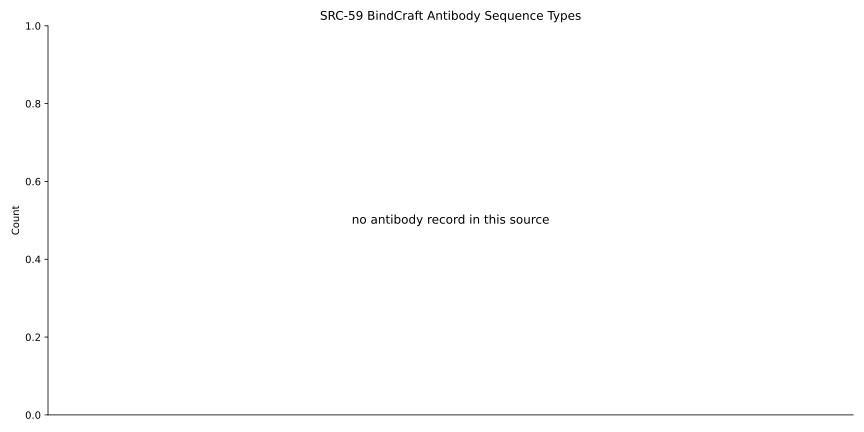
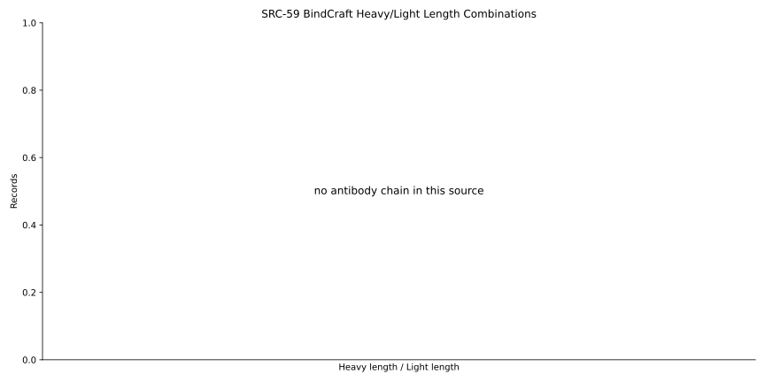
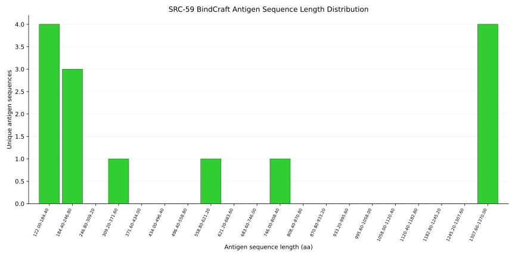

---
- tags:
  - context
---

# SRC-59 BindCraft

> 每条 data 统一建模为 `((ab, ag), label, assay, condition, replicate, source)`.
> 本地快照 `G:\abag-datasets\SRC_R59_BINDCRAFT\snapshot-2025-08-27`, `BindCraft/BindCraft_2025-08-27_Nature-SupplementaryData1.csv` 212 个设计 (225 列, 含 5 次 MPNN 采样的逐次结构指标), 另有成对 TM-score / 序列一致性工作簿与 17 个冻结 RCSB entry.
> 抗体侧为空: 被测对象是 60-188 aa 的 de novo 设计 miniprotein binder, 不是免疫球蛋白, 没有任何行能落入固定的 `Sequence Type` 词表.

## Antibody

> 有 Heavy 和 Light 的 `Unique` 字段是 `(heavy, light)` 二元组精确去重. `Unique with PDB_ID` 是按 Unique 后的 sequence 计数.
> Total Unique 计数方式为统一转 string, 如果有 Heavy 和 Light 用 `/` 拼接成 string.

| Key | 含义 | 说明 |
| --- | --- | --- |
| Sequence Type | 抗体序列类型 | 根据原始数据字段、链槽位及已有构建体标签划分的类别. |
| Records | 原始记录数 | 原始数据中的记录数量, 同一序列可能重复出现. |
| Unique | 唯一序列数 | 按对应数据集定义的去重规则统计. |
| Unique with PDB_ID | 关联 PDB 的唯一序列数 | 去重后具有关联 PDB_ID 的序列数量, 不等同于具有可用实验结构监督的序列数量. |
| Description | 类型说明 | 描述分类依据、序列槽位特征及分类限制. |

| Sequence Type | Records | Unique | Unique with PDB_ID | Description |
| --- | --- | --- | --- | --- |
| Total | 0 | 0 | 0 |  |

> 表里每一行都是一个设计 binder: `Sequence` 是 60-188 aa 的单链 (与 `Length` 逐行相等), 没有重链 / 轻链槽位, 也没有 Fab / Fv / scFv / VHH / IgG 任何措辞. 词表没有"非抗体结合蛋白"这一类别, 新增即自造标签, 因此本节 `Records = 0`.
>
> 17 个冻结 entry 里有 2 个含 Fab: `1N8Z` 是 herceptin Fab 配 HER2, `7MXL` 是 REGN5713 / 5714 / 5715 三套 Fab 配 Bet v 1. 两者都是靶点的参考结构, 不是本表 212 个设计中的任何一个; 表内 212 条序列与它们的链序列无一相等, 因此它们只在抗原侧作为 `Reference PDB` 出现, 不计为抗体记录.
>
> 三张图因此有两张是空轴加说明, 不含任何条形; 抗原长度图基于有结构的 14 条靶点链.

| Heavy Length | Light Length | Records | Description |
| --- | --- | --- | --- |
| missing | missing | 0 | 没有抗体链, 也就没有 Heavy / Light 长度; 设计 binder 自身的 60-188 aa 归 binder 层, 不写进本表. |

## Antigen

> Antigen 统计以 source-native antigen entity 为核心单位. 优先使用原始 antigen ID/name、construct 和 antigen chain 定义实体; 存在可靠序列时再统计唯一抗原序列.
> 结构、序列和数据库注释压缩到同一张表中, `PDB / UniProt` 采用唯一抗原实体粒度统计 2 × 2 覆盖结果.
> 长度图基于唯一抗原序列, 按该源实际范围平均切分 20 bins.

> 抗原侧是 13 个 source-native 靶点标签, 由 `Target` 列给出; 表内没有抗原序列字段, 序列只能取冻结 entry 里以该靶点名命名的非抗体链.

| Records | Unique ag entity | Unique ag sequence | PDB / UniProt coverage | Antigen Length | Antigen Evidence / Provenance | Description |
| --- | --- | --- | --- | --- | --- | --- |
| 212 | 13 | 14 | PDB=1/UniProt=0: 9; PDB=0/UniProt=0: 4; PDB=0/UniProt=1: 0; PDB=1/UniProt=1: 0 | 122-1370 aa; 13 unique lengths | Reference PDB / Fixed target | 13 个标签: BBF-14, BetV1, CD45, CLDN1, CbAgo, DerF21, DerF7, HER2, IFNAR2, PD-L1, PD1, Sas6, SpCas9. 实体就是这 13 个标签; 其中 9 个在冻结 entry 里有同名链, 取到 14 条唯一序列, 所以序列数多于实体数; CLDN1, PD-L1, PD1, Sas6 这 4 个没有任何冻结结构点名, 实体只有标签, 序列记 unavailable. 序列与实体的对应不是一对一: DerF21 有 128 aa (`5YNY` 的 `Allergen Der f 21`) 与 125 aa (`9HAD` 的 `Mite allergen Der f 21.0101`) 两条; DerF7 有 196 aa (`3UV1`) 与 204 aa (`9HAE` / `9HAF`) 两条; SpCas9 有 1368 / 1369 / 1369 / 1370 aa 四条 (`8YE9` / `4ZT0` / `6IFO` / `5VW1`), 是同一个 Cas9 在不同复合物里的不同构建体. `9HAC` / `9HAD` / `9HAE` / `9HAF` / `9HAG` 是本研究解出的 binder-靶点复合物, 其中 binder 链 (95-147 aa) 已按 `binder` 措辞排除, 只取靶点链. 长度 122-1370 aa 是完整靶点链, 不是设计时用的截短构建体长度, 源内也没有给构建体范围. 表内无 UniProt 字段. |

## Affinity

> 去重口径: 按 **(靶点标签, 设计名)** 去重, 212 行 / 212 个唯一键; `Affinity_nM` 的 20 行与 `Binding` 的 152 行取自同一批 212 条记录, 是同一组设计的两种读出, 跨 label 求和无意义.
>
> `Affinity_nM` 是实验测得的 Kd, 单位 nM (1-5,880 nM), 归 `Kd_M` 并保留原单位; 20 行全部同时是 `Binding = 1`. 其中 10 行在原表带星号, 是作者标注的弱结合 / 近似值, 原样保留星号状态在 Description, 不当删失值.
>
> `Binding` 是二值结合判定, `1` 65 行 / `0` 87 行; 另有 60 行这一格为空, 是没做这项判定, 记缺失而不是阴性, 不进入 `binary` 行.
>
> `Average_dG` (-87.59 至 -28.77) 是 BindCraft 的 Rosetta 打分, 不是实验亲和力, 归 `predicted` / `computational`, 与上面两行实验 label 分开. 同一批 212 行还有 37 个类似的预测列 (pLDDT 0.81-0.95, i_pTM 0.59-0.90, dSASA, 形状互补, 界面氢键等), 都是设计筛选指标, 不逐个立行.
>
> `1_pLDDT` 至 `5_pLDDT` 是同一设计 5 次 MPNN 采样的结构指标, 不是实验重复; 源内没有重复测量字段, replicate 全记 `unknown`.
>
> `BindCraft_2025-08-27_Nature-SupplementaryData2.xlsx` 是靶点与 binder 的成对 TM-score / 序列一致性矩阵, 属相似度而非亲和力, 不产生 Affinity 记录.

| Label | Assay | Condition | Replicate | Record pairs | Unique pairs | Description |
| --- | --- | --- | --- | --- | --- | --- |
| `Kd_M` | `unknown` | 全部 13 个靶点 | unknown:20 | 20 | 20 | `Affinity_nM` 20 行, 值域 1.0-5,880.0 nM (SPR / BLI 等方法在源内未标, 记 `unknown`); 其中 10 行原表带星号, 是作者标注的弱结合或近似值. 覆盖 12 个靶点 (HER2 无), 每靶 1-6 行. |
| `binary` | `unknown` | 全部 13 个靶点 | unknown:212 | 212 | 212 | `Binding` 列有值的 212 行: `1` 65 / `0` 87; 其余 60 行该格为空, 是没做这项判定, 记缺失不当阴性, 不计入本行. 判定方法源内未单列, 记 `unknown`. |
| `predicted` | `computational` | 全部 13 个靶点 | unknown:212 | 212 | 212 | `Average_dG` (-87.59 至 -28.77, Rosetta 能量单位, 中位数 -48.64) 是 BindCraft 的设计打分, 不是实验亲和力. 同批 37 个结构 / 界面指标 (pLDDT 0.81-0.95, i_pTM 0.59-0.90 等) 同属预测层, 不另立行. |
