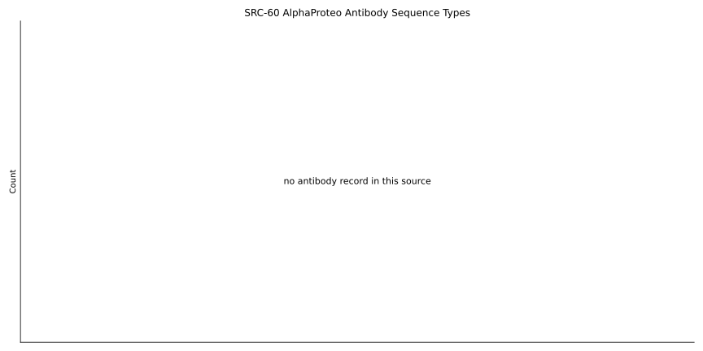
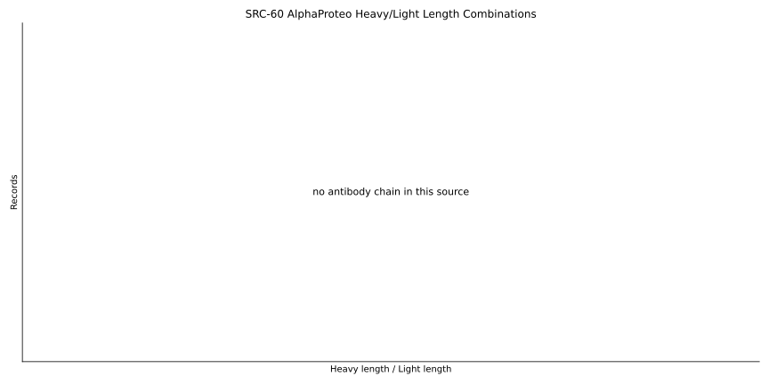
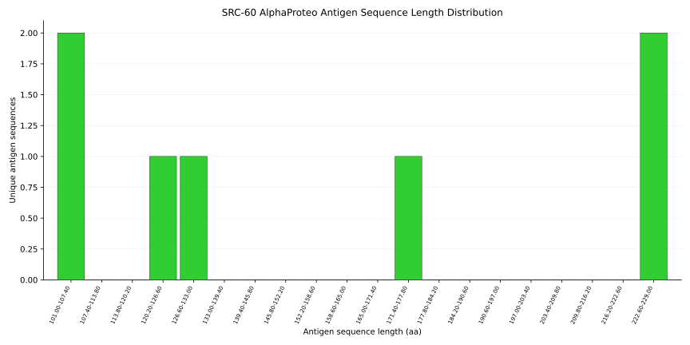

---
- tags:
  - context
---

# SRC-60 AlphaProteo

> 每条 data 统一建模为 `((ab, ag), label, assay, condition, replicate, source)`.
> 本地快照 `G:\abag-datasets\SRC_R60_ALPHAPROTEO\snapshot-2024-09-12`, 载荷是 arXiv v1 全文 HTML (`AlphaProteo_2024-09-12_arXiv-v1.html`, 内含 S1-S7 嵌入表) 与同版 PDF, 加 11 个冻结 RCSB entry.
> 抗体侧为空: 被测对象是 de novo 设计的 52-139 aa miniprotein binder, 不是免疫球蛋白, 没有任何行能落入固定的 `Sequence Type` 词表.

## Antibody

> 有 Heavy 和 Light 的 `Unique` 字段是 `(heavy, light)` 二元组精确去重. `Unique with PDB_ID` 是按 Unique 后的 sequence 计数.
> Total Unique 计数方式为统一转 string, 如果有 Heavy 和 Light 用 `/` 拼接成 string.

| Key | 含义 | 说明 |
| --- | --- | --- |
| Sequence Type | 抗体序列类型 | 根据原始数据字段、链槽位及已有构建体标签划分的类别. |
| Records | 原始记录数 | 原始数据中的记录数量, 同一序列可能重复出现. |
| Unique | 唯一序列数 | 按对应数据集定义的去重规则统计. |
| Unique with PDB_ID | 关联 PDB 的唯一序列数 | 去重后具有关联 PDB_ID 的序列数量, 不等同于具有可用实验结构监督的序列数量. |
| Description | 类型说明 | 描述分类依据、序列槽位特征及分类限制. |

| Sequence Type | Records | Unique | Unique with PDB_ID | Description |
| --- | --- | --- | --- | --- |
| Total | 0 | 0 | 0 |  |

> S7 的 28 条字面序列全部是单链, 52-139 aa, 只含 20 种标准氨基酸; 没有重链 / 轻链槽位, 也没有 Fab / Fv / scFv / VHH / IgG 任何措辞. 词表没有"非抗体结合蛋白"这一类别, 新增即自造标签, 因此本节 `Records = 0`, 不把这 28 条记成 `Unknown` 抗体.
>
> 11 个冻结 entry 里确实有 16 条 Fab 链 (1BJ1 的 anti-VEGF Fab、4ZXB 的 Fab 83-7 / 83-14、7ZBU 的 P008_60), 但它们是靶点侧或结构比较的参考复合物, 不是本表任何一条设计: 28 条设计序列与全部冻结链序列无一相等. 因此它们不在本节计为抗体记录.
>
> 三张图中前两张是空轴加说明, 不含任何条形; 抗原长度图基于 7 条有结构的靶点链.

| Heavy Length | Light Length | Records | Description |
| --- | --- | --- | --- |
| missing | missing | 0 | 没有抗体链, 也就没有 Heavy / Light 长度; 设计 binder 自身的 52-139 aa 归 binder 层, 不写进本表. |

## Antigen

> Antigen 统计以 source-native antigen entity 为核心单位. 优先使用原始 antigen ID/name、construct 和 antigen chain 定义实体; 存在可靠序列时再统计唯一抗原序列.
> 结构、序列和数据库注释压缩到同一张表中, `PDB / UniProt` 采用唯一抗原实体粒度统计 2 × 2 覆盖结果.
> 长度图基于唯一抗原序列, 按该源实际范围平均切分 20 bins.

> 抗原侧是源内 8 个实测靶点, 由主 Table 1 的列名给出; 每个靶点在 S1 里有 PDB 编号、作者链与残基区间, 序列取冻结 entry 的同名链全长.

| Records | Unique ag entity | Unique ag sequence | PDB / UniProt coverage | Antigen Length | Antigen Evidence / Provenance | Description |
| --- | --- | --- | --- | --- | --- | --- |
| 32 | 8 | 7 | PDB=1/UniProt=0: 7; PDB=0/UniProt=0: 1; PDB=1/UniProt=1: 0; PDB=0/UniProt=1: 0 | 101-229 aa | Reference PDB / PDB-derived sequence | 主 Table 1 的 8 个实测靶点: BHRF1 94 个测试候选、SC2RBD 172 个测试候选、IL-7RA 94 个测试候选、PD-L1 159 个测试候选、TrkA 131 个测试候选、IL-17A 63 个测试候选、VEGF-A 94 个测试候选、TNF α 54 个测试候选. `Records` 取 S7 的 32 条设计行; 它们只覆盖 7 个靶点 (SC2RBD 7、VEGF-A 5、BHRF1 4、IL-7RA 4、PD-L1 4、TrkA 4、IL-17A 4), TNF α 在 S7 里没有设计行 — Table 1 记 54 个测试候选但结合 KD 为 `–`, 没有可统计的配对. S1 另列 Insulin 与 H1 两个只作计算比较的输入靶点, 没有对应实验记录, 不计入本表. 有序列的 7 个靶点按 S1 的 (PDB, 作者链) 取冻结 FASTA 的链全长: BHRF1 173 aa (2WH6 chain A)、SC2RBD 229 aa (6M0J chain E)、IL-7RA 223 aa (3DI3 chain B)、PD-L1 129 aa (5O45 chain A)、TrkA 101 aa (1WWW chain X)、VEGF-A 102 aa (1BJ1 chain V)、IL-17A 122 aa (4HSA chain A). 这个长度是冻结 entry 的整条链, 不是 S1 写明的构建设计区间 (BHRF1 A2-158、SC2RBD E333-526、IL-7RA B17-209、PD-L1 A17-132、TrkA X282-382、VEGF-A V14-107, W14-107、IL-17A A17-131, B19-127); 源内没有给构建体贴合后的序列, 不按区间截取, 也不从长度反推构建体. 表内无 UniProt 字段, 记 0 覆盖而不是否定的生物学结论. |

## Affinity

> 去重口径: 按 **(设计名, 靶点)** 去重, 32 行全部 1:1 唯一. `Replicate` 取 S7 的 `Replicas` 列, 是本源少数真正记录了重复数的表.
>
> S7 的 `μ(K_D)(nM)` 是 HTRF 汇合解离常数, 32 行覆盖 7 个靶点, 值域 0.082-370.0 nM; `σ(KD) repl.` 是重复间标准差, `σ(KD) fit` 是拟合误差, 两者不是两份独立实验. `RFD_TrkA_88 (control)` 只有 1 次重复, 其 `σ(KD) repl.` 写作 `-`, 记缺失而不是零. assay 词表没有 HTRF 项, 记 `unknown`, 方法由表头与源 README 给出.
>
> S4 的 `EC50 (μM)` 是 SARS-CoV-2 假病毒抑制的功能读出: 16 行是 4 个设计 × 4 个病毒变体 (ancestral / BA.1 / XBB.1.5 / JN.1) 的 9 个非空 (设计, 变体) 组合, 各做 A / B 两轮, 其中 2 个组合只做了 1 轮. 它与 S7 的 KD 不是同一量纲, 也不是同一测量, 单列一行, 不并入 KD.
>
> 主 Table 1 里的 AlphaProteo `Binding KD (nM)` 行是每个靶点的最佳设计的汇总值 (8.5 / 26 / 0.082 / 0.18 / 0.96 / 8.4 / 0.48), 与 S7 的对应行是同一条测量, 不另立记录. `Experimental success rate` 是筛选统计, 不是亲和力.
>
> 无 replicate 字段的行不推断重复数; `unknown` 既不代表单次测量, 也不代表阴性.

| Label | Assay | Condition | Replicate | Record pairs | Unique pairs | Description |
| --- | --- | --- | --- | --- | --- | --- |
| `Kd_M` | `unknown` | S7 全部 7 个靶点 | n=1:1; n=2:17; n=3:7; n=4:3; n=5:1; n=8:1; n=11:1; n=20:1 | 32 | 32 | `μ(K_D)(nM)` 0.082-370.0 nM; 25 条 GDM 设计与 7 条对照, 其中 3 条 RFD 对照带字面序列、4 条 (BINDI、LCB1、VEGFR1、IL-17RA) 只给文献出处. GDM 设计的靶点分布: SC2RBD 6、VEGF-A 4、BHRF1 3、IL-7RA 3、PD-L1 3、TrkA 3、IL-17A 3. |
| `EC50` | `unknown` | S4: SC2RBD 4 个设计 × 4 个病毒变体 | n=1:2; n=2:7 | 16 | 9 | `EC50 (μM)` 0.089-3.053 μM, `SE (EC50)` 同步给出. 假病毒抑制的功能读出, 不与 S7 的结合 KD 合并计算. 9 个 (设计, 变体) 组合里 7 个做了 2 轮、2 个只做 1 轮 (GDM_SC2RBD_11 的 BA.1 与 JN.1). |
