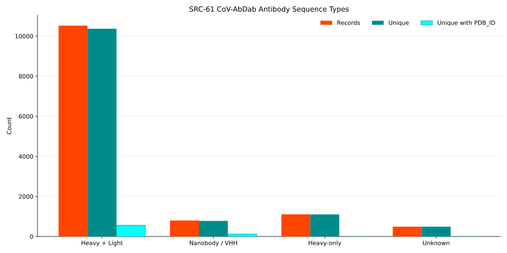
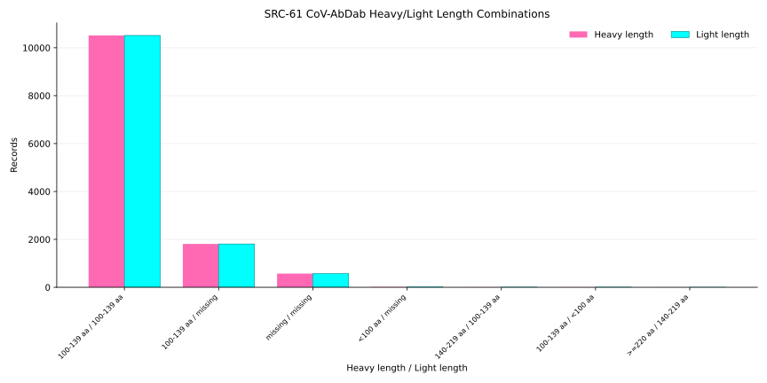
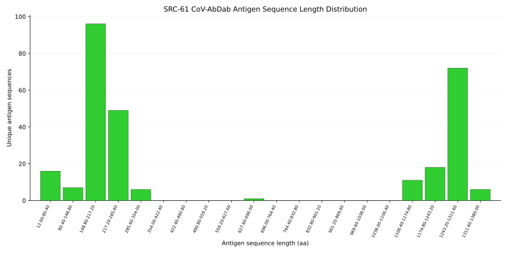

---
tags:
  - context
---

# SRC-61 CoV-AbDab

> 每条 data 统一建模为 `((ab, ag), label, assay, condition, replicate, source)`.
> 本地快照 `G:\abag-datasets\SRC_R61_COV_ABDAB\snapshot-2024-02-08`, 单表 `CoV-AbDab/CoV-AbDab_080224.csv` (12,918 条记录, 23 列, 含 VH、VL、逐毒株结合与中和标记), 加 1,057 个冻结 RCSB entry.
> `Unique` 按每类的序列单元去重: `Heavy + Light` 用 `(VH, VL)` 二元组, `Nanobody / VHH` 与 `Heavy-only` 用单条 VH 序列, 没有可用序列的 `Unknown` 用记录名. 12,918 条记录去重后 12,740 个单元.

## Antibody

> 有 Heavy 和 Light 的 `Unique` 字段是 `(heavy, light)` 二元组精确去重. `Unique with PDB_ID` 是按 Unique 后的 sequence 计数.
> Total Unique 计数方式为统一转 string, 如果有 Heavy 和 Light 用 `/` 拼接成 string.

| Key | 含义 | 说明 |
| --- | --- | --- |
| Sequence Type | 抗体序列类型 | 根据原始数据字段、链槽位及已有构建体标签划分的类别. |
| Records | 原始记录数 | 原始数据中的记录数量, 同一序列可能重复出现. |
| Unique | 唯一序列数 | 按对应数据集定义的去重规则统计. |
| Unique with PDB_ID | 关联 PDB 的唯一序列数 | 去重后具有关联 PDB_ID 的序列数量, 不等同于具有可用实验结构监督的序列数量. |
| Description | 类型说明 | 描述分类依据、序列槽位特征及分类限制. |

| Sequence Type | Records | Unique | Unique with PDB_ID | Description |
| --- | --- | --- | --- | --- |
| Heavy + Light | 10,523 | 10,369 | 566 | VH 与 VL 两槽都有序列, 无构建体字段; 绝大多数是 100-139 aa 的 V 区量级. |
| Nanobody / VHH | 801 | 779 | 121 | `Ab or Nb` 显式标 `Nb`; 只取 VH, 无轻链槽位. |
| Heavy-only | 1,104 | 1,102 | 1 | 标 `Ab` 但 VL 为 `ND` / `N/A` / 空; 有的是单链, 有的只是没登记轻链, 源内无法区分. |
| Unknown | 490 | 490 | 1 | VH 与 VL 都是 `ND` / `N/A`; 有记录名与结合标记但没有可用序列, 按记录名去重. |
| Total | 12,918 | 12,740 | 689 |  |

> `Ab or Nb` 列显式给出 `Ab` / `Nb`: `Nb` 的 801 行直接归 `Nanobody / VHH` 并只取 VH (801 行里 719 行有 VH, 82 行没有, 后者按记录名去重). `Nb` 行没有任何 VL, 与单域抗体的定义一致.
>
> 其余按槽位判定: VH 与 VL 都有序列 → `Heavy + Light` 10,523, 只有 VH → `Heavy-only` 1,104, VL 有而 VH 无 → `Light-only` (0 行), 两槽都没有可用序列 → `Unknown` 490.
>
> 源内的 `ND` / `N/A` 是"没有该链", 不是缺失值: 490 行两槽都写 `ND` / `N/A` 或空. 源内没有任何 Fab / Fv / scFv / IgG 构建体列, 因此不出现这些类别, 也不按长度反推.
>
> 记录名有 2 个重复 (`R15-F7`、`ADI-62113` 各两行), 两条的 VH/VL 完全一致, 只是毒株名单与结构链接不同, 序列单元去重后不重复计.
>
> `Unique with PDB_ID` 是链序列级覆盖: 700 行带 RCSB 链接, 去重到 689 个单元. 另有 7 行写 `Expected` 或 `Expected (7FBJ)` 之类, 只是预期结构, 没解出, 不计入; 1 行写 `ND, Despite structure in paper`. 链接里共 1,051 个不同 PDB ID, 本地冻结的 1,057 个 entry 中 1,046 个在链接里出现.
>
> 长度按 VH / VL 字面长度归桶: 只有 1 条 VH 达到 220 aa 以上 (226 aa), 1 条 VL 在 140-219 aa, 其余全在 100-139 aa 或缺失.

| Heavy Length | Light Length | Records | Description |
| --- | --- | --- | --- |
| 100-139 aa | 100-139 aa | 10,514 | 主体形式: V 区量级的 VH + VL 双链. |
| 100-139 aa | missing | 1,810 | 只有 VH, 轻链槽为 `ND` / `N/A` 或空; 单链或未登记轻链, 源内无法区分. |
| missing | missing | 572 | 两槽都写 `ND` / `N/A`, 只有记录名可用. |
| <100 aa | missing | 13 | VH 短于 100 aa 的 13 行, 无轻链. |
| 140-219 aa | 100-139 aa | 4 | VH 在 140-219 aa 的 4 行. |
| 100-139 aa | <100 aa | 4 | VL 短于 100 aa 的 4 行. |
| >=220 aa | 140-219 aa | 1 | 1 行: VH 226 aa 配 VL 215 aa, 两者都超出常规 V 区. |

## Antigen

> Antigen 统计以 source-native antigen entity 为核心单位. 优先使用原始 antigen ID/name、construct 和 antigen chain 定义实体; 存在可靠序列时再统计唯一抗原序列.
> 结构、序列和数据库注释压缩到同一张表中, `PDB / UniProt` 采用唯一抗原实体粒度统计 2 × 2 覆盖结果.
> 长度图基于唯一抗原序列, 按该源实际范围平均切分 20 bins.

> 抗原侧是 `Protein + Epitope` 列给出的 source-native 层: 蛋白名 + 表位区间. 蛋白名是实体, 表位区间是条件; 有结构的蛋白再从冻结 entry 取非免疫球蛋白链作为序列.

| Records | Unique ag entity | Unique ag sequence | PDB / UniProt coverage | Antigen Length | Antigen Evidence / Provenance | Description |
| --- | --- | --- | --- | --- | --- | --- |
| 12,918 | 11 | 282 | PDB=1/UniProt=0: 3; PDB=0/UniProt=0: 8; PDB=0/UniProt=1: 0; PDB=1/UniProt=1: 0 | 12-1380 aa; 139 unique lengths | Source-native / Reference PDB | 11 个蛋白名: CSP, E, M, Mpro, N, Nsp3, Nsp9, S, S1, S2 (quaternary glycan epitope), TBC. 其中 S 12,800 行 / N 73 行 / M 3 行, 另有 S1 11 行、S2 (quaternary glycan epitope) 2 行、Nsp3 3 行、Mpro 2 行、Nsp9 1 行、E 1 行、CSP 1 行、TBC 2 行, 各自是一个 name 级实体. 这 11 个名字里有 3 个是 spike 的子区或复合物 (`S1`、`S2 (quaternary glycan epitope)`) 和 `TBC`, 源内把它们写成独立的蛋白名, 因此按名字各计一个实体, 不合并回 S. 15 行写 `Unknown`、4 行为空, 不成实体. 表位区间是第二个维度 (43 种写法: `S; RBD` 8,510 行、`S; Unk` 1,873、`S; NTD` 849、`S; S2` 805、`S; non-RBD` 471 等), 记在 Condition 里, 不并入实体. 有结构的只有 3 个蛋白: S 在 670 个 entry、N 在 9 个、M 在 1 个里有同名非抗体链, 合计 301 条链、282 条唯一序列, 长度 12-1380 aa 覆盖肽段到完整 spike. 其余 8 个蛋白名没有冻结结构点名, 序列记 unavailable. 源内没有 UniProt 字段. |

## Affinity

> 去重口径: 结合 / 中和判定按与 Antibody 节相同的序列单元去重 (全表 12,740 个); 分组按 `Protein + Epitope` 蛋白名.
>
> 两个标记列是 **分株判定**, 不是数值亲和力: `Binds to` / `Doesn't Bind to` 与 `Neutralising Vs` / `Not Neutralising Vs` 列出毒株名单, 只能归 `binary`. 同一记录可以对一个株结合、对另一个株不结合 (3,201 行两列同时有值), 这是分株结果而不是矛盾.
>
> 全表 12,918 行每行都有 `Binds to` 的非空值, 所以 `binary` 的结合行覆盖全表; `Doesn't Bind to` 3,201 行, 中和 6,373 行, 非中和 5,482 行. 空值一律记缺失, 不当阴性.
>
> 源内没有任何 Kd / IC50 数值列, 因此没有 `Kd_M` / `IC50` 行; 也没有方法字段, `Assay` 记 `unknown`.
>
> 与本表同源的上游: 这就是 R45 里 `CoV-AbDab_220222.csv` 的 2024 版, 记录从 5,033 涨到 12,918. 两边 4,912 个记录名重合、4,404 个 `(VH, VL)` 对重合, R61 另有 8,004 个新记录名. 跨源汇总按记录名或序列单元去重, 不与 R45 相加.

| Label | Assay | Condition | Replicate | Record pairs | Unique pairs | Description |
| --- | --- | --- | --- | --- | --- | --- |
| `binary` | `unknown` | `Binds to`; 11 个蛋白名, 43 种表位写法 | unknown:12,918 | 12,918 | 12,740 | 分株结合判定, 每行列出该抗体结合的毒株名单 (SARS-CoV2_WT / Alpha / Omicron-BA1 / 229E 等, 含 `(weak)` 标注); 无方法字段. 12,918 行全部非空. |
| `binary` | `unknown` | `Doesn't Bind to`; 11 个蛋白名, 43 种表位写法 | unknown:3,201 | 3,201 | 3,155 | 分株不结合判定; 3,201 行与 `Binds to` 同时有值, 说明是分株结果而非全局阴性. |
| `binary` | `unknown` | `Neutralising Vs`; 11 个蛋白名, 43 种表位写法 | unknown:6,373 | 6,373 | 6,305 | 分株中和判定, 毒株名单与结合列独立; 有的条目带 `(weak)` 强度标记. |
| `binary` | `unknown` | `Not Neutralising Vs`; 11 个蛋白名, 43 种表位写法 | unknown:5,482 | 5,482 | 5,402 | 分株非中和判定; 2,941 行与中和列同时有值. |
