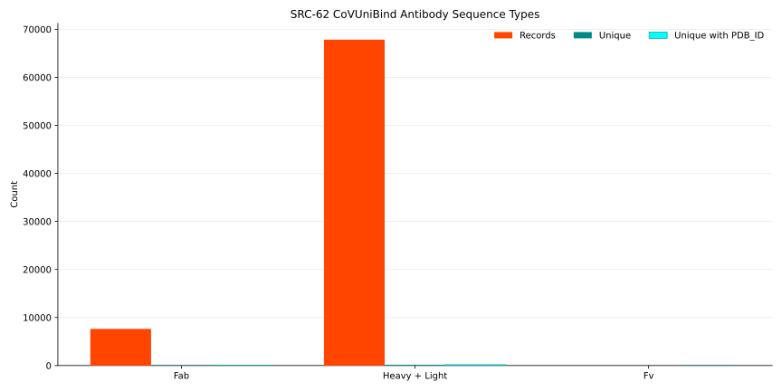
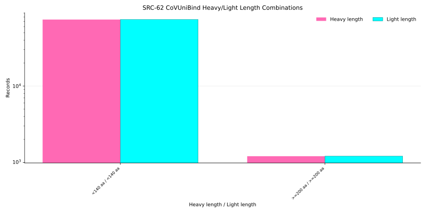
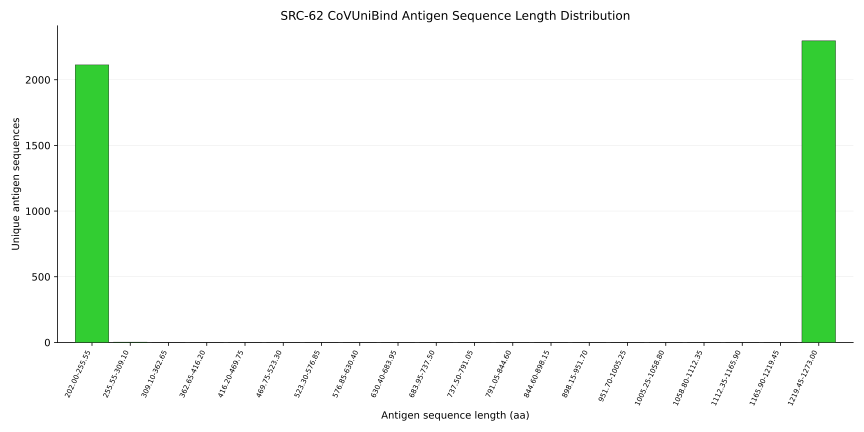

---
- tags:
  - context
---

# SRC-62 CoVUniBind

> 每条 data 统一建模为 `((ab, ag), label, assay, condition, replicate, source)`.
> 本地快照 `G:\abag-datasets\SRC_R62_COV_UNIBIND\snapshot-2025-12-02`, `CoVUniBind/data/` 6 张测量表 (75,459 行), `scores/` 下同名 6 张带结构 / 语言模型打分的副本, `antibody_info/` 183 行抗体别名与 CDR, 加 920 个冻结 RCSB entry.
> `Unique` 按 **(heavy, light) 链序列对**去重: 75,459 行折成 241 个抗体, 每行都带这两条链的完整序列.

## Antibody

> 有 Heavy 和 Light 的 `Unique` 字段是 `(heavy, light)` 二元组精确去重. `Unique with PDB_ID` 是按 Unique 后的 sequence 计数.
> Total Unique 计数方式为统一转 string, 如果有 Heavy 和 Light 用 `/` 拼接成 string.

| Key | 含义 | 说明 |
| --- | --- | --- |
| Sequence Type | 抗体序列类型 | 根据原始数据字段、链槽位及已有构建体标签划分的类别. |
| Records | 原始记录数 | 原始数据中的记录数量, 同一序列可能重复出现. |
| Unique | 唯一序列数 | 按对应数据集定义的去重规则统计. |
| Unique with PDB_ID | 关联 PDB 的唯一序列数 | 去重后具有关联 PDB_ID 的序列数量, 不等同于具有可用实验结构监督的序列数量. |
| Description | 类型说明 | 描述分类依据、序列槽位特征及分类限制. |

| Sequence Type | Records | Unique | Unique with PDB_ID | Description |
| --- | --- | --- | --- | --- |
| Fab | 7,617 | 68 | 68 | entry 措辞含 `Fab` / `fab` (如 `Heavy chain of 17B10 fab`、`Fab 4A8 heavy chain`); 其中 52 个给 Fab 全长链 (213-258 / 207-238 aa), 16 个只给可变区 (118-138 / 100-127 aa), 表内两种都有. |
| Heavy + Light | 67,837 | 172 | 172 | entry 只写 `heavy chain` / `light chain` 加抗体名, 无构建体措辞; 138 个是 115-138 aa 的 V 区, 34 个给到 213-261 aa 的完整链. |
| Fv | 5 | 1 | 1 | entry 措辞 `CC6.33 IgG Kappa chain Fv`, 两条链都是可变区 (118 / 108 aa). |
| Total | 75,459 | 241 | 241 |  |

> 构建体按每行 `pdb_id` 所指 entry 的链描述判定, 且只采信序列与该对完全相同的链行: 同一 entry 里别的抗体的措辞不算. 结果是 `Fab` 68 个 (7,617 行, 重链 213-261 aa 配轻链 207-238 aa)、`Heavy + Light` 172 个 (67,837 行)、`Fv` 1 个 (5 行, `CC6.33 IgG Kappa chain Fv`). 源内没有 Nanobody / VHH / scFv / IgG 的条目.
>
> 241 个对里, 只有 115 个能在自己的 entry 里逐字找到两条链. 另 90 个只以 V 区前缀形式出现 (表内给的是 `antibody_vh_sequence` 全长可变区, entry 里是 Fab 全长链), 36 个在 entry 里完全找不到, 其 `pdb_id` 只是该抗体的参考复合物. 这三种情况都算非空 PDB 字段, 按 `Unique with PDB_ID` 的定义各计一次, 但只有前一种是有逐链实验结构的.
>
> `Unique with PDB_ID` 因此等于 `Unique`, 口径见上: 它不是"有可用结构监督"的序列数; 逐字匹配的 115 个才是.
>
> 长度表只有两簇, 中间在 138-207 aa 之间断开: `<140 aa` 的 155 个抗体 (Fab 16 / Heavy + Light 138 / Fv 1) 只给可变区, `>=200 aa` 的 86 个 (Fab 52 / Heavy + Light 34) 给到含恒定区的全长链. 两簇的构建体各按 entry 措辞判定, 不按长度反推.

| Heavy Length | Light Length | Records | Description |
| --- | --- | --- | --- |
| <140 aa | <140 aa | 74,252 | 只给可变区的 155 个抗体 (重链 115-138 aa, 轻链 100-127 aa), 是 74,252 行的主体. |
| >=200 aa | >=200 aa | 1,207 | 带恒定区的 86 个抗体 (重链 213-261 aa, 轻链 207-238 aa). |

## Antigen

> Antigen 统计以 source-native antigen entity 为核心单位. 优先使用原始 antigen ID/name、construct 和 antigen chain 定义实体; 存在可靠序列时再统计唯一抗原序列.
> 结构、序列和数据库注释压缩到同一张表中, `PDB / UniProt` 采用唯一抗原实体粒度统计 2 × 2 覆盖结果.
> 长度图基于唯一抗原序列, 按该源实际范围平均切分 20 bins.

> 抗原侧实体是 **(lineage, mutations, domain)** 三元组: 毒株谱系 + 该谱系相对 Wuhan 的突变串 + 被测区域 (`RBD` / `spike` / `NTD`). 表内同时给完整 spike 序列与截短后的构建体序列 (`antigen_sequence_trimmed`), 有截短序列时以它为准, 没有时才用完整 spike.

| Records | Unique ag entity | Unique ag sequence | PDB / UniProt coverage | Antigen Length | Antigen Evidence / Provenance | Description |
| --- | --- | --- | --- | --- | --- | --- |
| 75,459 | 4,705 | 4,411 | PDB=1/UniProt=0: 4,193; PDB=0/UniProt=0: 512; PDB=0/UniProt=1: 0; PDB=1/UniProt=1: 0 | 202-1273 aa; 11 unique lengths | Direct sequence / PDB-derived sequence | 4,705 个实体分布在 73 个谱系标签上, 区域分 2,407 个 `RBD` / 2,286 个 `spike` / 12 个 `NTD`. 完整 spike 序列在同一实体内部唯一 (2,378 条, 长度 1,265-1,273 aa, 9 种长度), 表的构造体序列有 2,285 个实体给出, 长度 202-290 aa; 没有截短序列的 2,420 个实体退回用完整 spike, 所以唯一序列是 4,411 条、长度 202-1273 aa. 实体级结构覆盖 4,193 个: 该实体自己某行的 `pdb_id` entry 里确实含它的 `antigen_pdb_sequence`; 余下 512 个的 `pdb_id` 只是参考复合物, 不含这条抗原链, 记 PDB=0. 源内没有 UniProt 字段. 长度是链本身的长度, 不是被测表位的长度. |

## Affinity

> 去重口径: 按 **(heavy, light, lineage, mutations, domain, source_name, assay_name, target_type)** 去重. `covabdab_binding` / `dms_*` / `jian_elisa` / `spr` 四张表各自 1:1 唯一; `drdb_binding_potency` 的 2,472 行折成 2,175 个键, 同一 (抗体, 抗原, IC 类型) 在多个独立研究里各测一次, 那些是真正的研究间重复, 保留在 `Record pairs` 而不合并.
>
> 六张表各记一个 label: `binding` 是布尔结合判定; `escape` 是 DMS 逃逸分数 (相对读数, 不是 Kd); `IC*_log10_fold` 是以 log10 倍数表示的半数抑制浓度变化; `log10_kd` 是 log10 Kd. 没有一张表给原始单位, 所以抑制与亲和两族都保留源内量纲.
>
> `scores/` 下 6 张同名表是把结构模型打分 (pLDDT, pTM, PAE, ProteinMPNN / AbMPNN 等) 附在同样的行上, 属预测层, 不是新测量, 也不产生 `predicted` 亲和力行: 它们没有一个列是结合值.
>
> `antibody_info/antibody_synonyms.parquet` 的 183 行给抗体别名、CDR 与表位残基, 是注释而不是测量.
>
> 与本表同源的层: `covabdab_binding` 取自 CoV-AbDab (R45 / R61 的上游), `dms_bloom_ab_escape` 与 `dms_cao_ab_escape` 取自 Bloom / Cao 的深度突变扫描. 跨源汇总按 (抗体序列, 抗原实体, 测量) 去重.

| Label | Assay | Condition | Replicate | Record pairs | Unique pairs | Description |
| --- | --- | --- | --- | --- | --- | --- |
| `binary` | `unknown` | `various_assays`; 632 行 | unknown:632 | 632 | 632 | `target_value` 为布尔 (True 353 / False 279), 按 (抗体, 抗原实体) 判定结合与否; 方法列写 `various_assays`, 无法归到具体方法, 记 `unknown`. |
| `enrichment` | `NGS_seq` | `DMS`; 9 个上游研究 | unknown:61,661 | 61,661 | 61,661 | `target_value` 是 DMS 逃逸分数 1e-06-2.105 (越高逃逸越强), 无量纲相对读数, 不是 Kd; 覆盖 2,145 个突变串、2,145 条唯一抗原变体. |
| `enrichment` | `NGS_seq` | `DMS`; Cao imprinted immune escape | unknown:9,691 | 9,691 | 9,691 | `target_value` 是 DMS 逃逸分数 0.001421-1.0, 与上一行同一读出、不同研究. |
| `IC50` | `unknown` | 10 种假病毒 / 活病毒读出 | n=1:2,033; n=2:77; n=3:21; n=4:25; n=5:10; n=8:9 | 2,472 | 2,175 | `target_value` 是以 log10 倍数表示的 IC50 / IC80 / IC90 / IC100 变化 (-3.90 至 3.97), 0 表示与对照持平; 只给倍数不给绝对浓度, 因此保留源内量纲. |
| `IC50` | `ELISA` | `elisa`; Jian 2024 | unknown:164 | 164 | 164 | `target_value` 是 ELISA 读出的 IC50 log10 倍数 (-9.23 至 1.0). |
| `log_Kd` | `SPR` | `spr`; 5 个上游研究 | unknown:839 | 839 | 839 | `target_value` 是 log10 Kd (-3.05 至 4.30, 单位随源, 大多数为 log10 nM); 只有 12 个谱系 / 12 条 spike 序列, 是六张表里抗原多样性最低的一张. |
