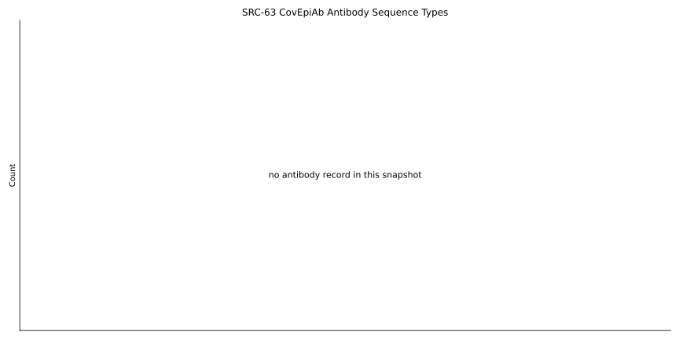
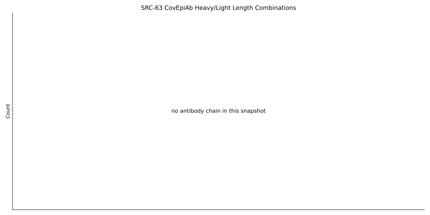
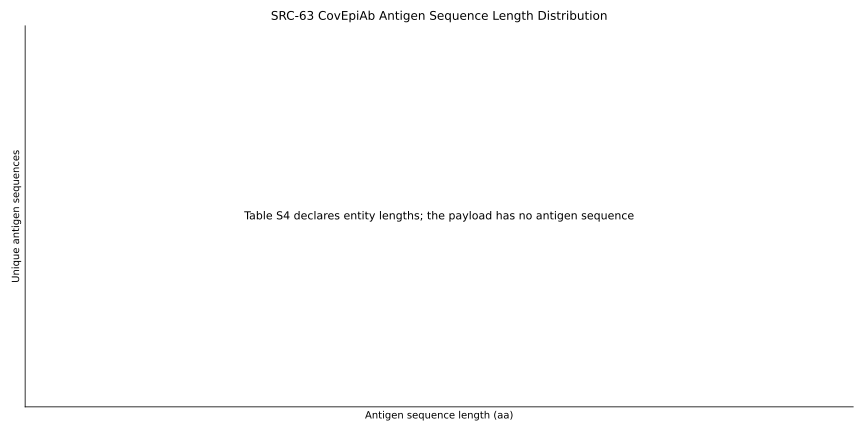

---
tags:
  - context
---

# [SRC-63 CovEpiAb](../2026-10-29-3a-src-readme/src-63-covepiab-readme.md)

> 每条 data 统一建模为 `((ab, ag), label, assay, condition, replicate, source)`.
> 本地快照 `G:\abag-datasets\SRC_R63_COVEPIAB\snapshot-2023-11-07`, 只有论文补充工作簿 `CovEpiAb_2024-04-23_BriefingsInBioinformatics-SupplementaryTables.xlsx` (Table S1–S5) 与 `pdb/` 下 828 个 RCSB entry; 抗体结果页 (12,604 行) 不在本快照内.
> 抗体侧为空: 快照没有任何抗体序列、抗体行或构建体字段, 828 个结构是没有逐抗体归属的结构锚点.

## Antibody

> 有 Heavy 和 Light 的 `Unique` 字段是 `(heavy, light)` 二元组精确去重. `Unique with PDB_ID` 是按 Unique 后的 sequence 计数.
> Total Unique 计数方式为统一转 string, 如果有 Heavy 和 Light 用 `/` 拼接成 string.

| Key | 含义 | 说明 |
| --- | --- | --- |
| Sequence Type | 抗体序列类型 | 根据原始数据字段、链槽位及已有构建体标签划分的类别. |
| Records | 原始记录数 | 原始数据中的记录数量, 同一序列可能重复出现. |
| Unique | 唯一序列数 | 按对应数据集定义的去重规则统计. |
| Unique with PDB_ID | 关联 PDB 的唯一序列数 | 去重后具有关联 PDB_ID 的序列数量, 不等同于具有可用实验结构监督的序列数量. |
| Description | 类型说明 | 描述分类依据、序列槽位特征及分类限制. |

| Sequence Type | Records | Unique | Unique with PDB_ID | Description |
| --- | --- | --- | --- | --- |
| Total | 0 | 0 | 0 |  |

> 官网抗体结果页与本快照的 `Structure` 列都不在 payload 内, 828 个冻结 entry 是检索页 `PDBID` 选择器的锚点集合, 每个 entry 可含多条抗体链, 但没有来源方给出的 entry 到抗体行的连接键, 也没有逐链角色说明. 因此本节 `Records = 0`, 不把 828 个 entry 或其中的 Fab 链记成抗体计数: 那会把结构锚点当成抗体观测.
>
> `Sequence Type` 词表里没有任何一项能描述"只有 PDB entry、没有抗体记录"的状态, 写 `Unknown` 会把 0 条记录写成一个类别. 三张图因此都是空轴加说明, 不含条形.
>
> 抗体层可核对的只有结构侧事实: 828 个 entry 各有一对冻结 FASTA / mmCIF, 未压缩 mmCIF 与 `.cif.gz` 各 828 个, 携带 2,612 条 polymer record.

| Heavy Length | Light Length | Records | Description |
| --- | --- | --- | --- |
| missing | missing | 0 | 没有抗体记录, 也就没有 Heavy / Light 长度; 828 个 entry 内的抗体链属于结构侧, 不写进本表. |

## Antigen

> Antigen 统计以 source-native antigen entity 为核心单位. 优先使用原始 antigen ID/name、construct 和 antigen chain 定义实体; 存在可靠序列时再统计唯一抗原序列.
> 结构、序列和数据库注释压缩到同一张表中, `PDB / UniProt` 采用唯一抗原实体粒度统计 2 × 2 覆盖结果.
> 长度图基于唯一抗原序列, 按该源实际范围平均切分 20 bins.

> 抗原侧的唯一可计单位是 Table S4 的 (病毒, 蛋白) 组合, 每行给出声明的蛋白长度与预测表位数; 表内没有抗原序列列, Table S5 的 116 段序列是同源保守片段, 不是这些实体的全长序列.
>
> 载荷没有抗原序列, 第三张图因此是空轴加说明; Table S4 声明的实体长度写在表中, 不画成序列长度分布.

| Records | Unique ag entity | Unique ag sequence | PDB / UniProt coverage | Antigen Length | Antigen Evidence / Provenance | Description |
| --- | --- | --- | --- | --- | --- | --- |
| 64 | 64 | unavailable | PDB=0/UniProt=0: 64 | 38-7182 aa; median 223.5 aa; 55 unique lengths | Source-native / Predicted epitopes | 64 行是 7 种人冠状病毒的 25 个蛋白组合, 不是完整笛卡尔积: HCoV-229E 7, HCoV-HKU1 8, HCoV-NL63 6, HCoV-OC43 9, MERS-CoV 10, SARS-CoV 13, SARS-CoV-2 11. 长度由 Table S4 `Length` 列直接给出 (38-7,182 aa), 中位数 223.5 aa; 同表 `No. B` / `No. T1` / `No. T2` 合计 9,049 / 47,355 / 52,549, 是 COVEP 的预测表位计数, 属计算方法产出, 不是实验结合证据. 抗原侧 PDB 覆盖记 0: 828 个冻结 entry 是抗体检索页的锚点, 来源方没有给出 entry 到 (病毒, 蛋白) 的映射, 也不声明它们是这些蛋白实体的抗原结构. Table S5 另给 116 段跨 HCoV 保守片段 (ORF1ab 104、S 9、N 2、M 1, 长度 8-55 aa), 坐标与序列逐行自洽, 但它们是蛋白内的片段, 不是实体全长序列, 故不计入 `Unique ag sequence`. 表内无 UniProt 字段. |

## Affinity

> 本快照不含任何亲和力或中和数值列. Table S4 的 `No. B` / `No. T1` / `No. T2` 是 COVEP 预测表位数量, 属计算产出; Table S1 是各预测工具的阈值, Table S2 / S3 是 HLA allele 支持范围与人群频率. 官网声称的 6,641 条 affinity records 与 62,916 条 neutralizing records 的明细导出不在本快照内, 也不在补充工作簿中.
>
> 因此本节只记录配对存在性, `Record pairs` 为 0; 不把预测表位数、HLA 频率或阈值当成 label.

| Label | Assay | Condition | Replicate | Record pairs | Unique pairs | Description |
| --- | --- | --- | --- | --- | --- | --- |
| `not_recorded` | `unknown` | CovEpiAb 公开子集 | — | 0 | 0 | 全表没有 Kd / IC50 / ΔG / 富集列; 64 个抗原实体只有预测表位计数, 没有任何 (ab, ag) 配对的测量值. 抗体结果页的 Bind / Neutralizing 是抗体级对象名称汇总, 不是逐 assay 数值, 且不在本快照. |
