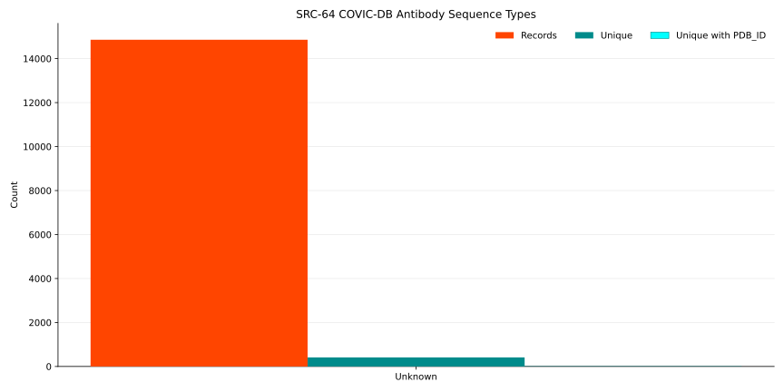
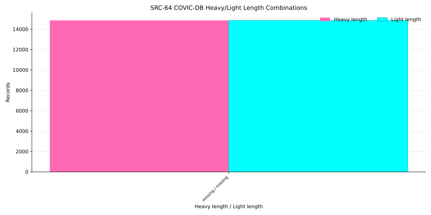
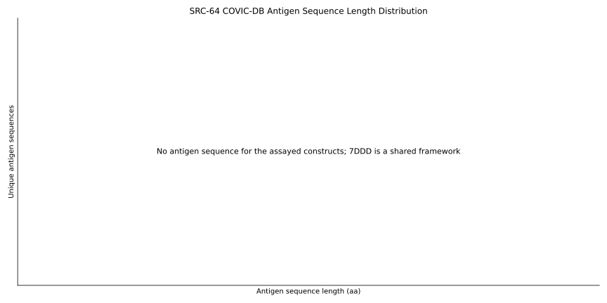

---
- tags:
  - context
---

# SRC-64 COVIC-DB

> 每条 data 统一建模为 `((ab, ag), label, assay, condition, replicate, source)`.
> 本地快照 `G:\abag-datasets\SRC_R64_COVIC_DB\snapshot-2026-09-19`, 14 个 XLSX, 每个都是 `Instructions` / `Dataset` / `Terminology` 三表; `Dataset` 合计 14,859 行, 覆盖 413 个 `Antibody label`.
> `Unique` 为源内抗体标签 `COVIC-*` 精确去重; 载荷里没有重链或轻链序列, 抗体只能以标签为单位.

## Antibody

> 有 Heavy 和 Light 的 `Unique` 字段是 `(heavy, light)` 二元组精确去重. `Unique with PDB_ID` 是按 Unique 后的 sequence 计数.
> Total Unique 计数方式为统一转 string, 如果有 Heavy 和 Light 用 `/` 拼接成 string.

| Key | 含义 | 说明 |
| --- | --- | --- |
| Sequence Type | 抗体序列类型 | 根据原始数据字段、链槽位及已有构建体标签划分的类别. |
| Records | 原始记录数 | 原始数据中的记录数量, 同一序列可能重复出现. |
| Unique | 唯一序列数 | 按对应数据集定义的去重规则统计. |
| Unique with PDB_ID | 关联 PDB 的唯一序列数 | 去重后具有关联 PDB_ID 的序列数量, 不等同于具有可用实验结构监督的序列数量. |
| Description | 类型说明 | 描述分类依据、序列槽位特征及分类限制. |

| Sequence Type | Records | Unique | Unique with PDB_ID | Description |
| --- | --- | --- | --- | --- |
| Unknown | 14,859 | 413 | 0 | 抗体只有 `COVIC-` 编号标签, 无序列、无构建体字段; 标签在 14 个表间可重复, 去重后 413 个. |
| Total | 14,859 | 413 | 0 |  |

> 构建体记 `Unknown`: 14 个表的 179 个字段里没有 IgG / Fab / Fv / scFv / nanobody 等构建体字段, 也没有可用于判定槽位的链序列. 论文说约 400 个提交对象含 "antibody or antibody-like molecules", 但这个范围不足以把任何一行归入具体构建体类别, 因此不写 `Heavy + Light`, 也不写 `IgG`.
>
> 记录数是测量行: 同一 `COVIC-*` 标签会在不同 assay、变体、剂量或 subject 下重复出现, 例如 Duke SPR 的 2,326 行只对应 389 个标签, Texas Biomed 的 3,999 行只对应 259 个. 因此 `Records` 与 `Unique` 相差 36 倍, 这不是重复测量, 而是同一条抗体在不同条件下的多条记录.
>
> `Unique with PDB_ID` 为 0: 14 个工作簿没有 PDB 字段; 快照唯一冻结 entry 不含任何 COVIC 抗体, 抗体侧没有任何结构证据.

| Heavy Length | Light Length | Records | Description |
| --- | --- | --- | --- |
| missing | missing | 14,859 | 载荷不含任何抗体链序列, 无法给出 Heavy / Light 长度; 冻结结构里的链属另一侧, 不写入本表. |

## Antigen

> Antigen 统计以 source-native antigen entity 为核心单位. 优先使用原始 antigen ID/name、construct 和 antigen chain 定义实体; 存在可靠序列时再统计唯一抗原序列.
> 结构、序列和数据库注释压缩到同一张表中, `PDB / UniProt` 采用唯一抗原实体粒度统计 2 × 2 覆盖结果.
> 长度图基于唯一抗原序列, 按该源实际范围平均切分 20 bins.

> 抗原实体按源内抗原字段计数: Duke SPR / BLI 与 Ragon 的 `Tested antigen`, UNC 的 `Virus Backbone`; 四个 Nexelis 假病毒表与 UTMB 活病毒表没有抗原字段, 其变异株由工作簿本身指定, 按文件级计 1 个实体.

> 载荷不含任何抗原序列字段, 只有一个冻结的 Spike 三聚体结构 `7DDD`, 用于把 COVIC-1 的 RBD-1 表位社区画到 Spike 表面; 它不是这些 assay 构建体的序列, 因此不反推抗原序列.

| Records | Unique ag entity | Unique ag sequence | PDB / UniProt coverage | Antigen Length | Antigen Evidence / Provenance | Description |
| --- | --- | --- | --- | --- | --- | --- |
| 14,859 | 20 | unavailable | Reference PDB: 1; UniProt=unavailable | unavailable | Reference PDB / Fixed target | 20 个抗原实体: Duke SPR 8 (SARS2-RBD-2xSTREP / NTD-2xSTREP / S-D614G-HEXAPRO / dfurin_HEXAPRO / B.1.351 HexaPro / Omicron HexaPro / RBD-No Tag / RBD XL-No Tag), Duke BLI 1 (RBD-2xSTREP), Ragon 4 (D614G Spike / RBD / S1 / S2), UNC 2 (WA-1 / SA-B.1.351 backbone), Nexelis 4 (D614G / Beta / Delta / Omicron 假病毒), UTMB 1 (活病毒). Texas Biomed、Wisconsin、Nexelis PK、UTMB ADMP / ADNK 五个工作簿没有抗原字段也不指定变异株, 其靶点与上述同一批 Spike 构建体重叠但无来源映射, 不另计实体. `Unique ag sequence` 与长度均记 unavailable: 载荷没有抗原序列; `7DDD` 是 3.00 A cryo-EM 的闭合态 Spike 三聚体 (单一 1,261 aa entity), 论文只把表位社区残基映射到它上面, 不是这些 assay 构建体的序列或复合物. 表内无 UniProt 字段. |

## Affinity

> 去重口径: 按 **(Antibody label, 抗原或变异株, 端点列)** 去重; Duke SPR 的 2,326 行按 标签 x 抗原 恰好 1:1 唯一, UNC 的 593 行按 标签 x backbone x 突变 1:1 唯一, Nexelis / UTMB / Ragon 每个标签一行.
>
> `n` 只在 Duke 两个表里出现, 值恒为 `3`; 其余表没有重复次数字段, 记 `unknown`.
>
> 端点分四层, 不互相换算: 结合动力学 (`dissociation constant; KD in M`)、ACE2 阻断 (BLI 的 nM 与 percent blocking 两个表示)、中和 (`neutralization IC50`, Nexelis 用 ug/mL, UTMB 与 UNC 用 ng/mL)、Fc 效应与 ELISA 信号. 后者不是亲和力, 但同表携带, 单独成行.
>
> 删失与无拟合必须分开: UNC 的 593 行里 211 行的 IC50 是 `<` / `>` 字符串 (98 / 113), 是检测边界不是点估计; Nexelis 四个表的 `NA` 分别是 0 / 175 / 137 / 242 行, 是四参数 logistic 未拟合出 IC50, 不是阴性. Beta / Delta / Omicron 另有 2 / 3 / 2 行 IC50 为负值, 属拟合失败的非物理值, 原样保留不置零.
>
> Texas Biomed (体内)、Wisconsin (逃逸突变)、Nexelis PK 的 RBD GMC (全空) 没有可用 label, 记 `not_recorded`, 不当阴性.

| Label | Assay | Condition | Replicate | Record pairs | Unique pairs | Description |
| --- | --- | --- | --- | --- | --- | --- |
| `Kd_M` | `SPR` | Duke SPR (`dissociation constant; KD in M`) | n=3:1,801 | 1,801 | 1,801 | `KD in M` 4.71e-12-1.64e-05; 另 525 行没有拟合值 (其中 378 行定性为 `negative`); `n` 列 2,326 行全为 `3`; 每行一个 标签 x 抗原 组合, 1:1 唯一. |
| `binary` | `SPR` | Duke SPR (`Qualitiative measure`) | n=3:2,326 | 2,326 | 2,326 | `positive` 1,948 / `negative` 378; 源内显式定性判定, 与上面的 KD 并存, 375 行只有定性没有 KD. `negative` 不区分表达失败、捕获不足与真实不结合. |
| `IC50` | `BLI` | Duke BLI (ACE2 blocking) | n=3:389 | 389 | 389 | `ACE 2 response; in nM` 全部 389 行有值; 同表 `percent blocking` 370 行 (0.1-100%), 是同一阻断结果的另一表示, 并列出标准差; 两个表示都属同一次 BLI 测量, 不另立行. |
| `IC50` | `unknown` | Nexelis D614G 假病毒 | unknown:313 | 313 | 313 | `neutralization IC50 (ug/mL)` 4.29e-04-2840; 0 行 `NA` (未拟合), 0 行为负值 (拟合失败), 49 行空白; 同表 IC80 / IC90 是同一曲线的另两个点, 不另立行. |
| `IC50` | `unknown` | Nexelis Beta 假病毒 | unknown:185 | 185 | 185 | `neutralization IC50 (ug/mL)` -3.98e-01-84.95; 175 行 `NA` (未拟合), 2 行为负值 (拟合失败), 0 行空白; 同表 IC80 / IC90 是同一曲线的另两个点, 不另立行. |
| `IC50` | `unknown` | Nexelis Delta 假病毒 | unknown:224 | 224 | 224 | `neutralization IC50 (ug/mL)` -7.65e-01-384.3; 137 行 `NA` (未拟合), 3 行为负值 (拟合失败), 0 行空白; 同表 IC80 / IC90 是同一曲线的另两个点, 不另立行. |
| `IC50` | `unknown` | Nexelis Omicron 假病毒 | unknown:117 | 117 | 117 | `neutralization IC50 (ug/mL)` -3.20e-01-4.206e+04; 242 行 `NA` (未拟合), 2 行为负值 (拟合失败), 0 行空白; 同表 IC80 / IC90 是同一曲线的另两个点, 不另立行. |
| `IC50` | `unknown` | UTMB 活病毒中和 | unknown:398 | 398 | 398 | `neutralization IC50 (ng/mL)` 0.67-25,000; 单位是 ng/mL, 与 Nexelis 的 ug/mL 不换算不合并; `4-PL curve parameter C` 全空, 拟合以 A/B/D 与 R2 记录. |
| `IC50` | `unknown` | UNC 中和 (WA-1 / SA-B.1.351) | unknown:379 | 379 | 379 | `neutralization IC50 (ng/mL)` 0.32-24,668, 其中 211 行是检测边界字符串 (`<` 98 / `>` 113); 另有 `ULOD` / `LLOD` 与 `MPI (%)` 同行, 边界值不当作点估计. |
| `enrichment` | `unknown` | Ragon Fc 效应面板 (7 个直接端点 + 8 个 FcR MFI) | unknown:1,480 | 1,480 | 1,372 | `ADCP` / `ADNP` / `ADCD` / `ADNKA % CD107a+` / `ADNKA % MIP-1b+` / `mADCP` / `mADNP` 与 8 个 `FcR (MFI)` 列, 每列 1,480 行满值; 是效应功能与受体结合强度, 不是 Kd, 不跨端点比较; 1,372 个 标签 x 抗原 组合 (同一标签在 4 个抗原下各一行). |
| `ordinal` | `unknown` | Ragon / UTMB ADMP 定性分档 | unknown:2,942 | 2,942 | 2,741 | Ragon 7 个 `qualitative value` 列共 2,590 个非空单元 (weak / moderate / strong), 覆盖 2,401 个 标签 x 抗原 x 端点 组合; UTMB ADMP 的 `Phagocytic Score` 352 行覆盖 340 个标签. 两个表合并去重后 2,741 个唯一 (标签, 端点) 组合. 分档来自 raw 值的阈值划分, 与 `normalized value` 同层, 不当作独立测量. |
| `enrichment` | `ELISA` | Nexelis PK (Pre-Spike IgG GMC) | unknown:3,307 | 3,307 | 333 | `GMC for Pre-Spike IgG ELISA (ELU/mL)` 2,730 个数值 + 577 个 `<50.3` 检测边界; 同一标签 x 剂量有多个 subject, 333 个唯一组合; `RBD IgG ELISA` 列 3,307 行全空, 不是阴性. |
| `enrichment` | `unknown` | UTMB ADNK (NK activation) | unknown:371 | 371 | 371 | `ADNKA % CD107a+` 338-341 行有值, 同表 `Fold-change` 三列成对; 是细胞层面读出, 不是亲和力; 30-33 行空白为未测. |
| `not_recorded` | `unknown` | Texas Biomed / Wisconsin / RBD GMC | unknown:7,485 | 7,485 | 7,011 | Texas Biomed 3,999 行是 K18 小鼠给药与生存记录 (病毒滴度与病理列全空), Wisconsin 179 行是 plaque 逃逸突变, Nexelis PK 3,307 行里 RBD GMC 全空; 三者共 286 个标签、7,485 行, 都无可解析 label, 不当作阴性. |
