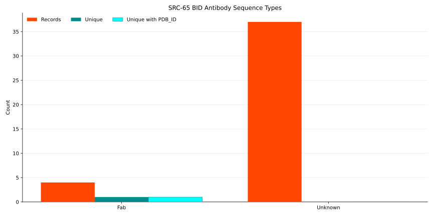
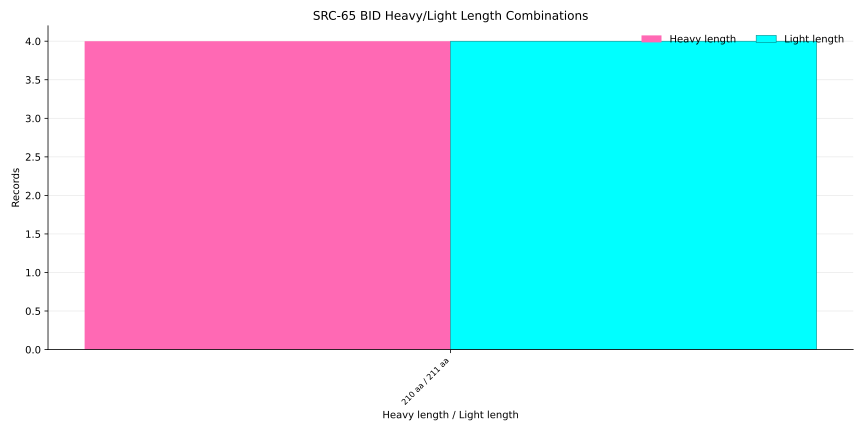
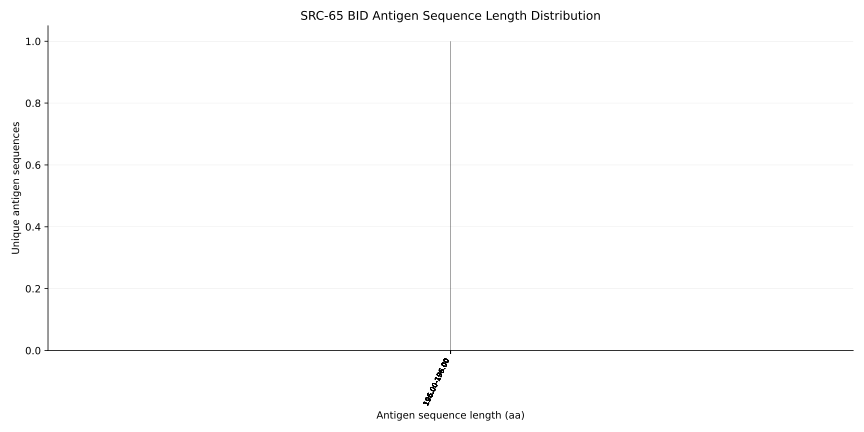

---
- tags:
  - context
---

# SRC-65 BID

> 每条 data 统一建模为 `((ab, ag), label, assay, condition, replicate, source)`.
> 本地快照 `G:\abag-datasets\SRC_R65_BID\snapshot-2009-10-30`, 载荷主体是 2009 年 BMC Bioinformatics 论文的 Additional file 4 (OLE Word 97–2003 `.doc`), 内含 Table S7 (9 个复合物) 与 Data set S2 (41 条丙氨酸突变), 加 9 个冻结 RCSB entry (`1ES7`、`1FAK`、`1FE8`、`1FOE`、`1GL4`、`1MQ8`、`1NFI`、`1NUN`、`1UB4`).
> `Unique` 为 `(heavy, light)` 二元组精确去重; 只有 1FE8 一个复合物含免疫球蛋白, 因此 Unique 为 1.

## Antibody

> 有 Heavy 和 Light 的 `Unique` 字段是 `(heavy, light)` 二元组精确去重. `Unique with PDB_ID` 是按 Unique 后的 sequence 计数.
> Total Unique 计数方式为统一转 string, 如果有 Heavy 和 Light 用 `/` 拼接成 string.

| Key | 含义 | 说明 |
| --- | --- | --- |
| Sequence Type | 抗体序列类型 | 根据原始数据字段、链槽位及已有构建体标签划分的类别. |
| Records | 原始记录数 | 原始数据中的记录数量, 同一序列可能重复出现. |
| Unique | 唯一序列数 | 按对应数据集定义的去重规则统计. |
| Unique with PDB_ID | 关联 PDB 的唯一序列数 | 去重后具有关联 PDB_ID 的序列数量, 不等同于具有可用实验结构监督的序列数量. |
| Description | 类型说明 | 描述分类依据、序列槽位特征及分类限制. |

| Sequence Type | Records | Unique | Unique with PDB_ID | Description |
| --- | --- | --- | --- | --- |
| Fab | 4 | 1 | 1 | 1FE8 的四个突变行共用同一对 Fab 链: 冻结 entry 的 entity 2 / 3 描述为 `IMMUNOGLOBULIN IGG RU5`, fragment 字段写 `FAB FRAGMENT HEAVY CHAIN` / `LIGHT CHAIN`, 重链 210 aa, 轻链 211 aa, 重链 chain H/I/J, 轻链 chain L/M/N. 构建体名来自该 entry 的 entity 描述. |
| Unknown | 37 | 0 | 0 | 其余 8 个复合物 (1ES7、1FAK、1FOE、1GL4、1MQ8、1NFI、1NUN、1UB4) 没有任何一条链的 entity 描述带免疫球蛋白措辞, 这 37 条突变没有抗体侧, 记 `Unknown` 以保持 41 行完整. |
| Total | 41 | 1 | 1 |  |

> BID 是蛋白–蛋白界面热点突变汇编, 不是抗体库. 41 条突变里只有 1FE8 的四个落在含 Fab 的复合物上, 其余 37 条所在复合物没有任何免疫球蛋白链, 按 `Unknown` 计入以保持 41 行完整, 不写 `Heavy + Light`.
>
> 1FAK 在 Table S7 里写作 protein 1 = `HL`, protein 2 = `T`. 这两个字母是同一蛋白的 LIGHT CHAIN (entity 1, 152 aa) 与 HEAVY CHAIN (entity 2, 254 aa) entity, 不是免疫球蛋白重链 / 轻链; 该 entry 没有任何免疫球蛋白实体, 这些行归 `Unknown`.
>
> 1GL4 的 entity 2 fragment 写作 `IG3 RESIDUES 1765-1858`; 这里的 `IG3` 是 immunoglobulin-like domain 3, 是免疫球蛋白折叠而不是免疫球蛋白链, 不据此判抗体.
>
> `Unique with PDB_ID` 记 1: 1FE8 是这批突变里唯一带抗体结构的复合物, 且它就是那 4 行的亲本复合物, 没有任何突变体单独解出结构. 9 个 entry 全部冻结在 `pdb/`, 但另外 8 个不含抗体侧, 不写入本表.

| Heavy Length | Light Length | Records | Description |
| --- | --- | --- | --- |
| 210 aa | 211 aa | 4 | 唯一抗体是 1FE8 的 Fab RU5: 重链 210 aa, 轻链 211 aa, 双链都含恒定区, 属 Fab 量级; 四行共用同一对链, 不是四种构建体. |

## Antigen

> Antigen 统计以 source-native antigen entity 为核心单位. 优先使用原始 antigen ID/name、construct 和 antigen chain 定义实体; 存在可靠序列时再统计唯一抗原序列.
> 结构、序列和数据库注释压缩到同一张表中, `PDB / UniProt` 采用唯一抗原实体粒度统计 2 × 2 覆盖结果.
> 长度图基于唯一抗原序列, 按该源实际范围平均切分 20 bins.

> 抗原只取与抗体配对的复合物一侧: 1FE8 的 vWF A3 结构域; 其余 8 个复合物没有抗体, 不产生抗原实体.

| Records | Unique ag entity | Unique ag sequence | PDB / UniProt coverage | Antigen Length | Antigen Evidence / Provenance | Description |
| --- | --- | --- | --- | --- | --- | --- |
| 41 | 1 | 1 | Reference PDB: 1; UniProt=unavailable | 196 aa | Reference PDB / PDB-derived sequence | 本节只统计与抗体配对的抗原: 1FE8 的 chain A/B/C (entity 1, `VON WILLEBRAND FACTOR` fragment `COLLAGEN BINDING DOMAIN A3`) 是一条 196 aa 序列, 三个链同一 entity, 去重后 1 条. 9 个复合物共 41 条突变, 只有这 4 条 (vWF A3 的 963 / 987 / 990 / 1023) 有抗体对侧; 另外 8 个复合物的 37 条突变是普通蛋白–蛋白界面, 没有抗体, 不产生抗原实体. 抗原序列取自冻结 FASTA, 属 PDB-derived, 不是载荷给出的序列. 表内无 UniProt 字段, 记 unavailable 而不是 0. |

## Affinity

> 去重口径: 按 **(抗体, 抗原)** 复合物身份去重; 1FE8 的 4 条突变是同一条 (Fab RU5, vWF A3) 配对上的四个位点. 无 replicate 字段, 全记 `unknown`.
>
> 抗体子集只有这 4 行, `Effect of mutation` 全为 `Insg` (Insignificant); `Observed ΔΔG` 4 行全是 `NA`. 全表 41 行里, 19 行的 ΔΔG 有实测值, 但全部来自 1FAK (凝血因子 VIIa–组织因子), 与抗体无关, 不并入本节.
>
> `Effect of mutation` 是 BID 的人工分档 (`Str` / `Int` / `Weak` / `Insg`), 原文说明这些分档来自动力学或热力学测量、归类规则未完全公开, 且与实测 ΔΔG 不完全一致; 因此按 `ordinal` 记录, 不换算成 ΔΔG. `TSVM score` 是 Lise 等的模型预测, 不是实验值, 不进本表.
>
> 空值不是阴性: 4 行 ΔΔG 为 `NA` 是未给出实测自由能, 不是"不结合".

| Label | Assay | Condition | Replicate | Record pairs | Unique pairs | Description |
| --- | --- | --- | --- | --- | --- | --- |
| `ordinal` | `unknown` | 1FE8 `Effect of mutation` | unknown:4 | 4 | 1 | 四行全为 `Insg`; 全表观察到的 `Str` 10 / `Int` 10 / `Weak` 4 / `Insg` 17, 但其中只有 `Insg` 的 4 行属抗体子集. |
| `not_recorded` | `unknown` | 1FE8 `Observed ΔΔG` | unknown:4 | 4 | 1 | `Observed ΔΔG (kcal/mol)` 四行全为 `NA`; 全表 19 个实测值都在 1FAK, 不属于抗体子集. 空值记为未记录, 不是 0, 也不是不结合. |
