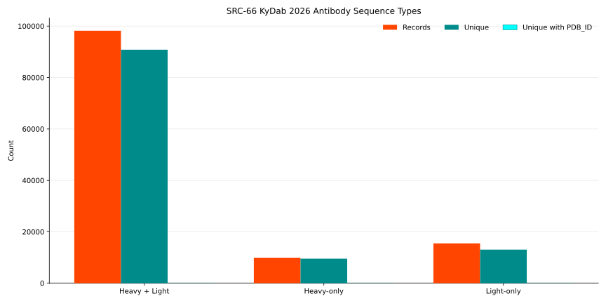
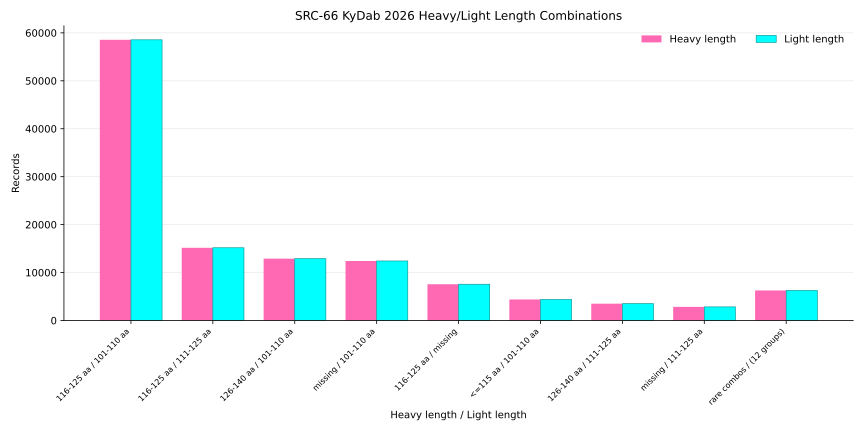
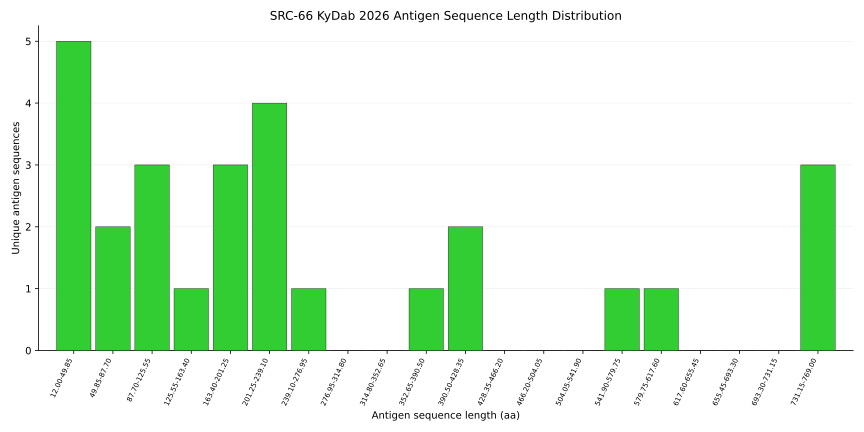

---
tags:
  - context
---

# SRC-66 KyDab

> 每条 data 统一建模为 `((ab, ag), label, assay, condition, replicate, source)`.
> 本地快照 `G:\abag-datasets\SRC_R66_KYDAB\snapshot-2026-03-23`, 11 个研究 ZIP 解到快照内的 `extracted/<study>/` 后使用, 原始 ZIP 未改. 每项研究的主配对表合计 123,527 行, 与源 README 的 productive 配对数一致; `*.annotated.csv` 是同一批行的氨基酸与 V/J 注释, AIRR 链表是逐链视图, FASTA 是序列副本, 都不另计记录.
> `Unique` 为 `(heavy, light)` 二元组精确去重, 无轻链时按重链序列去重; 113,503 个唯一单位.

## Antibody

> 有 Heavy 和 Light 的 `Unique` 字段是 `(heavy, light)` 二元组精确去重. `Unique with PDB_ID` 是按 Unique 后的 sequence 计数.
> Total Unique 计数方式为统一转 string, 如果有 Heavy 和 Light 用 `/` 拼接成 string.

| Key | 含义 | 说明 |
| --- | --- | --- |
| Sequence Type | 抗体序列类型 | 根据原始数据字段、链槽位及已有构建体标签划分的类别. |
| Records | 原始记录数 | 原始数据中的记录数量, 同一序列可能重复出现. |
| Unique | 唯一序列数 | 按对应数据集定义的去重规则统计. |
| Unique with PDB_ID | 关联 PDB 的唯一序列数 | 去重后具有关联 PDB_ID 的序列数量, 不等同于具有可用实验结构监督的序列数量. |
| Description | 类型说明 | 描述分类依据、序列槽位特征及分类限制. |

| Sequence Type | Records | Unique | Unique with PDB_ID | Description |
| --- | --- | --- | --- | --- |
| Heavy + Light | 98,196 | 90,811 | 0 | 两侧核苷酸序列均有值; 主表无构建体字段, 序列只到 V 区, 不判定为 IgG / Fab / Fv. |
| Heavy-only | 9,862 | 9,602 | 0 | 只有重链序列, 轻链列空; 属配对表中的单侧记录, 无构建体标注. |
| Light-only | 15,469 | 13,090 | 0 | 只有轻链序列, 重链列空; 同上, 不据此判为 VL-only 构建体. |
| Total | 123,527 | 113,503 | 0 |  |

> 构建体只按槽位判定: 11 张主表的主列是核苷酸 `HEAVY_CHAIN_SEQ` / `LIGHT_CHAIN_SEQ`, 没有 IgG / Fab / Fv / scFv 等构建体字段, 序列也只到 V 区 (AA 56-183 aa / 50-166 aa), 因此只写 `Heavy + Light` / `Heavy-only` / `Light-only`, 不据长度升级为 Fab 或 IgG.
>
> 单链槽位的行不是另一种构建体: `Heavy-only` 的 9,862 行与 `Light-only` 的 15,469 行是同一配对表中另一侧未测出或未通过 productive 过滤的记录, 其中 520 条重链与 1,765 条轻链在别处以配对形式出现. 记 `Heavy-only` / `Light-only` 是槽位事实, 不代表这批是单域抗体.
>
> 核苷酸主表与氨基酸注释表逐行同序 (按 `CLONE_NAME` / `CLONE_ID` 对齐, 11 张表全部对齐), 但注释覆盖低于主表: 173 行两侧都没有 AA 序列, 因此长度表里出现 `missing` 组合, 记录数仍按主表计.
>
> `Unique with PDB_ID` 为 0: 快照内没有 `pdb/` 目录, 源 README 的 PDB 状态是 `partial` 且未接受任何构建体级锚点, 主表也没有 PDB 字段.

| Heavy Length | Light Length | Records | Description |
| --- | --- | --- | --- |
| 116-125 aa | 101-110 aa | 58,541 | 主簇 47.4%: 可变区量级双链, 与其余研究一致. 两侧 AA 序列均来自 `*.annotated.csv`, 长度不用于判定构建体. |
| 116-125 aa | 111-125 aa | 15,159 | 占 12.3% 的记录. |
| 126-140 aa | 101-110 aa | 12,893 | 占 10.4% 的记录. |
| missing | 101-110 aa | 12,409 | 一侧没有 AA 注释序列 (核苷酸主表有值, 注释表为空); 记录仍计入主表. |
| 116-125 aa | missing | 7,553 | 一侧没有 AA 注释序列 (核苷酸主表有值, 注释表为空); 记录仍计入主表. |
| <=115 aa | 101-110 aa | 4,384 | 占 3.5% 的记录. |
| 126-140 aa | 111-125 aa | 3,500 | 占 2.8% 的记录. |
| missing | 111-125 aa | 2,835 | 一侧没有 AA 注释序列 (核苷酸主表有值, 注释表为空); 记录仍计入主表. |
| residual | (15 个组合) | 6,253 | 余下组合各 < 2,000 条, 含 `>140 aa` 与 `>125 aa` 的稀有侧. |

## Antigen

> Antigen 统计以 source-native antigen entity 为核心单位. 优先使用原始 antigen ID/name、construct 和 antigen chain 定义实体; 存在可靠序列时再统计唯一抗原序列.
> 结构、序列和数据库注释压缩到同一张表中, `PDB / UniProt` 采用唯一抗原实体粒度统计 2 × 2 覆盖结果.
> 长度图基于唯一抗原序列, 按该源实际范围平均切分 20 bins.

> 抗原标签按研究取测定的分析物: KV7027 用 `ANALYTE`, 两个 Malaria 研究用 `ANALYTE_NAME`, 其余用 `ANTIGEN_NAME` / `IMMUNOGEN`; pertussis 的抗原由 `animal-antigen-mapping.csv` 按动物映射得到.
>
> 只有 4 项研究随包提供抗原序列 (两个 Malaria 的 analyte FASTA、pertussis 的 toxin FASTA、RSV 与 KV7022 的 immunogen 文本), 共 27 条唯一序列; 其余研究的标签没有序列.

| Records | Unique ag entity | Unique ag sequence | PDB / UniProt coverage | Antigen Length | Antigen Evidence / Provenance | Description |
| --- | --- | --- | --- | --- | --- | --- |
| 123,527 | 56 | 27 | PDB=0/UniProt=0: 56 | 12-769 aa; median 199 aa | Direct sequence / Source-native | 56 个 (研究, 标签) 实体, 50 个不同标签: Influenza 5、KV7019 1、KV7022 9、KV7027 8、KV7033 6、KV7036 6、Malaria 两项研究各 6 (同一组 6 个 peptide)、RSV 5 (含 `no antigen`)、Typhi 1、pertussis 3 (WT toxoid、R9K E129A 突变体、两者混合免疫). 27 条唯一抗原序列来自 4 项研究的随包文件, 长度 12-769 aa, 中位数 199 aa, 含单段 peptide (12-24 aa)、单体蛋白 (82-269 aa) 与纳米颗粒融合构建体 (374-769 aa); 序列属源方直接给出, 不是从 PDB 反推. RSV 的 `Live RSV` 与 `FI-RSV` 只给 GenBank 号 `KT992094.1` 没有序列, KV7022 的 9 个标签共用其文本里的部分构建体序列. 快照内没有 `pdb/` 目录, 源 README 明确未接受任何抗原结构锚点, 因此 56 个实体的 PDB 覆盖全部为 0, 不是 `unavailable`. 表内无 UniProt 字段. |

## Affinity

> 去重口径: 按 **(heavy 序列, light 序列, 抗原标签)** 去重, 每个 label 内按该口径计唯一对. 表内没有统一的重复数字段, 除 KV7019 ELISA 的 `Replicate` 外全记 `unknown`.
>
> 11 项研究的实验口径不同, 各占独立行: SPR 动力学 (Malaria x 2、pertussis、Typhi x 3 个 pH)、HTRF (KV7027)、ELISA (KV7019). Influenza、KV7022、KV7033、KV7036、RSV 五项研究的主表没有任何测量列 (RSV / Influenza 的 `has_kd_measurement` 全部为 False), 它们的 48,736 行只有序列, 记 `not_recorded`.
>
> SPR 合计 1,544 行, 与源索引的 "1,544 条条件特异的 SPR KD" 相符. `KD (M)` 与 `ka` / `k d` 不是独立测量: 在 Malaria-7018 的 124 行里 113 行满足 `k d / ka = KD`, 余下 11 行偏差超过 5%; Typhi 三个 pH 的偏差行分别为 12 / 15 / 6, 原值保留不重算.
>
> Typhi 的 `KD_M_PH*` 有字面零值 (pH 5.5 9 行、pH 7.6 1 行), 是源内既有编码, 不是缺失也不是阴性, 保留在范围统计里并在该行注明.

| Label | Assay | Condition | Replicate | Record pairs | Unique pairs | Description |
| --- | --- | --- | --- | --- | --- | --- |
| `Kd_M` | `SPR` | Malaria-7018 (`KD (M)`) | unknown:124 | 124 | 124 | `KD (M)` 1.90e-11-1.20e-05; 6 个 analyte peptide 各约 20 行; `ka` 1.53e+03-8.79e+05 M-1s-1, `k d` 1.00e-05-7.39e-02 s-1. |
| `Kd_M` | `SPR` | Malaria-7021 (`KD (M)`) | unknown:110 | 110 | 110 | `KD (M)` 7.69e-12-5.17e-06; 6 个 analyte peptide; `ka` 1.13e+04-1.30e+06, `k d` 1.00e-05-5.95e-02. |
| `Kd_M` | `SPR` | pertussis (`KD (M)`) | unknown:422 | 422 | 363 | `KD (M)` 2.00e-11-1.31e-08; 抗原由动物映射到 WT toxoid 与 R9K E129A 突变体两个标签; 同一 (ab, ag) 有 59 行重复条目. |
| `Kd_M` | `SPR` | Typhi pH 5.5 (`KD_M_PH5_5`) | unknown:415 | 415 | 399 | `KD_M_PH5_5` 0-4.86e-08, 9 行字面 0; `KA_PH5_5` 5.45e+03-3.26e+07; 12 行 `KD_PH5_5 / KA_PH5_5` 与 `KD_M` 偏差 >5%. |
| `Kd_M` | `SPR` | Typhi pH 7.2 (`KD_M_PH7_2`) | unknown:144 | 144 | 139 | `KD_M_PH7_2` 3.00e-12-5.67e-09, 无字面 0; `KA_PH7_2` 7.16e+04-3.80e+07; 15 行比值与 `KD_M` 偏差 >5%. |
| `Kd_M` | `SPR` | Typhi pH 7.6 (`KD_M_PH7_6`) | unknown:329 | 329 | 317 | `KD_M_PH7_6` 0-8.75e-08, 1 行字面 0; `KA_PH7_6` 62.2-2.50e+07; 6 行比值与 `KD_M` 偏差 >5%. |
| `enrichment` | `ELISA` | KV7019 (`ELISA Mean (FI)`) | n=3:256; n=2:256 | 1,280 | 512 | `ELISA Mean (FI)` 对两个分析物 (Abaum / OMV) 的荧光强度, 每对 2-3 个 `Replicate`; 是相对信号不是 Kd, 未给归一化口径, 不跨分析物比较. |
| `enrichment` | `unknown` | KV7027 (`Ratio` / `Percent Effect`) | unknown:1,992 | 1,992 | 1,992 | HTRF 的 `Ratio` / `Percent Effect` / `DeltaF` / `Numerator` 同批同值, 1:1 唯一; assay 词表没有 HTRF 项, 记 `unknown`, 方法由列名与源 README 给出. |
| `not_recorded` | `unknown` | 5 项研究无测量列 | unknown:48,736 | 48,736 | 45,061 | Influenza-7015 4,106 + KV7022 10,751 + KV7033 6,401 + KV7036 26,379 + RSV 1,099; 主表只有序列与免疫原标签, 没有 Kd / 比值 / 结合判定, 不当作阴性. |
