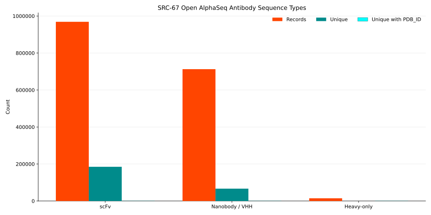
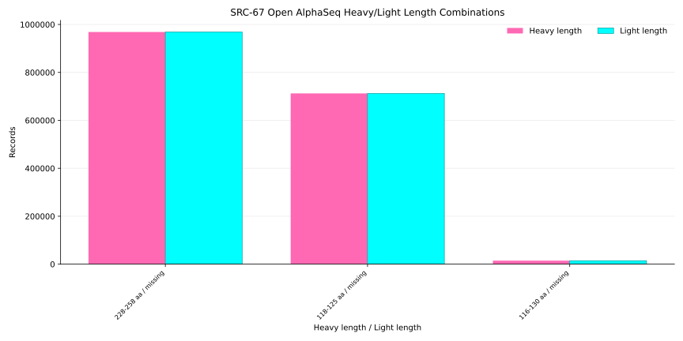
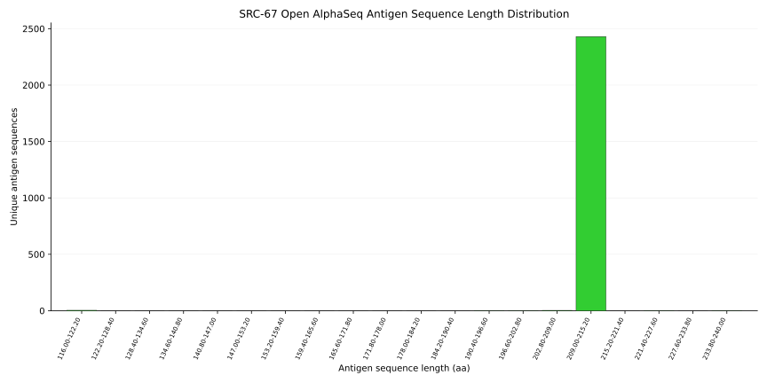

---
tags:
  - context
---

# SRC-67 Open AlphaSeq

> 每条 data 统一建模为 `((ab, ag), label, assay, condition, replicate, source)`.
> 本地快照 `G:\abag-datasets\SRC_R67_OPEN_ALPHASEQ\snapshot-2025-12-04`, 九张 `open-alphaseq/data/<实验>/data.parquet`, 各表 10 列同构, 合计 1,705,908 行, 无完全重复行; 每行是一个 MATa 构建体与一个 MATα 构建体的配对.
> `Unique` 为抗体侧 (MATa) 氨基酸序列精确去重; MATa 一行一序列, 没有重/轻链两列, 因此 `Light Length` 一律记 `missing`.

## Antibody

> 有 Heavy 和 Light 的 `Unique` 字段是 `(heavy, light)` 二元组精确去重. `Unique with PDB_ID` 是按 Unique 后的 sequence 计数.
> Total Unique 计数方式为统一转 string, 如果有 Heavy 和 Light 用 `/` 拼接成 string.

| Key | 含义 | 说明 |
| --- | --- | --- |
| Sequence Type | 抗体序列类型 | 根据原始数据字段、链槽位及已有构建体标签划分的类别. |
| Records | 原始记录数 | 原始数据中的记录数量, 同一序列可能重复出现. |
| Unique | 唯一序列数 | 按对应数据集定义的去重规则统计. |
| Unique with PDB_ID | 关联 PDB 的唯一序列数 | 去重后具有关联 PDB_ID 的序列数量, 不等同于具有可用实验结构监督的序列数量. |
| Description | 类型说明 | 描述分类依据、序列槽位特征及分类限制. |

| Sequence Type | Records | Unique | Unique with PDB_ID | Description |
| --- | --- | --- | --- | --- |
| scFv | 968,765 | 184,812 | 1 | 描述自带 `scFv` / `_HL` / `_LH`, 或实验级设计声明为 scFv; 三个亲本共 3 个冻结构造, 无变体结构. |
| Nanobody / VHH | 712,542 | 66,601 | 1 | 描述自带 `VHH`, 或 VHH72 设计轮的设计行 (亲本级标签); 亲本 VHH-72 有 `6WAQ`, 无变体结构. |
| Heavy-only | 14,676 | 6 | 0 | 单序列槽位且描述与实验卡都无构建体措辞, 即 YM_0005 的 `CoV_binder_28` 至 `CoV_binder_33`; 不据长度判为 VHH. |
| Total | 1,695,983 | 251,417 | 0 |  |

> 构建体按两级证据判定: 描述串自带 `scFv` 或 `VHH` 的 (如 `CR3022_scFv_LH_Mod`、`SARS_VHH72`), 以及描述以 `_HL` / `_LH` 结尾的 (源方对重链在前/轻链在前两种书写顺序的命名), 直接取该标签; 描述只有 `candidate_` / `WT_` / `pair_` 等设计编号的, 取该实验在源 README 实验表里写明的构建体, 属亲本级标签: VHH72 VHH (YM_0549 / YM_1068)、PP489 scFv (YM_0693)、Pembrolizumab scFv (YM_0852 / YM_0985)、ABC001 scFv (YM_0988)、Trastuzumab scFv (YM_0989 / YM_0990). 上游数据卡有三处与表不符 (YM_0985 卡称 34,890 个 VHH、YM_0988 沿用了 Iter0 的序列数、YM_0990 卡称 VHH 并沿用 CDR 前缀), 本表的构建体取 README 实验表与描述串, 不取这三处卡文.
>
> 唯一不沿用实验级标签的是 YM_0005: 该表的 `CoV_binder_28` 至 `CoV_binder_33` 六个描述既无构建体措辞也无实验级声明, 只有单序列槽位, 记 `Heavy-only`; 它们的序列 118-125 aa, 长度不作为构建体判据. 这六条占 `Heavy-only` 的 14,676 行与 6 个唯一序列.
>
> 两类行不计入抗体: `ACE2_Full` (2,446 行) 是 MATa 侧的人类受体构建体, 不是免疫球蛋白; `ANeg1/2/3` (7,479 行) 有描述但序列为空, 是阴性对照. 二者合计 9,925 行, 占全表 0.58%.
>
> `Unique with PDB_ID` 是亲本级计数: 四个抗体侧冻结构造 (`6ZLR` CR3022、`5JXE` Pembrolizumab、`1N8Z` Trastuzumab、`6WAQ` VHH-72) 各是这些抗体家族的复合物, 没有任何一个设计变体单独解出结构. `scFv` 行由前三个亲本支撑, `Nanobody / VHH` 行由 VHH-72 支撑, `Heavy-only` 的 18 万级设计没有任何结构锚点, 记 0.
>
> 三组长度由序列本身实测 (scFv 228-258 aa、VHH 120-126 aa、单槽位 118-125 aa), 只用于描述, 不回流到构建体判定.
>
> 三行的 Unique 相加减 2 才是 Total: YM_0005 的两个 `CoV_binder_*` 序列与 VHH 表内的序列逐字相同, 在 `Heavy-only` 与 `Nanobody / VHH` 两行各计一次, 合并不重复计. `scFv` 与另两组无共享序列.

| Heavy Length | Light Length | Records | Description |
| --- | --- | --- | --- |
| 228-258 aa | missing | 968,765 | scFv 单串: 表内无独立轻链槽位, 轻链记 missing; 长度只作描述. |
| 120-126 aa | missing | 712,542 | VHH 单域与 VHH72 设计行; 轻链槽位不存在. |
| 118-125 aa | missing | 14,676 | 六个单槽位描述, 长度与 VHH 重叠, 但仍按槽位记 `Heavy-only`. |

## Antigen

> Antigen 统计以 source-native antigen entity 为核心单位. 优先使用原始 antigen ID/name、construct 和 antigen chain 定义实体; 存在可靠序列时再统计唯一抗原序列.
> 结构、序列和数据库注释压缩到同一张表中, `PDB / UniProt` 采用唯一抗原实体粒度统计 2 × 2 覆盖结果.
> 长度图基于唯一抗原序列, 按该源实际范围平均切分 20 bins.

> 抗原侧是 MATα 的 2,466 个描述, 去掉三个 `AlphaNeg` 阴性对照后按描述去重; 有序列的 2,441 条为唯一抗原序列, 长度 116-240 aa.
>
> 六种目标是 RBD 突变库 (2,443 个描述)、VHH72 的两个病毒 RBD 面板 (7 与 8 个)、TIGIT 人/鼠 (2 个)、PD-1 (1 个)、HER2 (1 个); 同一目标在不同实验里复用同一序列.

| Records | Unique ag entity | Unique ag sequence | PDB / UniProt coverage | Antigen Length | Antigen Evidence / Provenance | Description |
| --- | --- | --- | --- | --- | --- | --- |
| 1,705,908 | 2,466 | 2,441 | Reference PDB: 2; UniProt=unavailable | 116-240 aa | Direct sequence / Fixed target / Reference PDB | 2,466 个 (实验, MATα 描述) 实体, 去掉 `AlphaNeg` 后按描述计数: YM_0005 2,443 (RBD 单点突变库) + VHH72 两轮 7 / 8 + TIGIT 两轮 2 / 2 + PD-1 两轮 1 / 1 + HER2 两轮 1 / 1. 目标序列由 MATα 列直接给出, 长度 116-240 aa, 属源方序列而非结构反推. 冻结结构里 `6LZG` (RBD-ACE2) 与 `3UDW` (TIGIT) 是目标侧参考, 其余四个是抗体亲本; 目标结构与具体构建体不一一对应, 因此抗原侧 PDB 覆盖按目标计 2, 不是 2,466. 表内无 UniProt 字段. |

## Affinity

> 去重口径: 按 **(MATa 序列或描述, MATα 序列或描述)** 去重, 无序列时用描述占位; 九个实验各按自己的 key 计, 不跨实验合并同一对抗体—目标.
>
> `alphaseq_affinity` 是 `log10(K_D / nM)`: 数值越小结合越强, 例如 0 对应 1 nM. 这是 AlphaSeq 条形码计数经标定得到的估计, 不是逐候选 SPR / BLI 读数. 九表有限值合计 1,378,079 行, 范围 -0.989 至 7.459.
>
> `affinity_lower_bound` / `affinity_upper_bound` 是 Wilson 区间, 1,378,079 行全部满足 `upper <= affinity <= lower`; 它们是边界而非点估计, 不另立 label. `affinity_upper_bound` 在无点估计的行也有值, 但本表只统计有点估计的行.
>
> 缺失的 327,829 行没有点估计, 数据卡解释为未观察到该蛋白对的细胞融合或配对条形码 reads, 属未测, 不是阴性. `above_background` (BH 校正 q<0.05) 与 `sufficient_replicate_observations` 是源内质量标记, 不改变 label; 表内没有重复次数, `Replicate` 全记 `unknown`.
>
> 同源关系: SRC-79 AlphaBind 的 8 张 AlphaSeq 表与本源的 8 个实验是同批设计活动. 序列集合多数重合: PP489 fine-tuning 26,726 条全中、VHH72 Iter1 36,862 全中、Trastuzumab CDR 3,632 全中、Trastuzumab full 7,491 全中、PP489/ABC001 Iter1 35,929 全中; 例外是 SRC-79 的 pembrolizumab validation 表: 它 35,131 条唯一设计里只有 230 条落在 YM_0852、3,036 条落在 YM_0985, 这批设计与本源不同. 本源把同一设计在多个靶点下展开成 5-11 行, 行数因此多出 3-8 倍, 但测量身份是同一批. 与 SRC-23 MIT-LL AlphaSeq、SRC-09 的 AlphaSeq 系列同属 AlphaSeq 平台, 不同 campaign. 跨源合并须按 (设计, 靶点) 去重, 不能按行相加.

| Label | Assay | Condition | Replicate | Record pairs | Unique pairs | Description |
| --- | --- | --- | --- | --- | --- | --- |
| `log_Kd` | `NGS_seq` | YM_0005 RBD 单点突变库 | unknown:96,855 | 96,855 | 93,469 | `alphaseq_affinity` log10(Kd/nM) -0.471 至 5.543; `above_background` 88,630 行; `sufficient_replicate_observations` 70,113 行; 缺 67,027 行无点估计. |
| `log_Kd` | `NGS_seq` | YM_0549 VHH72 Iter0 | unknown:214,122 | 214,122 | 212,761 | `alphaseq_affinity` log10(Kd/nM) 0.288 至 5.236; `above_background` 116,296 行; `sufficient_replicate_observations` 131,144 行; 缺 85,788 行无点估计. |
| `log_Kd` | `NGS_seq` | YM_0693 PP489 Iter0 | unknown:101,204 | 101,204 | 100,596 | `alphaseq_affinity` log10(Kd/nM) -0.989 至 5.004; `above_background` 25,800 行; `sufficient_replicate_observations` 38,959 行; 缺 33,376 行无点估计. |
| `log_Kd` | `NGS_seq` | YM_0852 Pembrolizumab Iter0 | unknown:120,074 | 120,074 | 119,411 | `alphaseq_affinity` log10(Kd/nM) 1.020 至 6.676; `above_background` 5,407 行; `sufficient_replicate_observations` 110,949 行; 缺 134 行无点估计. |
| `log_Kd` | `NGS_seq` | YM_0985 Pembrolizumab Iter1 | unknown:144,838 | 144,838 | 136,626 | `alphaseq_affinity` log10(Kd/nM) -0.038 至 6.215; `above_background` 24,504 行; `sufficient_replicate_observations` 127,434 行; 缺 3,290 行无点估计. |
| `log_Kd` | `NGS_seq` | YM_0988 ABC001/PP489 Iter1 | unknown:167,740 | 167,740 | 161,910 | `alphaseq_affinity` log10(Kd/nM) -0.724 至 5.788; `above_background` 71,747 行; `sufficient_replicate_observations` 93,345 行; 缺 19,005 行无点估计. |
| `log_Kd` | `NGS_seq` | YM_0989 Trastuzumab CDR | unknown:94,576 | 94,576 | 83,296 | `alphaseq_affinity` log10(Kd/nM) 1.007 至 6.486; `above_background` 12,026 行; `sufficient_replicate_observations` 93,154 行; 缺 28 行无点估计. |
| `log_Kd` | `NGS_seq` | YM_0990 Trastuzumab CDR+framework | unknown:149,973 | 149,973 | 148,245 | `alphaseq_affinity` log10(Kd/nM) 0.782 至 7.459; `above_background` 6,790 行; `sufficient_replicate_observations` 146,699 行; 缺 75 行无点估计. |
| `log_Kd` | `NGS_seq` | YM_1068 VHH72 Iter1 | unknown:288,697 | 288,697 | 287,169 | `alphaseq_affinity` log10(Kd/nM) -0.447 至 5.412; `above_background` 183,709 行; `sufficient_replicate_observations` 188,664 行; 缺 119,106 行无点估计. |
