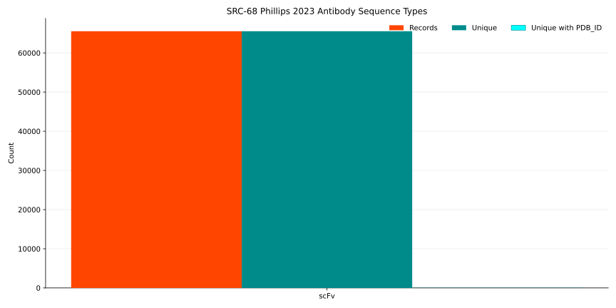
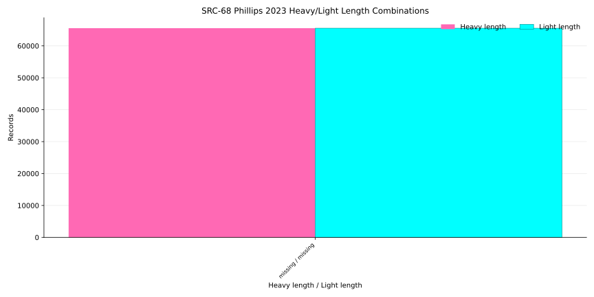
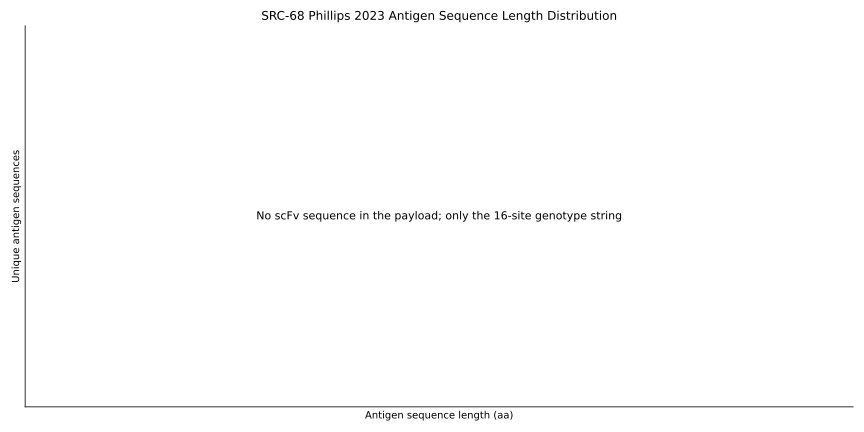

---
tags:
  - context
---

# [SRC-68 Phillips 2023](../2026-10-29-3a-src-readme/src-68-ch65-comblib-readme.md)

> 每条 data 统一建模为 `((ab, ag), label, assay, condition, replicate, source)`.
> 本地快照 `G:\abag-datasets\SRC_R69_CH65_COMBLIB\snapshot-2023-02-01`, 上游固定 commit `cea336d`, 主体是 `Kd_Inference/results_CH65/` 的基因型与拟合结果表; `QCfilt.csv` 65,536 个 genotype, `QCfilt_REPfilt.csv` 65,535 个, 另有三份 browser 表与三份 delta 派生表.
> `Unique` 为 16 位二元 genotype 串精确去重; 公开包不含 scFv 序列, 单位只能是 genotype, 不能写成序列去重.

## Antibody

> 有 Heavy 和 Light 的 `Unique` 字段是 `(heavy, light)` 二元组精确去重. `Unique with PDB_ID` 是按 Unique 后的 sequence 计数.
> Total Unique 计数方式为统一转 string, 如果有 Heavy 和 Light 用 `/` 拼接成 string.

| Key | 含义 | 说明 |
| --- | --- | --- |
| Sequence Type | 抗体序列类型 | 根据原始数据字段、链槽位及已有构建体标签划分的类别. |
| Records | 原始记录数 | 原始数据中的记录数量, 同一序列可能重复出现. |
| Unique | 唯一序列数 | 按对应数据集定义的去重规则统计. |
| Unique with PDB_ID | 关联 PDB 的唯一序列数 | 去重后具有关联 PDB_ID 的序列数量, 不等同于具有可用实验结构监督的序列数量. |
| Description | 类型说明 | 描述分类依据、序列槽位特征及分类限制. |

| Sequence Type | Records | Unique | Unique with PDB_ID | Description |
| --- | --- | --- | --- | --- |
| scFv | 65,536 | 65,536 | 1 | 16 位二元组合文库, 以 genotype 串为唯一单位; 无序列槽位, 无逐行构建体字段, 构建体标签取源文措辞. |
| Total | 65,536 | 65,536 | 1 |  |

> 构建体取自源文显式措辞: 论文与仓库 README 都写实验用 yeast-displayed scFv, `Kd_Inference/metadata/replicate_info.tsv` 的 `construct` 列同此; 表内没有逐行构建体字段, 也没有轻链与重链两个槽位, 整条 scFv 以一个 genotype 串表示.
>
> `Unique with PDB_ID` 按亲本体系计 1: 冻结构造 `5UGY` 是成熟 CH65 Fab 的复合物, 210 / 227 aa 的轻/重链; 65,536 个组合变体没有一个单独解出结构. `8EK6` / `8EKH` 是 UCA 与 I-2 两个祖先 Fab 的游离结构, 不是 CH65, 也不属于本库任何 genotype.
>
> 长度列全记 `missing`: 公开包只有 16 位点基因型与拟合值, 没有 scFv 氨基酸序列; `5UGY` 的链长属冻结构造, 不当作本库构建体的长度.
>
> 16 个位点来自 `mutation_list.tsv`, 其中 `V98I` 一行保留上游原样冲突 (`aa_0=R`、`aa_1=R`、`aa_pos=53`、`synonymous=True`), 名称与残基不一致, 按原样引用不改名.

| Heavy Length | Light Length | Records | Description |
| --- | --- | --- | --- |
| missing | missing | 65,536 | 公开包无 scFv 序列, 只有 16 位 genotype; 两侧长度均无法给出. |

## Antigen

> Antigen 统计以 source-native antigen entity 为核心单位. 优先使用原始 antigen ID/name、construct 和 antigen chain 定义实体; 存在可靠序列时再统计唯一抗原序列.
> 结构、序列和数据库注释压缩到同一张表中, `PDB / UniProt` 采用唯一抗原实体粒度统计 2 × 2 覆盖结果.
> 长度图基于唯一抗原序列, 按该源实际范围平均切分 20 bins.

> 三个抗原是源内的 solute 标签 `MA90` / `SI06` / `MA90-G189E` (即 MA90 的 G189E 单点), 由 `replicate_info.tsv` 与 `sample_info.tsv` 的 `solute` 列给出; 表内没有抗原序列字段.
>
> 三个抗原都没有可直接归属的抗原序列: 唯一冻结构造 `5UGY` 的 HA 链没有被告知是哪一个 solute 的构建体, 因此长度记 unavailable, 第三张图不画柱.

| Records | Unique ag entity | Unique ag sequence | PDB / UniProt coverage | Antigen Length | Antigen Evidence / Provenance | Description |
| --- | --- | --- | --- | --- | --- | --- |
| 65,536 | 3 | unavailable | Reference PDB: 1; UniProt=unavailable | unavailable | Reference PDB / Fixed target | 三个 solute 标签: MA90, SI06, MA90-G189E. 每次测量在同一构建体上做表达与三条抗原的结合, 属单一固定的三个靶点. 唯一冻结 entry `5UGY` 是成熟 CH65 Fab–A/Solomon Islands/3/2006 HA 复合物, 提供 HA1 323 aa / HA2 173 aa; 源文没有把 MA90 / SI06 / G189E 任一标签指认为这套 HA 链, 因此不把参考链当作实测抗原序列, `Unique ag sequence` 与长度均记 unavailable. 表内无 UniProt 字段. |

## Affinity

> 去重口径: 按 **16 位 genotype 串** 去重, `QCfilt.csv` 65,536 行全部 1:1 唯一. 三张 `*_browser.tsv` 是同一批拟合的分 replicate 展开, `dKd_*` 是背景到目标 genotype 的派生差, 都不新增 (ab, ag) 对.
>
> `log10Kd` 列名沿用上游, 语义是 `-log10(K_D [M])`: 数值越大结合越强, `6.0` 是检测下界钉扎, 不是缺失, 也不是测到的 6.0. 三个抗原的钉扎行数分别为 0 / 31,524 / 9,452; 这些行保留为观测, 下游使用前须当作删失.
>
> 每份 `QCfilt` 值是 replicate 合并后的均值 (replicate a/b、d/e、g/h 各成对), 表内没有逐 replicate 的数值列, 因此 `Replicate` 记 `unknown`. `REPfilt` 是更严格的 replicate 过滤版本, 三个抗原的非缺失数为 65,530 / 64,619 / 63,840; 本表用未过滤的 `QCfilt` 计数, 差异写在 Description.
>
> 论文主图的 62,926 是三抗原联合过滤后的集合, 不是任何一个文件的行数, 当前没有逐行重现.

| Label | Assay | Condition | Replicate | Record pairs | Unique pairs | Description |
| --- | --- | --- | --- | --- | --- | --- |
| `log_Kd` | `NGS_seq` | MA90 (`MA90_mean`) | unknown:65,533 | 65,533 | 65,533 | `MA90_mean` = -log10(K_D/M), 7.95-10.53; 0 行钉扎在检测下界 6.0 (删失, 非点估计); 缺 3 行; REPfilt 版本 65,530 行非缺失. |
| `log_Kd` | `NGS_seq` | SI06 (`SI06_mean`) | unknown:65,514 | 65,514 | 65,514 | `SI06_mean` = -log10(K_D/M), 6.00-9.76; 31,524 行钉扎在检测下界 6.0 (删失, 非点估计); 缺 22 行; REPfilt 版本 64,619 行非缺失. |
| `log_Kd` | `NGS_seq` | G189E (`G189E_mean`) | unknown:65,536 | 65,536 | 65,536 | `G189E_mean` = -log10(K_D/M), 6.00-10.33; 9,452 行钉扎在检测下界 6.0 (删失, 非点估计); 缺 0 行; REPfilt 版本 63,840 行非缺失. |
