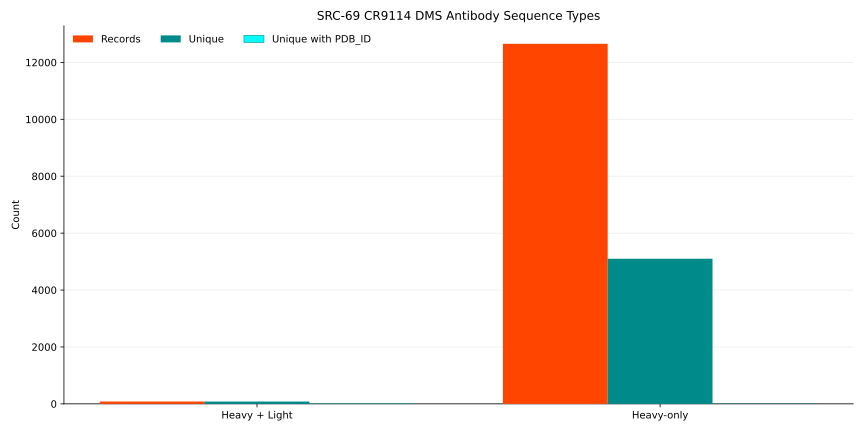
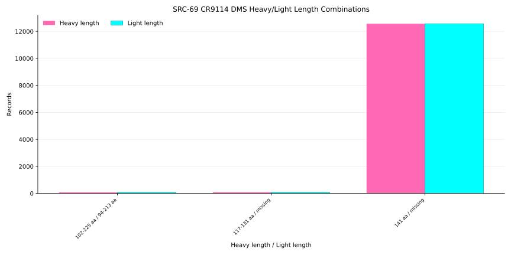
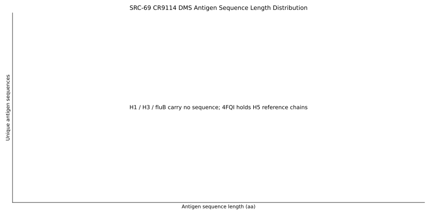

---
- tags:
  - context
---

# SRC-69 CR9114 DMS

> 每条 data 统一建模为 `((ab, ag), label, assay, condition, replicate, source)`.
> 本地快照 `G:\abag-datasets\SRC_R70_CR9114_DMS\v1.0.0`, 一个 CR9114 重链点突变库 (germline 与成熟亲本各一套)、一个 168 行 IGHV1-69 抗体面板、40 行 BLI 复核、18 行 MIC 与 342 行热稳定性表.
> `Unique` 按 **(亲本, 突变标签)** 去重; DMS 表只有突变标签, 没有逐变体序列, 亲本重链以 423 nt 的 FASTA 给出.

## Antibody

> 有 Heavy 和 Light 的 `Unique` 字段是 `(heavy, light)` 二元组精确去重. `Unique with PDB_ID` 是按 Unique 后的 sequence 计数.
> Total Unique 计数方式为统一转 string, 如果有 Heavy 和 Light 用 `/` 拼接成 string.

| Key | 含义 | 说明 |
| --- | --- | --- |
| Sequence Type | 抗体序列类型 | 根据原始数据字段、链槽位及已有构建体标签划分的类别. |
| Records | 原始记录数 | 原始数据中的记录数量, 同一序列可能重复出现. |
| Unique | 唯一序列数 | 按对应数据集定义的去重规则统计. |
| Unique with PDB_ID | 关联 PDB 的唯一序列数 | 去重后具有关联 PDB_ID 的序列数量, 不等同于具有可用实验结构监督的序列数量. |
| Description | 类型说明 | 描述分类依据、序列槽位特征及分类限制. |

| Sequence Type | Records | Unique | Unique with PDB_ID | Description |
| --- | --- | --- | --- | --- |
| Heavy + Light | 81 | 81 | 4 | 面板中 VH / VL 两槽都有值的行, 按 `(VH_AA, VL_AA)` 二元组去重; 4 行带 PDB 字段 (CR9114 / CR6261 / F10 / 27F3). |
| Heavy-only | 12,654 | 5,100 | 0 | CR9114 重链点突变库 (五张表的行数) 加面板 87 行单槽位; 去重单位是 (亲本, 突变标签) 与 VH 序列, 载荷无轻链列, 无构建体措辞. |
| Total | 12,735 | 5,181 | 4 |  |

> DMS 侧只有重链槽位: 四张 KD 表与两张 counts 表的列全是 `mut` / `conc` / `bin`, 没有轻链列; 成熟亲本与 germline 亲本的重链分别来自 `CR9114_HC_WT.fa` 与 `CR9114_HC_GL.fa`, 各 423 nt (141 aa, 含信号肽与部分 CH1), 两条只在 18 个位置不同. 载荷没有任何构建体措辞 (无 IgG / Fab / scFv / 展示体系字段), 因此按槽位记 `Heavy-only`, 不按 141 aa 反推构建体.
>
> 面板侧 `doc/` 下的 IGHV1-69 抗体工作簿有 `VH_AA` 与 `VL_AA` 两个槽位: 168 行里 81 行两侧都有值, 87 行只有 VH. 两侧都有值的按 `Heavy + Light`, 只有 VH 的按 `Heavy-only`. 面板行的去重单位是 `(VH_AA, VL_AA)` 精确二元组, 单槽位行按 `VH_AA` 去重, 与 DMS 的 (亲本, 突变) 单位不同, 两行 Description 分别写明.
>
> DMS 的突变标签在两张表里用了两套编号: 同一行 `mut` 与 `mut_kabat` 在 GL 表有 1,428 处、成熟亲本三张表分别有 1,423 / 1,411 / 1,416 处相差 1 个位置 (如 `A58A` 对 `A57A`), 另有 138 个标签以 `_` 结尾 (如 `A24_`). 去重与连线都用 `mut` 原值, 不合并两套编号.
>
> `Unique with PDB_ID`: 只有面板的 4 行带 `PDB` 字段, 分别 CR9114 (`4FQH, 4FQI, 4FQV, 4FQY`)、CR6261 (`3GBN`)、F10 (`3FKU`)、27F3 (`5WKO`), 四行都是双链行, 因此记在 `Heavy + Light`; DMS 变体没有任何逐行 PDB 字段, 其亲本 CR9114 的结构已由面板那一行计入, 不重复加, `Heavy-only` 记 0.
>
> 计数单位: `Heavy + Light` 的 Records 是面板中双链行的行数, Unique 是 `(VH, VL)` 二元组; `Heavy-only` 的 Records 是五张 DMS 表的行数 (同一突变在四张筛选表里各出现一次) 加面板单槽位行, Unique 是 GL / WT 两套 `(亲本, mut)` 加面板 `VH_AA`. 因此 Total 的 Records 不是独立变体数.

| Heavy Length | Light Length | Records | Description |
| --- | --- | --- | --- |
| 102-225 aa | 94-213 aa | 81 | 面板双链行; 最长一条 VH 225 aa / VL 213 aa, 短端 VH 102 aa / VL 94 aa, 只看槽位不据此判构建体. |
| 117-131 aa | missing | 87 | 面板单槽位行, 只有 VH, 轻链槽为空. |
| 141 aa | missing | 12,567 | DMS 变体的亲本重链 (423 nt → 141 aa, 含信号肽与部分 CH1); 突变不改变长度. |

## Antigen

> Antigen 统计以 source-native antigen entity 为核心单位. 优先使用原始 antigen ID/name、construct 和 antigen chain 定义实体; 存在可靠序列时再统计唯一抗原序列.
> 结构、序列和数据库注释压缩到同一张表中, `PDB / UniProt` 采用唯一抗原实体粒度统计 2 × 2 覆盖结果.
> 长度图基于唯一抗原序列, 按该源实际范围平均切分 20 bins.

> 抗原侧是三个 source-native 标签: H1、H3、fluB (germline 库用 miniHA-PE 探针, 成熟库分三张毒株表); 表内没有抗原序列字段.
>
> 唯一冻结 entry `4FQI` 的抗原链是 H5 HA1 / HA2, 与被测的 H1 / H3 / fluB 都不是同一抗原; 它作为 CR9114 结合的参考结构保留在快照里, 不作为这三个实体的序列或结构覆盖.

| Records | Unique ag entity | Unique ag sequence | PDB / UniProt coverage | Antigen Length | Antigen Evidence / Provenance | Description |
| --- | --- | --- | --- | --- | --- | --- |
| 12,735 | 3 | unavailable | PDB=0/UniProt=0: 3 | unavailable | Fixed target / Unavailable | 三个实体是 H1、H3、fluB, 由 `somatic_CR9114_FACS_info.xlsx` 的 H1 / H3 / fluB 三张表与 `germline_CR9114_FACS_info.xlsx` 的 miniHA-PE 探针给出; 面板工作簿 `doc/IGHV1-69_HAstem_Abs.xlsx` 的 `Binds to` 列全为 `HA:Stem`. 载荷没有任何抗原序列列. `4FQI` 的 HA1 334 aa / HA2 177 aa 是 H5 链, 论文把它当作 CR9114-HA stem 结合的参考结构, 不是 H1 / H3 / fluB 任一所测抗原的序列, 因此抗原侧 PDB 覆盖记 0, `Unique ag sequence` 与长度均记 unavailable. 表内无 UniProt 字段. 表达表 (`Exp`) 与热稳定性表测的不是抗原结合, 不产生抗原实体. |

## Affinity

> 去重口径: `Kd_M` 与 `log_Kd` 行按 **(亲本, 突变标签)** 去重; 面板按 **(抗体名, SHM 标签)**; BLI 复核按 **(experiment, 突变)**; MIC 按 (背景, 突变). DMS 表没有 antigen 列, 抗原身份由实验 (哪一张表 / 哪一个毒株) 给出.
>
> 同一批拟合在文件里以两种形式出现, 数值不逐行相等: `HC_*_KD_table_summary*.csv` 的 `Kd` 单位是 M, kabat 表的 `minus_log_Kd` 是 -log10(Kd); 逐行比对 |log10(Kd) + minus_log_Kd| 的 GL - H1 中位数 0.033 最大 1.054, WT - H1 中位数 0.005 最大 0.651, WT - H3 中位数 0.012 最大 0.834, WT - fluB 中位数 0.037 最大 0.238, 是两次不同的汇总, 不能互相换算回同一组数, 因此分行记录.
>
> `bind_score` 不是第二个读数: 它与 `minus_delta_log_Kd` 在四张表上 Spearman 均为 1.0, 是同一差值单调重标定; `bind_score_rep1/2` 与 `minus_log_Kd_rep1/2` 只为该差值提供重复信息.
>
> 删失: `Kd` 上界钉在 1e-5 M (GL - H1 19 / WT - H1 1 / WT - H3 10 / WT - fluB 152 行), `minus_log_Kd` 下界钉在 5.0 (GL - H1 5 / WT - H1 0 / WT - H3 6 / WT - fluB 55 行). 两者都是窗口边界, 不是精确读数.
>
> 不在词表内的读出单独剔除: `HC_WT_expression_score_kabat.csv` 的 `exp_score` 是表面表达的 log 荧光, `CR9114_thermal_shift.csv` 的 `mean` 是热漂移曲线信号 (10-95 °C, 342 行, 其中 44 行为负值), 都不产生亲和力记录.

| Label | Assay | Condition | Replicate | Record pairs | Unique pairs | Description |
| --- | --- | --- | --- | --- | --- | --- |
| `Kd_M` | `NGS_seq` | GL - H1 (`Kd`, M) | unknown:2,468 | 2,468 | 2,468 | `Kd` 单位 M, 7.15e-11-1e-05; 19 行钉在窗口上界 1e-5 M (截断). 同表的 `Kd_SE` 与 `p.value` 是拟合不确定度, 不是第二个端点. |
| `Kd_M` | `NGS_seq` | WT - H1 (`Kd`, M) | unknown:2,496 | 2,496 | 2,496 | `Kd` 单位 M, 2.06e-10-1e-05; 1 行钉在窗口上界 1e-5 M (截断). 同表的 `Kd_SE` 与 `p.value` 是拟合不确定度, 不是第二个端点. |
| `Kd_M` | `NGS_seq` | WT - H3 (`Kd`, M) | unknown:2,499 | 2,499 | 2,499 | `Kd` 单位 M, 1.08e-08-1e-05; 10 行钉在窗口上界 1e-5 M (截断). 同表的 `Kd_SE` 与 `p.value` 是拟合不确定度, 不是第二个端点. |
| `Kd_M` | `NGS_seq` | WT - fluB (`Kd`, M) | unknown:2,501 | 2,501 | 2,501 | `Kd` 单位 M, 2.4e-08-1e-05; 152 行钉在窗口上界 1e-5 M (截断). 同表的 `Kd_SE` 与 `p.value` 是拟合不确定度, 不是第二个端点. |
| `log_Kd` | `NGS_seq` | GL - H1 (`minus_log_Kd`) | n=0:1; n=1:66; n=2:2,401 | 2,421 | 2,421 | `minus_log_Kd` = -log10(Kd/M), 5.000-10.119; 5 行钉在 5.0 (窗口下界, 截断); `minus_delta_log_Kd` -4.456 至 0.663 是相对该实验亲本的差值, 同表同值, 不另立行. 表内 100 行没有拟合值 (含 silent / nonsense), 记缺失, 不当阴性. |
| `log_Kd` | `NGS_seq` | WT - H1 (`minus_log_Kd`) | n=1:25; n=2:2,471 | 2,476 | 2,476 | `minus_log_Kd` = -log10(Kd/M), 5.651-9.640; 0 行钉在 5.0 (窗口下界, 截断); `minus_delta_log_Kd` -3.649 至 0.340 是相对该实验亲本的差值, 同表同值, 不另立行. 表内 40 行没有拟合值 (含 silent / nonsense), 记缺失, 不当阴性. |
| `log_Kd` | `NGS_seq` | WT - H3 (`minus_log_Kd`) | n=1:2; n=2:2,497 | 2,498 | 2,498 | `minus_log_Kd` = -log10(Kd/M), 5.000-7.939; 6 行钉在 5.0 (窗口下界, 截断); `minus_delta_log_Kd` -2.662 至 0.277 是相对该实验亲本的差值, 同表同值, 不另立行. 表内 6 行没有拟合值 (含 silent / nonsense), 记缺失, 不当阴性. |
| `log_Kd` | `NGS_seq` | WT - fluB (`minus_log_Kd`) | n=2:2,501 | 2,503 | 2,503 | `minus_log_Kd` = -log10(Kd/M), 5.000-7.550; 55 行钉在 5.0 (窗口下界, 截断); `minus_delta_log_Kd` -2.105 至 0.445 是相对该实验亲本的差值, 同表同值, 不另立行. 表内 6 行没有拟合值 (含 silent / nonsense), 记缺失, 不当阴性. |
| `log_Kd` | `NGS_seq` | IGHV1-69 面板 160 抗体 × SHM | unknown:1,956 | 1,956 | 1,956 | `minus_delta_log_KD (GL)` -3.663 至 0.560, 是每条抗体相对自身 germline 的 Δlog10 Kd; 1,956 个 (抗体, SHM) 组合逐对唯一; 其中 283 对属于 CR9114 自身的 SHM. 是差值不是绝对 Kd, 也不换算成 ddG. |
| `log_Kd` | `BLI` | 低通量 BLI 复核 (4 个实验) | unknown:40 | 40 | 40 | `log_Kd_BLI` -10.000 至 -5.000, 与同表 `log_Kd_DMS` (-9.802 至 -5.005) 并列, 是同一批变体的正交复核; 两侧不是同一测量, 不互相替换. |
| `IC50` | `unknown` | CR9114 变体 MIC (中和) | unknown:18 | 18 | 18 | `MIC` 1.56-200, 落在两倍稀释梯上 (8 个取值), 是 7 GL + 11 WT 个变体的最小抑制浓度端点; 源表未给单位与曲线拟合, 不是拟合出的半数抑制浓度, 按中和端点保留. |
