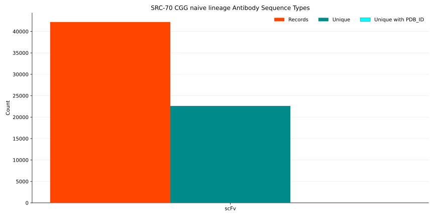
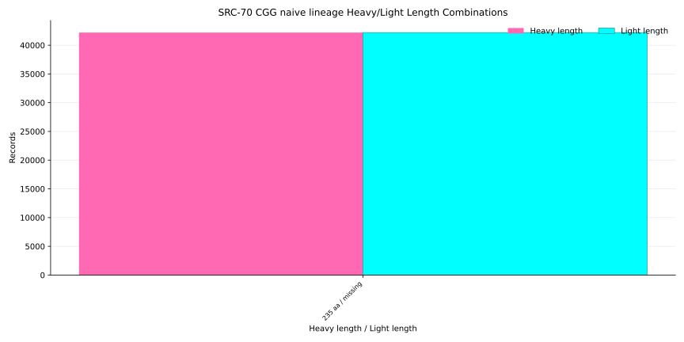
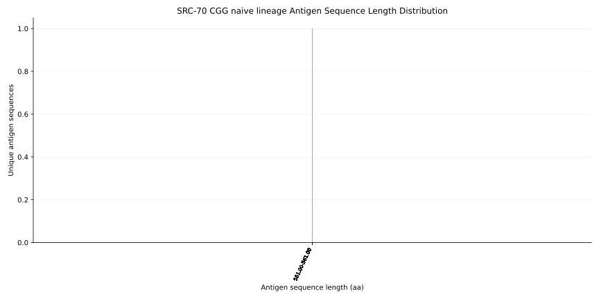

---
tags:
  - context
---

# [SRC-70 CGG naive lineage](../2026-10-29-3a-src-readme/src-70-cggnaive-dms-readme.md)

> 每条 data 统一建模为 `((ab, ag), label, assay, condition, replicate, source)`.
> 本地快照 `G:\abag-datasets\SRC_R71_CGGNAIVE_DMS\snapshot-2025-02-03`, 两个文库 (lib1 / lib2) 的 Tite-Seq 变体表、逐位置突变汇总表、条码调用表, 以及 `paper-linked/` 下一份 27 列的评分表.
> `Unique` 按 **(library, aa_substitutions)** 去重; 变体身份是亲本 scFv 上的替换串, 不是独立序列列.

## Antibody

> 有 Heavy 和 Light 的 `Unique` 字段是 `(heavy, light)` 二元组精确去重. `Unique with PDB_ID` 是按 Unique 后的 sequence 计数.
> Total Unique 计数方式为统一转 string, 如果有 Heavy 和 Light 用 `/` 拼接成 string.

| Key | 含义 | 说明 |
| --- | --- | --- |
| Sequence Type | 抗体序列类型 | 根据原始数据字段、链槽位及已有构建体标签划分的类别. |
| Records | 原始记录数 | 原始数据中的记录数量, 同一序列可能重复出现. |
| Unique | 唯一序列数 | 按对应数据集定义的去重规则统计. |
| Unique with PDB_ID | 关联 PDB 的唯一序列数 | 去重后具有关联 PDB_ID 的序列数量, 不等同于具有可用实验结构监督的序列数量. |
| Description | 类型说明 | 描述分类依据、序列槽位特征及分类限制. |

| Sequence Type | Records | Unique | Unique with PDB_ID | Description |
| --- | --- | --- | --- | --- |
| scFv | 42,203 | 22,624 | 0 | 单链 scFv (VH 112 + linker 15 + VL 108 aa), 以 (library, 替换串) 为唯一单位; Records 是两张变体表 19,579 + 22,624 行之和, Unique 是两者并集 22,624, 变体序列不逐行给出. |
| Total | 42,203 | 22,624 | 0 |  |

> 构建体取源表显式措辞: `data/` 下位点表的列名是 `site_scFv`, 亲本序列 `wildtype_sequence.fasta` 是单条 705 nt 序列, 翻译后 235 aa, 其中 VH 112 aa、`(GGGGS)3` 连接区 15 aa、VL 108 aa; 235 个位点的 `chain` 标注为 H 112 / L 108 / link 15. 因此整条单链记 `scFv`, 表内没有 IgG / Fab 措辞. `Heavy Length` 填整条 scFv 的 235 aa, 轻链槽位不存在, 记 missing; 长度只作描述, 不用来判定构建体.
>
> `Unique with PDB_ID` 记 0: 快照唯一冻结 entry `9ODB` 是同一谱系另一个克隆 (Clone 2.1) 的 Fab, 与亲本 scFv 的 VH 命中 109/112、VL 命中 103/108, 既不是逐字相同的亲本, 也不是二代测序库里的任何构建体; 22,624 个变体没有一个单独解出结构.
>
> 四种表粒度不同, 不合并: `results/` 下的变体评分表 19,579 行与表达表 22,624 行都是 `(library, 变体)` 一行, 后者覆盖前者; 条码调用表 192,429 行是条码到变体调用的映射 (18,586 个不同替换串, 一个变体对应多个条码); `final_variant_scores.csv` 4,800 行是按位点汇总的单点替换 (4,460 个不同 `mutation`). 本表只用前两张作为 Records / Unique, 后两张是同一设计的另一种切分.

| Heavy Length | Light Length | Records | Description |
| --- | --- | --- | --- |
| 235 aa | missing | 42,203 | 亲本整条 scFv 705 nt → 235 aa; 轻链槽位不存在, 突变不改变长度. |

## Antigen

> Antigen 统计以 source-native antigen entity 为核心单位. 优先使用原始 antigen ID/name、construct 和 antigen chain 定义实体; 存在可靠序列时再统计唯一抗原序列.
> 结构、序列和数据库注释压缩到同一张表中, `PDB / UniProt` 采用唯一抗原实体粒度统计 2 × 2 覆盖结果.
> 长度图基于唯一抗原序列, 按该源实际范围平均切分 20 bins.

> 抗原侧按源内读出列名计三个实体: CGG (两个文库共用的主读出)、TuGG、PSR (多反应性试剂); 表内没有抗原序列字段, `target` 列在整张表里恒为 `CGG_naive`.
>
> 只有 CGG 有可归属的参考结构: `9ODB` 的抗原链是完整的鸡 IgY 重链 (561 aa), 结构标题写明 Clone 2.1 Fab 与该重链的 CH2 域结合. TuGG 与 PSR 没有任何结构或序列.

| Records | Unique ag entity | Unique ag sequence | PDB / UniProt coverage | Antigen Length | Antigen Evidence / Provenance | Description |
| --- | --- | --- | --- | --- | --- | --- |
| 29,119 | 3 | 1 | PDB=1/UniProt=0: 1; PDB=0/UniProt=0: 2 | 561 aa (9ODB chicken IgY heavy chain) | Reference PDB / Shared upstream source | 三个实体由读出列名给出: `bind_CGG` (repo 表与 paper-linked 表)、`bind_TuGG`、`psr`. 表内没有抗原序列列, `target` 恒为 `CGG_naive`, 所以实体只到读出列这一层. CGG 的序列取 `9ODB` 的抗原链: 561 aa 鸡 IgY 重链, 结构标题记 Clone 2.1 Fab 与其 CH2 域结合, 属参考复合物, 不是本库实测的重组构建体. TuGG 与 PSR 没有序列, `Unique ag sequence` 只计 1 条. 表内无 UniProt 字段. Records 是 `variant_binding.csv` 19,579 行、`final_variant_scores.csv` 4,800 行与 paper-linked 评分表 4,740 行之和, 即所有带抗原读出的行. |

## Affinity

> 去重口径: 变体行按 **(library, aa_substitutions)**; paper-linked 评分表与 `final_variant_scores` 按 **(chain, mutation)**; BLI 表每行一个选定变体; `Repeat measurements UA` 按构建体去重成 1 对.
>
> `bind_CGG` 等列沿用上游正向尺度, 越大结合越强, 与 `-log10(K_D)` 同方向; 源内没有给出绝对 Kd 的换算, 因此按 `log_Kd` 记, 不写成 `Kd_M`. repo 与 paper-linked 两份 `bind_CGG` 在 4,177 个共享变体上最大差 0.315, 与 `bind_CGG_old` 在 4,379 个共享变体上最大差 2.155: 两份文件是两次拟合, 不互相替换, 也不相加.
>
> paper-linked 表的列结构: `bind_CGG_old` 是被取代的旧拟合, `bind_TuGG` 与 `psr` 是另外两个抗原读出, `expr` 是表达荧光, `delta_*` 是相对亲本的差值; 差值列不另立行.
>
> 复本: 两张变体表没有重复数字段, 记 `unknown`; BLI 表每行只给一次拟合, 记 `unknown`; `Repeat measurements UA` 的 9 行是同一亲本的独立重复.

| Label | Assay | Condition | Replicate | Record pairs | Unique pairs | Description |
| --- | --- | --- | --- | --- | --- | --- |
| `log_Kd` | `NGS_seq` | CGG (`variant_binding.csv`, `bind_CGG`) | unknown:19,579 | 19,579 | 19,579 | `bind_CGG` 4.94-9.61, 1 行一个 (library, 变体); 两库分别 9,427 / 10,152 个变体. `log10fraction_titeseq` 是分箱占用比, 不是第二个端点; `log10expression_titeseq` 属表达侧. |
| `log_Kd` | `NGS_seq` | CGG (`final_variant_scores.csv`, `bind_CGG`) | unknown:4,450 | 4,450 | 4,450 | 4,800 行按位点汇总, 4,460 个不同 `mutation`, 其中 350 行 (60 个 mutation, 主要是 link 位点) 没有结合值, 记缺失; 与 `variant_binding.csv` 是同一批读数的另一种切分, 不相加. |
| `log_Kd` | `NGS_seq` | CGG (paper-linked, `bind_CGG`) | unknown:4,177 | 4,177 | 4,177 | paper-linked 副本的重新拟合, 5.595-9.533; 与 repo 的 `bind_CGG` 在 4,177 个共享变体上最大差 0.315. 同表 `bind_CGG_old` (6.114-11.359) 是被取代的旧拟合, 不另立行. |
| `log_Kd` | `NGS_seq` | TuGG (paper-linked, `bind_TuGG`) | unknown:4,404 | 4,404 | 4,404 | `bind_TuGG` 5.987-9.657; 与同一批变体的 `bind_CGG` 相关 -0.242 (负值), 两个抗原的排序不一致, 不互相替代. `delta_bind_TuGG` 是相对亲本的差值. |
| `log_Kd` | `NGS_seq` | PSR (paper-linked, `psr`) | unknown:4,398 | 4,398 | 4,398 | `psr` 6.104-9.284, 对多反应性试剂的结合读出, 不是单一纯化抗原; 与 `bind_TuGG` 相关 0.831. `delta_psr` 是相对亲本的差值, 不另立行. |
| `Kd_M` | `BLI` | MMC2 选定变体 BLI (Fig. 2H / 2I / 5I) | unknown:52 | 52 | 52 | `KD` (M) 1e-12-1.08e-06 跨三张表 28 + 11 + 13 行; 同表 `ka (1/Ms)` 与 `kdis (1/s)` 是动力学常数, 与 KD 同一次拟合, 不另立行; Fig. 2I 有 6 行 `-` 与 `WT Kappa` 对照无值, 记缺失. |
| `Kd_M` | `BLI` | MMC2 `Repeat measurements UA` (WT 重复滴定) | n=9:9 | 9 | 1 | 9 次独立 WT 滴定 7.79e-09-9.58e-08 M, 同一构建体的重复测量, 唯一配对是 1 个; 表内 `log10 KD` 与 `R^2` 是同一批拟合的另两个表示. |
