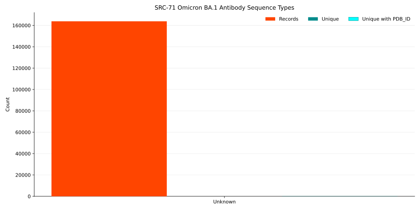
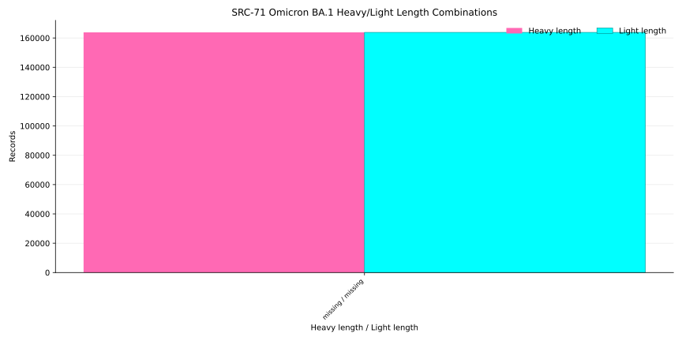
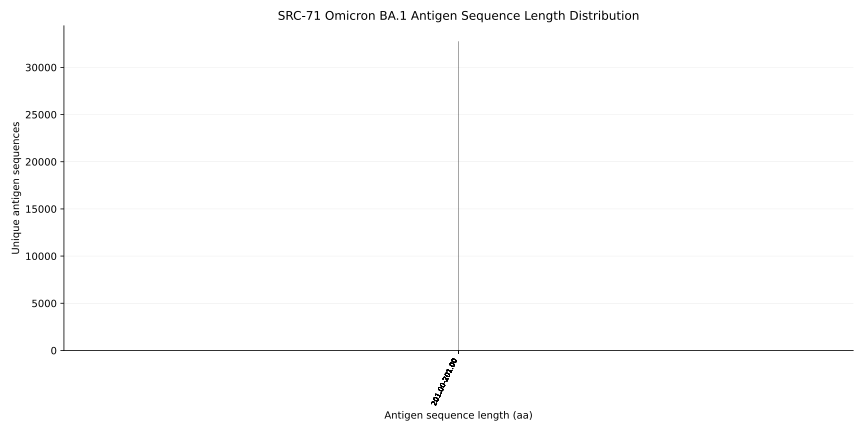

---
- tags:
  - context
---

# SRC-71 Omicron BA.1

> 每条 data 统一建模为 `((ab, ag), label, assay, condition, replicate, source)`.
> 本地快照 `G:\abag-datasets\SRC_R72_OMICRON_AB_LANDSCAPE\snapshot-2023-11-10`, 研究对象是抗原侧: 15 个 Omicron BA.1 替换的 `2^15 = 32,768` 个全组合, 对四株固定抗体与 ACE2 受体各测一张亲和力表.
> 抗体侧不入表: 载荷没有任何抗体序列字段, 五张表各对应一个固定结合物, 抗体单位是结合物本身, 不是序列.

## Antibody

> 有 Heavy 和 Light 的 `Unique` 字段是 `(heavy, light)` 二元组精确去重. `Unique with PDB_ID` 是按 Unique 后的 sequence 计数.
> Total Unique 计数方式为统一转 string, 如果有 Heavy 和 Light 用 `/` 拼接成 string.

| Key | 含义 | 说明 |
| --- | --- | --- |
| Sequence Type | 抗体序列类型 | 根据原始数据字段、链槽位及已有构建体标签划分的类别. |
| Records | 原始记录数 | 原始数据中的记录数量, 同一序列可能重复出现. |
| Unique | 唯一序列数 | 按对应数据集定义的去重规则统计. |
| Unique with PDB_ID | 关联 PDB 的唯一序列数 | 去重后具有关联 PDB_ID 的序列数量, 不等同于具有可用实验结构监督的序列数量. |
| Description | 类型说明 | 描述分类依据、序列槽位特征及分类限制. |

| Sequence Type | Records | Unique | Unique with PDB_ID | Description |
| --- | --- | --- | --- | --- |
| Unknown | 163,840 | 5 | 0 | 五个固定结合物 (四株单抗 + ACE2), 表内无抗体序列也无构建体标注; 逐行变化在变体侧. |
| Total | 163,840 | 5 | 0 |  |

> 构建体记 `Unknown`: 五张亲和力表的列全是 `geno` / 拟合参数 / 荧光分箱, 没有 IgG / Fab / scFv 等构建体字段, 也没有链槽位; 载荷里没有能把任何一行归入具体构建体类别的措辞.
>
> `Unique` 计 5: 每个结合物 (LY-CoV016、LY-CoV555、REGN10987、S309、ACE2) 是一个固定抗体侧对象, 记录行的变化全在另一侧 (被测变体). 因此 `Records` 是五张表的行数之和, `Unique` 是结合物数, 两者不是同一量纲.
>
> `Unique with PDB_ID` 记 0: 载荷没有逐行 PDB 字段; 快照内五个冻结 entry 是各结合物的参考复合物, 记录的是结合物身份而不是抗体序列; 其中的非免疫球蛋白链属另一侧, 不在本表计.

| Heavy Length | Light Length | Records | Description |
| --- | --- | --- | --- |
| missing | missing | 163,840 | 五张表只有 `geno` 与拟合列, 没有抗体链序列; 两侧记 missing. |

## Antigen

> Antigen 统计以 source-native antigen entity 为核心单位. 优先使用原始 antigen ID/name、construct 和 antigen chain 定义实体; 存在可靠序列时再统计唯一抗原序列.
> 结构、序列和数据库注释压缩到同一张表中, `PDB / UniProt` 采用唯一抗原实体粒度统计 2 × 2 覆盖结果.
> 长度图基于唯一抗原序列, 按该源实际范围平均切分 20 bins.

> 抗原实体是 32,768 个基因型对应的 RBD 变体: 身份由 15 位二进制 `geno` 给出, 序列按流程配置的武汉 Hu-1 RBD (201 aa, 残基 331-531) 加 15 个替换重建, 属 `PDB-derived sequence` 之外的规则重建, 记为可复算的重建序列.
>
> 五个冻结复合物的抗原链都是武汉谱系 Spike, 不是本批 BA.1 变体, 因此按参考结构计, 不当作逐变体结构.

| Records | Unique ag entity | Unique ag sequence | PDB / UniProt coverage | Antigen Length | Antigen Evidence / Provenance | Description |
| --- | --- | --- | --- | --- | --- | --- |
| 163,840 | 32,768 | 32,768 | PDB=0/UniProt=0: 32,768 | 201 aa (reconstructed RBD), all 32,768 variants | Direct design + rule-based reconstruction / Reference PDB | 抗原实体按 15 位 `geno` 计, 每个位点对应一个 BA.1 替换 (339 G339D、371 S371L、373 S373P、375 S375F、417 K417N、440 N440K、446 G446S、477 S477N、478 T478K、484 E484A、493 Q493R、496 G496S、498 Q498R、501 N501Y、505 Y505H); 序列由 `compensatory_epistasis_omicron/Titeseq/metadata/config.yaml.RBD` 的 `ancestral_seq` 翻译成 201 aa (起点残基 331), 再按 geno 逐位替换, 32,768 个 geno 对应 32,768 条 201 aa 序列, 无重复. 抗原侧结构只到参考层: `7WPB` 是 BA.1 Spike 与 ACE2 的复合物 (Spike 1,205 aa, ACE2 805 aa), 是全套里唯一使用 BA.1 抗原的条目; `7C01` / `7KMG` / `6XDG` / `6WPT` 的抗原链是 229 / 205 / 251 / 1,281 aa 的武汉谱系 S1 或完整 Spike, 属 `Reference PDB`, 不是被测变体的结构. 实体层面 PDB 覆盖记 0: 201 aa 的 RBD 构建体没有逐变体结构, `7WPB` 的 BA.1 Spike 是 1,205 aa 的全长胞外域, 与这 201 aa 构建体不是同一实体; 它是全套里唯一的 BA.1 参考锚点, 记在 Description 而不计入覆盖. 表内无 UniProt 字段. |

## Affinity

> 去重口径: 每张亲和力表按 **`geno` (15 位基因型)** 去重, 表内 32,768 行即 32,768 个唯一抗原变体; 同一 `geno` 在五张表里是五次不同测量, 不合并.
>
> `log10Kd` 沿用上游定义 `-log10(K_D,app [M])`, 越大结合越强; `log10Kd_pinned` 与它逐行相同, 是同一列. 发布表保留上游原值: 非结合型多为空值, 但也有带值的行 (CB6 261 / CoV555 5,426 / REGN10987 2,173 行). 论文作图时把非结合型设为 5.0, 该替换发生在 `Omicron_ab_Landscape.Rmd` 内, 没有写回发布表, 因此发布表里 5.0 出现 0 次.
>
> 复本: 四个抗体的表各两次 experiment (CB6 `i`/`j`、CoV555 `e`/`v`、REGN10987 `g`/`h`、S309 `c`/`d`), ACE2 三次 (`a`/`b`/`x`); 有标签的行里参与汇总的 experiment 数写在 `Replicate`.
>
> `data/lasso_prediction_*` 是 32,768 行逐基因型模型预测与系数表, `CV_rsquared.csv` 与 `fig4_phylogeny.csv` 是模型评估与系统发生对照, 都属派生结果, 不产生测量行.

| Label | Assay | Condition | Replicate | Record pairs | Unique pairs | Description |
| --- | --- | --- | --- | --- | --- | --- |
| `log_Kd` | `NGS_seq` | LY-CoV016 (CB6) x 32,768 基因型 | n=1:732; n=2:15,779 | 16,511 | 16,511 | `log10Kd` = -log10(K_D,app/M), 5.000-10.561; 5.0 出现 0 次 (作图钉值未写回). `is_non_binder` 16,470 行由荧光判据 (max-min log10PE < 1) 判为非结合; `is_clean` 15,760 行要求两次拟合同时 r² ≥ 0.8 且 SE ≤ 1; 空值不是阴性. |
| `log_Kd` | `NGS_seq` | LY-CoV555 x 32,768 基因型 | n=1:4,317; n=2:15,550 | 19,867 | 19,867 | `log10Kd` = -log10(K_D,app/M), 5.000-10.659; 5.0 出现 0 次 (作图钉值未写回). `is_non_binder` 17,898 行由荧光判据 (max-min log10PE < 1) 判为非结合; `is_clean` 13,088 行要求两次拟合同时 r² ≥ 0.8 且 SE ≤ 1; 空值不是阴性. |
| `log_Kd` | `NGS_seq` | REGN10987 x 32,768 基因型 | n=1:3,662; n=2:20,024 | 23,686 | 23,686 | `log10Kd` = -log10(K_D,app/M), 7.109-10.805; 5.0 出现 0 次 (作图钉值未写回). `is_non_binder` 10,837 行由荧光判据 (max-min log10PE < 1) 判为非结合; `is_clean` 19,888 行要求两次拟合同时 r² ≥ 0.8 且 SE ≤ 1; 空值不是阴性. |
| `log_Kd` | `NGS_seq` | S309 x 32,768 基因型 | n=1:166; n=2:32,602 | 32,768 | 32,768 | `log10Kd` = -log10(K_D,app/M), 7.686-10.013; 5.0 出现 0 次 (作图钉值未写回). 该表没有一行被判为非结合型. `is_clean` 32,602 行要求两次拟合同时 r² ≥ 0.8 且 SE ≤ 1; 空值不是阴性. |
| `log_Kd` | `flow` | ACE2 (receptor) x 32,768 基因型 | n=1:9; n=2:128; n=3:32,631 | 32,768 | 32,768 | ACE2 是受体不是抗体, 这一行记的是同一批 RBD 变体对受体的读出, 不参与抗体侧计数. `log10Kd` = -log10(K_D,app/M), 6.036-10.040; 5.0 出现 0 次 (作图钉值未写回). 该表没有一行被判为非结合型. 该表没有 `is_clean` 列, 按 Rmd 的处理全部视为结合型. |
| `predicted` | `computational` | LY-CoV016 (CB6) lasso 预测 (32,768 基因型) | — | 0 | 0 | `Predicted Kd` 覆盖全部 32,768 个基因型, 值域 4.117 至 10.428, 其中 `Actual Kd` 非空 16,511 行; 模型对没有实测的基因型也给值, 因此不计入测量行, 也不与上面的实测行相加. |
| `predicted` | `computational` | LY-CoV555 lasso 预测 (32,768 基因型) | — | 0 | 0 | `Predicted Kd` 覆盖全部 32,768 个基因型, 值域 -3.651 至 10.236, 其中 `Actual Kd` 非空 19,867 行; 模型对没有实测的基因型也给值, 因此不计入测量行, 也不与上面的实测行相加. |
| `predicted` | `computational` | REGN10987 lasso 预测 (32,768 基因型) | — | 0 | 0 | `Predicted Kd` 覆盖全部 32,768 个基因型, 值域 1.419 至 10.489, 其中 `Actual Kd` 非空 23,686 行; 模型对没有实测的基因型也给值, 因此不计入测量行, 也不与上面的实测行相加. |
| `predicted` | `computational` | S309 lasso 预测 (32,768 基因型) | — | 0 | 0 | `Predicted Kd` 覆盖全部 32,768 个基因型, 值域 8.154 至 9.848, 其中 `Actual Kd` 非空 32,768 行; 模型对没有实测的基因型也给值, 因此不计入测量行, 也不与上面的实测行相加. |
