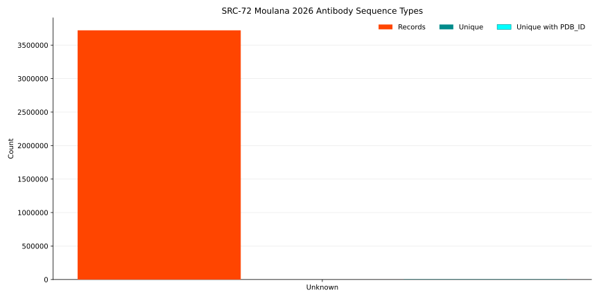
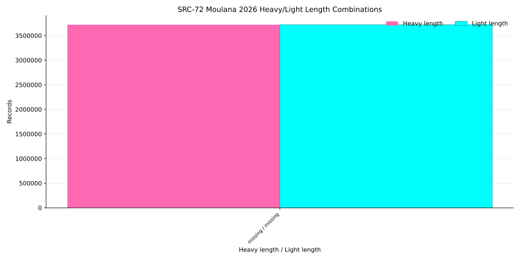
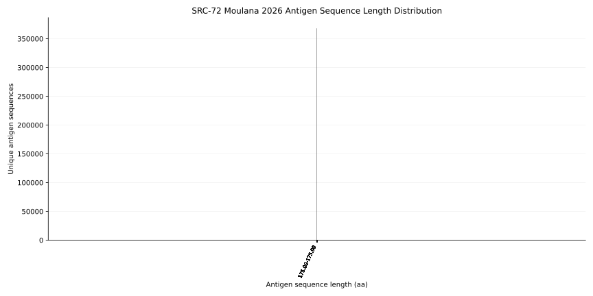

---
- tags:
  - context
---

# SRC-72 Moulana 2026

> 每条 data 统一建模为 `((ab, ag), label, assay, condition, replicate, source)`.
> 本地快照 `G:\abag-datasets\SRC_R73_BACKGROUND_DEPENDENCE_SARS_COV2\snapshot-2026-02-13`, `File_Details.csv` 索引的 51 张表型表全部落地, 合计 4,795,558 行, 分属 B / C / M 三个 RBD 组合突变文库.
> `Unique` 计 8: 表内只有配体名 (抗体), 没有任何抗体序列或链槽位, 抗体单位是配体标签本身.

## Antibody

> 有 Heavy 和 Light 的 `Unique` 字段是 `(heavy, light)` 二元组精确去重. `Unique with PDB_ID` 是按 Unique 后的 sequence 计数.
> Total Unique 计数方式为统一转 string, 如果有 Heavy 和 Light 用 `/` 拼接成 string.

| Key | 含义 | 说明 |
| --- | --- | --- |
| Sequence Type | 抗体序列类型 | 根据原始数据字段、链槽位及已有构建体标签划分的类别. |
| Records | 原始记录数 | 原始数据中的记录数量, 同一序列可能重复出现. |
| Unique | 唯一序列数 | 按对应数据集定义的去重规则统计. |
| Unique with PDB_ID | 关联 PDB 的唯一序列数 | 去重后具有关联 PDB_ID 的序列数量, 不等同于具有可用实验结构监督的序列数量. |
| Description | 类型说明 | 描述分类依据、序列槽位特征及分类限制. |

| Sequence Type | Records | Unique | Unique with PDB_ID | Description |
| --- | --- | --- | --- | --- |
| Unknown | 3,720,854 | 8 | 3 | 八株抗体以配体名出现, 无抗体序列也无构建体字段; 其中 3 株有参考 Fab 复合物 (7L7E 两株, 7MMO 一株). |
| Total | 3,720,854 | 8 | 3 |  |

> 构建体记 `Unknown`: 51 张表的列全是表型值、标准差、位点列与基因型序列, 没有 IgG / Fab / scFv 字段, 也没有抗体序列; 载荷没有能把任何一行归入具体构建体类别的措辞.
>
> `Records` 是八株抗体作为配体的行数 (3,720,854), 不含 ACE2 的 539,047 行与表达测定的 535,657 行: ACE2 是受体不是抗体, 表达测定的对象是展示量而不是配对读数. 两个被排除的块记在 Antigen 与 Affinity 侧.
>
> `Unique with PDB_ID` 按配体计 3, 是参考复合物覆盖而不是逐行结构: 快照三个冻结 entry 里, `7L7E` 同时含 AZD8895 与 AZD1061 两个 Fab, `7MMO` 含 LY-CoV-1404 Fab, 覆盖 8 株中的 3 株; 其余五株 (REGN10987、S309、002-S21F2、Iv0221、Iv0262) 没有任何复合物结构. 这些结构是参考复合物, 不对应任何一行测量.
>
> 长度列两侧均记 `missing`: 表内没有抗体链序列, 位点列也只覆盖被测变体一侧.

| Heavy Length | Light Length | Records | Description |
| --- | --- | --- | --- |
| missing | missing | 3,720,854 | 51 张表只有被测变体的位点列与序列, 没有抗体链序列; 两侧记 missing. |

## Antigen

> Antigen 统计以 source-native antigen entity 为核心单位. 优先使用原始 antigen ID/name、construct 和 antigen chain 定义实体; 存在可靠序列时再统计唯一抗原序列.
> 结构、序列和数据库注释压缩到同一张表中, `PDB / UniProt` 采用唯一抗原实体粒度统计 2 × 2 覆盖结果.
> 长度图基于唯一抗原序列, 按该源实际范围平均切分 20 bins.

> 抗原实体是三个文库的 RBD 变体, 身份取 `aa_geno` (175 aa, 起点残基 331); 序列逐字由发布表给出, `-` 是上游对 3 nt 缺失的占位符.
>
> 三个冻结 entry 的抗原链都是武汉谱系 Spike S1 或全长 Spike, 属论文制图用的参考结构, 不是本批变体的结构.

| Records | Unique ag entity | Unique ag sequence | PDB / UniProt coverage | Antigen Length | Antigen Evidence / Provenance | Description |
| --- | --- | --- | --- | --- | --- | --- |
| 4,795,558 | 368,215 | 368,215 | PDB=0/UniProt=0: 368,215 | 175 aa (all variants); 155,750 carry one `-` placeholder | Direct sequence / Source-native | 51 张表的 `aa_geno` 逐行给出 175 aa RBD 序列; 三个文库的去重序列数分别为 B 1,175、C 56,479、M 311,927, 三者并集 368,215, 交集非空 (B 有 386 条、C 有 55,917 条不在 M 里, M 与 B 共享 789 条), 因此按并集计实体与唯一序列, 不求和. 155,750 条序列含一个 `-`, 是上游对 3 nt 缺失的占位符, 仍是 175 个字符; 按原样计长度. 抗原侧 PDB 覆盖记 0: `7WHH` 的 RBD 链 194 aa、`7L7E` 215 aa、`7MMO` 205 aa 都是武汉谱系 Spike S1 构建体, 论文用它们展示突变位点的空间分布, 不是 368,215 个变体中任何一个的结构. 表内无 UniProt 字段. |

## Affinity

> 去重口径: 每组 (表型, 配体) 内按 **`aa_geno`** 去重; 同一序列在不同表型或不同配体下是不同测量, 不合并.
>
> 三类表型互不换算: `KD` 是 Tite-Seq 滴定的 `-log10(K_D,app / M)` 尺度 (B 与 C 的 ACE2 表, 值域 5.0-11.9, 弱端钉在 5.0); `Fluor at 1uM` / `Fluor at 10nM` / `Fluor at 100nM` 是单一浓度下的平均对数荧光; `Enrichment at 100nM` 是单分箱富集分数 (可为负, 也可大于 1).
>
> `Fluor RBD` (535,657 行) 是表达标签自身的荧光, 不是结合测量, 不入本表. `File_Details.csv` 把 `XABA_ACE2_rep_c` 列为文件名, 磁盘上实际是 `XABA_ACE2_rep_d`, 该表仍按 ACE2 的 KD 处理.
>
> `sort` 列只标分组 (`a`/`b`/`d`/`NA`), 不标重复次数; `Replicate` 的 n 是同一序列在几份发布文件里出现, 是文件级重复而非实验级重复, 因此 `unknown` 不出现.

| Label | Assay | Condition | Replicate | Record pairs | Unique pairs | Description |
| --- | --- | --- | --- | --- | --- | --- |
| `log_Kd` | `NGS_seq` | ACE2 x RBD 变体 (KD) | n=1:49,563; n=2:2,005; n=3:27; n=4:9 | 53,690 | 50,398 | `ph_mean` = -log10(K_D,app/M), Tite-Seq 滴定; 按 `aa_geno` 去重后 50,398 条唯一序列; 表内 `ph_sd` 是同一读出的标准差. |
| `log_Kd` | `NGS_seq` | AZD1061 x RBD 变体 (KD) | n=1:2,247; n=2:56; n=3:3 | 2,368 | 1,154 | `ph_mean` = -log10(K_D,app/M), Tite-Seq 滴定; 按 `aa_geno` 去重后 1,154 条唯一序列; 表内 `ph_sd` 是同一读出的标准差. |
| `log_Kd` | `NGS_seq` | AZD8895 x RBD 变体 (KD) | n=1:2,177; n=2:108; n=3:16; n=4:7 | 2,469 | 1,156 | `ph_mean` = -log10(K_D,app/M), Tite-Seq 滴定; 按 `aa_geno` 去重后 1,156 条唯一序列; 表内 `ph_sd` 是同一读出的标准差. |
| `log_Kd` | `NGS_seq` | REGN10987 x RBD 变体 (KD) | n=1:1,929; n=2:297; n=3:82; n=4:14 | 2,825 | 1,170 | `ph_mean` = -log10(K_D,app/M), Tite-Seq 滴定; 按 `aa_geno` 去重后 1,170 条唯一序列; 表内 `ph_sd` 是同一读出的标准差. |
| `enrichment` | `NGS_seq` | AZD1061 x RBD 变体 (Fluor at 1uM) | n=1:105,994; n=2:2,100; n=3:25; n=4:4; n=5:1 | 110,290 | 55,010 | `ph_mean` 是 Fluor at 1uM 单浓度下的平均对数荧光, 不是 Kd; 按 `aa_geno` 去重后 55,010 条唯一序列; 该表没有 `ph_sd` 列. |
| `enrichment` | `NGS_seq` | AZD8895 x RBD 变体 (Fluor at 1uM) | n=1:98,361; n=2:5,408; n=3:136; n=4:31; n=5:5 | 109,734 | 53,291 | `ph_mean` 是 Fluor at 1uM 单浓度下的平均对数荧光, 不是 Kd; 按 `aa_geno` 去重后 53,291 条唯一序列; 该表没有 `ph_sd` 列. |
| `enrichment` | `NGS_seq` | LY-CoV-1404 x RBD 变体 (Fluor at 1uM) | n=1:98,153; n=2:4,826; n=3:121; n=4:22; n=5:3 | 108,271 | 53,727 | `ph_mean` 是 Fluor at 1uM 单浓度下的平均对数荧光, 不是 Kd; 按 `aa_geno` 去重后 53,727 条唯一序列; 该表没有 `ph_sd` 列. |
| `enrichment` | `NGS_seq` | REGN10987 x RBD 变体 (Fluor at 1uM) | n=1:99,782; n=2:5,418; n=3:123; n=4:25 | 111,087 | 53,764 | `ph_mean` 是 Fluor at 1uM 单浓度下的平均对数荧光, 不是 Kd; 按 `aa_geno` 去重后 53,764 条唯一序列; 该表没有 `ph_sd` 列. |
| `enrichment` | `NGS_seq` | S309 x RBD 变体 (Fluor at 1uM) | n=1:97,412; n=2:4,010; n=3:73; n=4:16 | 105,715 | 52,692 | `ph_mean` 是 Fluor at 1uM 单浓度下的平均对数荧光, 不是 Kd; 按 `aa_geno` 去重后 52,692 条唯一序列; 该表没有 `ph_sd` 列. |
| `enrichment` | `NGS_seq` | AZD1061 x RBD 变体 (Fluor at 10nM) | n=1:106,508; n=2:1,444; n=3:18; n=4:2; n=5:1 | 109,463 | 54,819 | `ph_mean` 是 Fluor at 10nM 单浓度下的平均对数荧光, 不是 Kd; 按 `aa_geno` 去重后 54,819 条唯一序列; 该表没有 `ph_sd` 列. |
| `enrichment` | `NGS_seq` | AZD8895 x RBD 变体 (Fluor at 10nM) | n=1:93,756; n=2:5,066; n=3:151; n=4:34; n=5:4 | 104,497 | 51,184 | `ph_mean` 是 Fluor at 10nM 单浓度下的平均对数荧光, 不是 Kd; 按 `aa_geno` 去重后 51,184 条唯一序列; 该表没有 `ph_sd` 列. |
| `enrichment` | `NGS_seq` | LY-CoV-1404 x RBD 变体 (Fluor at 10nM) | n=1:101,057; n=2:5,484; n=3:120; n=4:26; n=5:4 | 112,509 | 54,683 | `ph_mean` 是 Fluor at 10nM 单浓度下的平均对数荧光, 不是 Kd; 按 `aa_geno` 去重后 54,683 条唯一序列; 该表没有 `ph_sd` 列. |
| `enrichment` | `NGS_seq` | REGN10987 x RBD 变体 (Fluor at 10nM) | n=1:100,540; n=2:5,343; n=3:117; n=4:22; n=5:1 | 111,670 | 54,159 | `ph_mean` 是 Fluor at 10nM 单浓度下的平均对数荧光, 不是 Kd; 按 `aa_geno` 去重后 54,159 条唯一序列; 该表没有 `ph_sd` 列. |
| `enrichment` | `NGS_seq` | S309 x RBD 变体 (Fluor at 10nM) | n=1:97,974; n=2:4,660; n=3:87; n=4:19; n=5:1 | 107,636 | 53,479 | `ph_mean` 是 Fluor at 10nM 单浓度下的平均对数荧光, 不是 Kd; 按 `aa_geno` 去重后 53,479 条唯一序列; 该表没有 `ph_sd` 列. |
| `enrichment` | `NGS_seq` | ACE2 x RBD 变体 (Fluor at 100nM) | n=1:481,371; n=2:1,912; n=3:39; n=4:5; n=5:2; n=6:1; n=9:1 | 485,357 | 311,927 | `ph_mean` 是 Fluor at 100nM 单浓度下的平均对数荧光, 不是 Kd; 按 `aa_geno` 去重后 311,927 条唯一序列; 表内 `ph_sd` 是同一读出的标准差. |
| `enrichment` | `NGS_seq` | 002-S21F2 x RBD 变体 (Enrichment at 100nM) | n=1:327,176; n=2:304; n=3:2 | 327,790 | 201,419 | `ph_mean` 是单分箱富集分数, 可为负也可大于 1, 不跨抗体比较绝对值; 按 `aa_geno` 去重后 201,419 条唯一序列; 该表没有 `ph_sd` 列. |
| `enrichment` | `NGS_seq` | AZD1061 x RBD 变体 (Enrichment at 100nM) | n=1:327,176; n=2:304; n=3:2 | 327,790 | 201,419 | `ph_mean` 是单分箱富集分数, 可为负也可大于 1, 不跨抗体比较绝对值; 按 `aa_geno` 去重后 201,419 条唯一序列; 该表没有 `ph_sd` 列. |
| `enrichment` | `NGS_seq` | AZD8895 x RBD 变体 (Enrichment at 100nM) | n=1:327,176; n=2:304; n=3:2 | 327,790 | 201,419 | `ph_mean` 是单分箱富集分数, 可为负也可大于 1, 不跨抗体比较绝对值; 按 `aa_geno` 去重后 201,419 条唯一序列; 该表没有 `ph_sd` 列. |
| `enrichment` | `NGS_seq` | Iv0221 x RBD 变体 (Enrichment at 100nM) | n=1:327,176; n=2:304; n=3:2 | 327,790 | 201,419 | `ph_mean` 是单分箱富集分数, 可为负也可大于 1, 不跨抗体比较绝对值; 按 `aa_geno` 去重后 201,419 条唯一序列; 该表没有 `ph_sd` 列. |
| `enrichment` | `NGS_seq` | Iv0262 x RBD 变体 (Enrichment at 100nM) | n=1:327,176; n=2:304; n=3:2 | 327,790 | 201,419 | `ph_mean` 是单分箱富集分数, 可为负也可大于 1, 不跨抗体比较绝对值; 按 `aa_geno` 去重后 201,419 条唯一序列; 该表没有 `ph_sd` 列. |
| `enrichment` | `NGS_seq` | LY-CoV-1404 x RBD 变体 (Enrichment at 100nM) | n=1:327,176; n=2:304; n=3:2 | 327,790 | 201,419 | `ph_mean` 是单分箱富集分数, 可为负也可大于 1, 不跨抗体比较绝对值; 按 `aa_geno` 去重后 201,419 条唯一序列; 该表没有 `ph_sd` 列. |
| `enrichment` | `NGS_seq` | REGN10987 x RBD 变体 (Enrichment at 100nM) | n=1:327,176; n=2:304; n=3:2 | 327,790 | 201,419 | `ph_mean` 是单分箱富集分数, 可为负也可大于 1, 不跨抗体比较绝对值; 按 `aa_geno` 去重后 201,419 条唯一序列; 该表没有 `ph_sd` 列. |
| `enrichment` | `NGS_seq` | S309 x RBD 变体 (Enrichment at 100nM) | n=1:327,176; n=2:304; n=3:2 | 327,790 | 201,419 | `ph_mean` 是单分箱富集分数, 可为负也可大于 1, 不跨抗体比较绝对值; 按 `aa_geno` 去重后 201,419 条唯一序列; 该表没有 `ph_sd` 列. |
