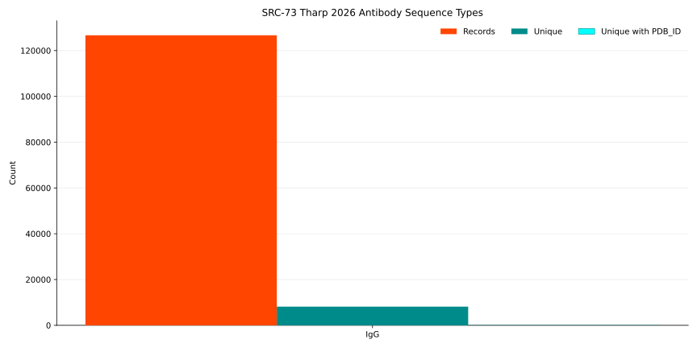
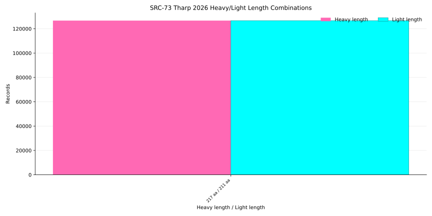
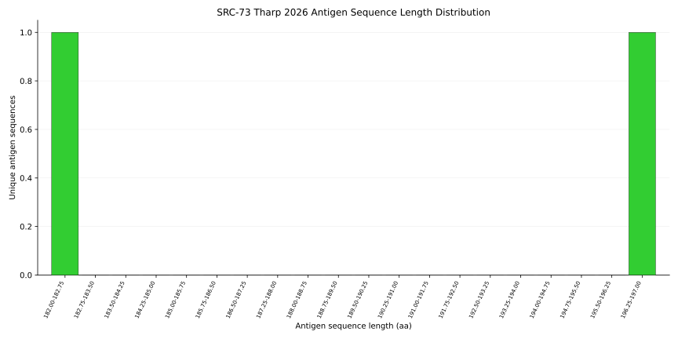

---
tags:
  - context
---

# SRC-73 Tharp 2026

> 每条 data 统一建模为 `((ab, ag), label, assay, condition, replicate, source)`.
> 本地快照 `G:\abag-datasets\SRC_R74_OMI32_BIOPHY_SEQ\snapshot-2026-05-30`, 对象是 Omi32 谱系 13 个二元位点的组合库 (`2^13 = 8,192` 个设计), 在 HEK 细胞表面以全长 IgG 形式展示.
> `Unique` 取 13 位 `geno` 串; 五张 cleaned 表各自的行数就是该表保留下来的基因型数, 不能相加成独立抗体数.

## Antibody

> 有 Heavy 和 Light 的 `Unique` 字段是 `(heavy, light)` 二元组精确去重. `Unique with PDB_ID` 是按 Unique 后的 sequence 计数.
> Total Unique 计数方式为统一转 string, 如果有 Heavy 和 Light 用 `/` 拼接成 string.

| Key | 含义 | 说明 |
| --- | --- | --- |
| Sequence Type | 抗体序列类型 | 根据原始数据字段、链槽位及已有构建体标签划分的类别. |
| Records | 原始记录数 | 原始数据中的记录数量, 同一序列可能重复出现. |
| Unique | 唯一序列数 | 按对应数据集定义的去重规则统计. |
| Unique with PDB_ID | 关联 PDB 的唯一序列数 | 去重后具有关联 PDB_ID 的序列数量, 不等同于具有可用实验结构监督的序列数量. |
| Description | 类型说明 | 描述分类依据、序列槽位特征及分类限制. |

| Sequence Type | Records | Unique | Unique with PDB_ID | Description |
| --- | --- | --- | --- | --- |
| IgG | 126,684 | 8,152 | 1 | HEK 细胞表面展示的全长 IgG (VH-CH1-CH2-CH3 + P2A + VL-CK + myc); 变体以 13 位 geno 表示, 逐变体序列不在表内. |
| Total | 126,684 | 8,152 | 1 |  |

> 构建体取源文显式措辞: Methods 写明展示构建体是 signal peptide + 重链可变区与恒定区 + 合成跨膜域 + P2A + 第二个 signal peptide + 轻链可变区与恒定区 + C 端 myc 标签, 并在 HEK 细胞上展示全长 IgG; 建库质粒图谱的 `gene` 段也覆盖 VH-CH1-CH2-CH3 与 VL-CK. 因此全表记 `IgG`, 这是构建体层面的措辞, 不是由序列长度推断.
>
> `Records` 取条码到设计基因型的映射表 126,684 行: 它逐条码给出 `binary_genotypes`, 是库里记录的原始粒度; 五张表型表每行是一个设计基因型在该表型下的汇总, 记为 `Unique`.
>
> `Unique` 是五张 cleaned 表的 `geno` 并集 8,152: 五张表各自的保留数为 6,740 / 7,037 / 7,416 / 8,150 / 5,510. 并集比设计空间 8,192 少 40 个基因型, 这 40 个只在预测表里出现.
>
> `Unique with PDB_ID` 按构建体计 1: 五个冻结 entry 是 germline 与 Omi32 的 Fab (含 LC-kappa VHH 辅助链) 或游离 Fab 复合物, 覆盖这一个亲本体系; 8,152 个设计变体没有一个单独解出结构.
>
> 长度取自参考结构: `11OR` 的 Omi32 重链 217 aa、轻链 211 aa; `11OU` 的 germline 重链 219 aa、轻链 214 aa. 变体序列本身不在表内, 长度只作描述.

| Heavy Length | Light Length | Records | Description |
| --- | --- | --- | --- |
| 217 aa | 211 aa | 126,684 | Omi32 重链 / 轻链长度取参考结构 `11OR`; germline 体系为 219 / 214 aa, 变体不改变长度. |

## Antigen

> Antigen 统计以 source-native antigen entity 为核心单位. 优先使用原始 antigen ID/name、construct 和 antigen chain 定义实体; 存在可靠序列时再统计唯一抗原序列.
> 结构、序列和数据库注释压缩到同一张表中, `PDB / UniProt` 采用唯一抗原实体粒度统计 2 × 2 覆盖结果.
> 长度图基于唯一抗原序列, 按该源实际范围平均切分 20 bins.

> 抗原实体按 source-native 标签计: Wuhan RBD、Omicron BA.1 RBD、Omicron BA.4 RBD, 由 cleaned 表的列名 (`wuhan_` / `ba1_` / `ba4_`) 给出; 表内没有抗原序列列.
>
> 五个冻结 entry 里 `11OQ` 含 BA.1 Spike (182 aa)、`11OL` / `11OO` 含 BA.4 Spike (197 aa); `11OR` / `11OU` 只有抗体侧 (含 LC-kappa VHH 辅助链), Wuhan RBD 没有任何结构锚点.

| Records | Unique ag entity | Unique ag sequence | PDB / UniProt coverage | Antigen Length | Antigen Evidence / Provenance | Description |
| --- | --- | --- | --- | --- | --- | --- |
| 34,853 | 3 | 2 | PDB=1/UniProt=0: 2; PDB=0/UniProt=0: 1 | 182-197 aa (BA.1 / BA.4 reference Spike chains) | Reference PDB / Fixed target | 三个实体是 Wuhan RBD、Omicron BA.1 RBD、Omicron BA.4 RBD, 由 cleaned 表的列名与论文实验设计给出; 表达表与多反应性表测的是抗体侧性质, 不另立抗原实体, 但它们的行仍计入 Records. 抗原序列只取到参考层: `11OQ` 的 BA.1 Spike 182 aa、`11OL` 与 `11OO` 的 BA.4 Spike 197 aa, 因此 `Unique ag sequence` 计 2; Wuhan RBD 在这一批判定的复合物里没有链, 记 `PDB=0` 且序列 unavailable. 两条参考链都是 RBD 片段构建体, 不是 8,192 个变体中任何一个的抗原结构. 表内无 UniProt 字段. Records 是五张 cleaned 表的行数之和 (6,740 + 7,037 + 7,416 + 8,150 + 5,510). |

## Affinity

> 去重口径: 每张 cleaned 表按 **`geno` (13 位基因型)** 去重, 行数与唯一 `geno` 数相等; 同一 `geno` 在不同表型下是不同测量, 不合并.
>
> `log10Kd` 按源内定义存 `-log10(K_D/M)`, 越大结合越强; `7.0` 是检测下界钉值 (Wuhan 1,002 / BA.1 318 / BA.4 1,634 行), 这些行的 `_sem` 为 0 (999 / 316 / 1,631 行), 是边界而不是精确读数. 每行是两个生物重复的均值, 两列都非空.
>
> 多反应性表的 `mean_EC50_3p` 与 `SEM_EC50_3p` 由两个 `PSR_log10EC50` 重复值算出 (逐行等于两者均值); 试剂浓度以 mg/mL 表示, 汇总值在 log 尺度. `expr_mednorm_mean` (8,150 行) 是批次中位数校正后的表达荧光, 相对尺度, 不是亲和力, 不入本表.
>
> `epistasis_inference/` 的五张 `*_predictions.csv` 各 8,192 行, 覆盖没有实测的基因型; 浏览器 `data/Omi32.csv` 与四个 Arrow 是同一批数值的展示副本, 方向与仓库输出不同, 都不产生测量行.

| Label | Assay | Condition | Replicate | Record pairs | Unique pairs | Description |
| --- | --- | --- | --- | --- | --- | --- |
| `log_Kd` | `flow` | WUHAN RBD x 8,192 设计 | n=2:6,740 | 6,740 | 6,740 | `wuhan_log10Kd_mean` = -log10(K_D/M), 7.00-10.09; 1,002 行钉在检测下界 7.0 (其中 999 行 SEM=0); 每行两个生物重复, `z_used` 过滤阈值 1.8. |
| `log_Kd` | `flow` | BA1 RBD x 8,192 设计 | n=2:7,037 | 7,037 | 7,037 | `ba1_log10Kd_mean` = -log10(K_D/M), 7.00-10.25; 318 行钉在检测下界 7.0 (其中 316 行 SEM=0); 每行两个生物重复, `z_used` 过滤阈值 3.4. |
| `log_Kd` | `flow` | BA4 RBD x 8,192 设计 | n=2:7,416 | 7,416 | 7,416 | `ba4_log10Kd_mean` = -log10(K_D/M), 7.00-9.50; 1,634 行钉在检测下界 7.0 (其中 1,631 行 SEM=0); 每行两个生物重复, `z_used` 过滤阈值 1.9. |
| `EC50` | `flow` | PSR 多反应性 x 8,192 设计 | n=2:5,510 | 5,510 | 5,510 | `mean_EC50_3p` -0.43-3.04, 逐行等于两个 `PSR_log10EC50` 重复值的均值; 多反应性结合曲线的半数有效浓度, 对数尺度, 与 Kd 不同量纲. |
| `EC50` | `flow` | 低通量 PSR 复核 (10 株) | n=2:10 | 10 | 10 | `mean_log_EC50` -1.459 至 -0.892 (3 参数) 与 -1.756 至 -1.074 (4 参数); 同一批滴定的两种拟合, 不互换, 也不与高通量表相加. |
| `Kd_M` | `BLI` | 低通量 BLI 复核 (10 株) | n=2:6 | 6 | 6 | `*_lt_mean` 6 行有值 (Wuhan / BA.1 / BA.4 各 6), 是选定变体的独立 BLI 复测; `*_lt_sem` 0.00-0.15. 其余 4 行只有部分抗原没有值, `5469` 三个抗原全空. |
| `predicted` | `computational` | wuhan lasso 预测 (8,192 设计) | — | 0 | 0 | `predicted_phenotype` 5.851 至 9.928, 覆盖全部 8,192 个设计点, 没有实测值的基因型也给预测; 模型输出, 不与实测行相加. |
| `predicted` | `computational` | ba1 lasso 预测 (8,192 设计) | — | 0 | 0 | `predicted_phenotype` 6.509 至 9.947, 覆盖全部 8,192 个设计点, 没有实测值的基因型也给预测; 模型输出, 不与实测行相加. |
| `predicted` | `computational` | ba4 lasso 预测 (8,192 设计) | — | 0 | 0 | `predicted_phenotype` 6.63 至 9.422, 覆盖全部 8,192 个设计点, 没有实测值的基因型也给预测; 模型输出, 不与实测行相加. |
| `predicted` | `computational` | expression lasso 预测 (8,192 设计) | — | 0 | 0 | `predicted_phenotype` 3.817 至 4.422, 覆盖全部 8,192 个设计点, 没有实测值的基因型也给预测; 模型输出, 不与实测行相加. |
| `predicted` | `computational` | psr lasso 预测 (8,192 设计) | — | 0 | 0 | `predicted_phenotype` 0.929 至 2.229, 覆盖全部 8,192 个设计点, 没有实测值的基因型也给预测; 模型输出, 不与实测行相加. |
