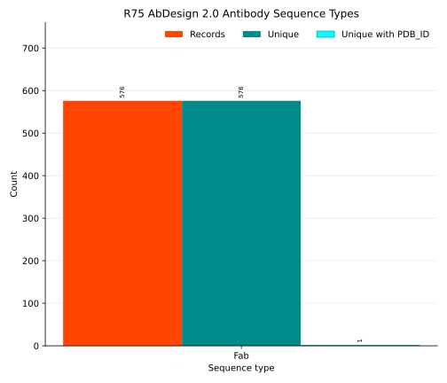
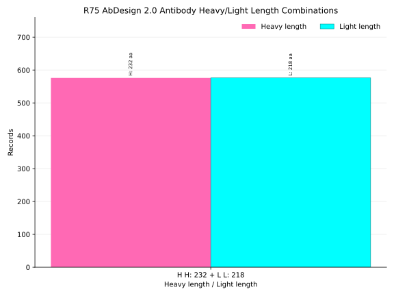
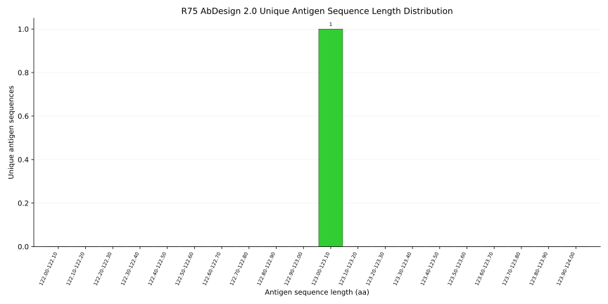

---
tags:
  - context
---

# [SRC-74 AbDesign 2.0](../2026-10-29-3a-src-readme/src-74-abdesign2-readme.md)

> 每条 data 统一建模为 `((ab, ag), label, assay, condition, replicate, source)`.
> 本地快照 `G:\abag-datasets\SRC_R75_ABDESIGN2\snapshot-2026-02-23`, `pd_1/affinity.csv` 576 行, 另有 5 张 developability 表.
> `Unique` 为 `(heavy, light)` 二元组精确去重, 全表 1:1 唯一.

## Antibody

> 有 Heavy 和 Light 的 `Unique` 字段是 `(heavy, light)` 二元组精确去重. `Unique with PDB_ID` 是按 Unique 后的 sequence 计数.
> Total Unique 计数方式为统一转 string, 如果有 Heavy 和 Light 用 `/` 拼接成 string.

| Key | 含义 | 说明 |
| --- | --- | --- |
| Sequence Type | 抗体序列类型 | 根据原始数据字段、链槽位及已有构建体标签划分的类别. |
| Records | 原始记录数 | 原始数据中的记录数量, 同一序列可能重复出现. |
| Unique | 唯一序列数 | 按对应数据集定义的去重规则统计. |
| Unique with PDB_ID | 关联 PDB 的唯一序列数 | 去重后具有关联 PDB_ID 的序列数量, 不等同于具有可用实验结构监督的序列数量. |
| Description | 类型说明 | 描述分类依据、序列槽位特征及分类限制. |

| Sequence Type | Records | Unique | Unique with PDB_ID | Description |
| --- | --- | --- | --- | --- |
| Fab | 576 | 576 | 1 | Pembrolizumab 重链单点突变集; `heavy_sequence` 232 aa 为 VH-CH1 加铰链片段, 末尾带 `HHHHHH`; `light_sequence` 恒为 218 aa. 构建体类型取自 README 的 Fab 表述, 不靠链长反推. |
| Total | 576 | 576 | 1 | |

> 抗体单元是 576 个唯一突变 Fab. 全部记录只有 1 个 PDB entry `5GGS`, 即亲本 pembrolizumab Fab–PD-1 复合物; 没有单独为任何突变体解出的结构.

`affinity.csv` 另有 2 行 `Negative Control`/`Positive Control`, 无 antibody sequence, 不并入上表. `binding` 为二值判定, `kd`/`kon`/`koff` 为动力学拟合, 有 189 行 `kd` 为空, 空值与 0 不自动解释为 non-binder. 五张 developability 表是同一批抗体的其他 assay, 不与 affinity 行相加.

| Heavy Length | Light Length | Records | Description |
| --- | --- | --- | --- |
| 232 aa | 218 aa | 576 | 唯一观测到的长度组合; 全部记录只变重链, 轻链恒定. |

## Antigen

> Antigen 统计以 source-native antigen entity 为核心单位. 优先使用原始 antigen ID/name、construct 和 antigen chain 定义实体; 存在可靠序列时再统计唯一抗原序列.
> 结构、序列和数据库注释压缩到同一张表中, `PDB / UniProt` 采用唯一抗原实体粒度统计 2 × 2 覆盖结果.
> 长度图基于唯一抗原序列, 按该源实际范围平均切分 20 bins.

| Records | Unique ag entity | Unique ag sequence | PDB / UniProt coverage | Antigen Length | Antigen Evidence / Provenance | Description |
| --- | --- | --- | --- | --- | --- | --- |
| 576 | 1 | 1 | Reference PDB: 1; UniProt=unavailable | 123 aa | PDB-derived sequence / Fixed target | 全部 576 条记录针对单一固定抗原 PD-1, 无逐行抗原字段; 抗原序列由参考复合物 5GGS 的 entity 3 (author chain E/F, 123 aa) 重建, 属派生数据. 参考复合物 5GGS 是 pembrolizumab Fab–PD-1 亲本结构, 不是任何突变体的独立结构. 5 张 developability 表 (ac_sins, hydrophobicity, nano_dsf, polyreactivity, production_summary) 是同一批抗体的其他 assay, 其 polyreactivity 表含多种非特异结合物 (BVP, Ovoalbumin, dsDNA, Heparin 等), 不计入抗原实体. |

## Affinity

> 去重口径: 按 **(heavy 序列, light 序列)** 去重, 全表 1:1 唯一. 无 replicate 字段, 全记 `unknown`. 单条抗原 (单一靶), 无抗原序列列.
>
> `pd_1/affinity.csv` 576 行, 单组 (Group 1). 双 label: `kd` (M, SPR/BLI 动力学) 388 行有值, `binding` 二元 566 行有值 (1:468, 0:98). `kon`/`koff`/`r2` 388 行与 kd 同行全有. 同 SRC-75 的 Buzz 源, 跨源去重按测量身份.

| Label | Assay | Condition | Replicate | Record pairs | Unique pairs | Description |
| --- | --- | --- | --- | --- | --- | --- |
| `Kd_M` | `SPR` / `BLI` | `Group 1 (kd)` | `unknown:388` | 388 | 388 | `KD` (M) 6.7e-10~1.9e-6, SPR/BLI 动力学, 同表 `kon`/`koff`/`r2` 同行全有. |
| `binary` | `unknown` | `Group 1 (binding)` | `unknown:566` | 566 | 566 | `Yes/No Binding FINAL` 1:468 / 0:98, 10 行两 label 均空. |
