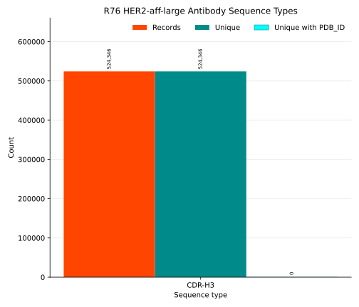
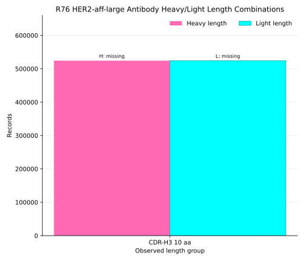
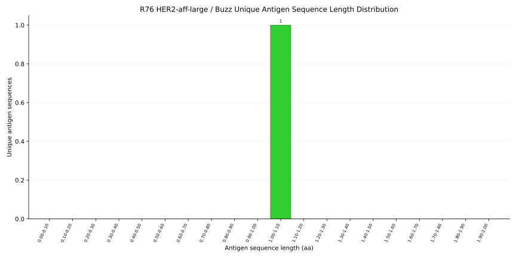

---
tags:
  - context
---

# [SRC-75 HER2-aff-large / Buzz](../2026-10-29-3a-src-readme/src-75-buzz-readme.md)

> 每条 data 统一建模为 `((ab, ag), label, assay, condition, replicate, source)`.
> 本地快照 `G:\abag-datasets\SRC_R76_BUZZ\zenodo-10831512`, `data.zip` 内含 5 个不同研究的处理后数据.
> `Unique` 为主表按 CDR-H3 序列去重.

## Antibody

> 有 Heavy 和 Light 的 `Unique` 字段是 `(heavy, light)` 二元组精确去重. `Unique with PDB_ID` 是按 Unique 后的 sequence 计数.
> Total Unique 计数方式为统一转 string, 如果有 Heavy 和 Light 用 `/` 拼接成 string.

| Key | 含义 | 说明 |
| --- | --- | --- |
| Sequence Type | 抗体序列类型 | 根据原始数据字段、链槽位及已有构建体标签划分的类别. |
| Records | 原始记录数 | 原始数据中的记录数量, 同一序列可能重复出现. |
| Unique | 唯一序列数 | 按对应数据集定义的去重规则统计. |
| Unique with PDB_ID | 关联 PDB 的唯一序列数 | 去重后具有关联 PDB_ID 的序列数量, 不等同于具有可用实验结构监督的序列数量. |
| Description | 类型说明 | 描述分类依据、序列槽位特征及分类限制. |

| Sequence Type | Records | Unique | Unique with PDB_ID | Description |
| --- | --- | --- | --- | --- |
| CDR-H3 | 524,346 | 524,346 | 0 | Trastuzumab 重链 IMGT 107-116 位, 10 aa; 酵母表面展示的 scFv 只是文库展示形式, 不是逐行构建体标签, 行内无其它区域序列. |
| Total | 524,346 | 524,346 | 0 | |

> 全部 524,346 条记录共享参考复合物 `1N8Z` (Herceptin Fab–HER2); 没有为任何变体单独解出的结构, 也没有逐行 PDB 字段.

| Heavy Length | Light Length | Records | Description |
| --- | --- | --- | --- |
| missing | missing | 524,346 | 表中只有 10 aa 的 CDR-H3, 无重链/轻链序列. |

## Antigen

> Antigen 统计以 source-native antigen entity 为核心单位. 优先使用原始 antigen ID/name、construct 和 antigen chain 定义实体; 存在可靠序列时再统计唯一抗原序列.
> 结构、序列和数据库注释压缩到同一张表中, `PDB / UniProt` 采用唯一抗原实体粒度统计 2 × 2 覆盖结果.
> 长度图基于唯一抗原序列, 按该源实际范围平均切分 20 bins.

| Records | Unique ag entity | Unique ag sequence | PDB / UniProt coverage | Antigen Length | Antigen Evidence / Provenance | Description |
| --- | --- | --- | --- | --- | --- | --- |
| 524,346 | 1 | 1 | Reference PDB: 1; UniProt=unavailable | 592 aa (extracellular domain) | Reference PDB / Fixed target | 全部 524,346 条 CDR-H3 记录针对单一固定抗原 HER2 (酵母表面展示 scFv 用荧光标记 HER2 染色分选), 表内无逐行抗原字段. 参考复合物 1N8Z 是 Herceptin Fab–HER2 结构, 非任何变体的独立结构. 数据还含三个 HER2 相关子集 (mason_et_al, example, 流感对照) 与流感体系, 为其他 assay 记录, 不计入本表. |

## Affinity

> 去重口径: HER2 主表按 **(CDR-H3 seq)** 去重 (524,346 行 = 524,261 唯一序列 + 85 重复, 我复核的 0.7/0.15/0.15 一套无重复). 外部子集各自独立按序列去重. 无 replicate 字段, 全记 `unknown`.
>
> `data.zip` 内含 5 个不同研究的处理后数据. **主表 `her2_aff_large`**: Trastuzumab CDR-H3 替换文库 (IMGT 107–116 位 10 aa), HER2 靶, 酵母展示分选三档 `high/mid/low`, 524,346 行 (high 172,149 / mid 190,011 / low 162,186, 与论文 546,284 差 22,023 为 remove_overlap). 二值 `label` 只把 `class=high` 标 1 (172,121), mid+low 全为 0 — 是"最高亲和力档 / 其余", 不是结合/不结合. `seq,class,label,edit_distance` 4 列, 无抗原序列列 (单一 HER2 靶). 同 SRC-12 buzz 行同源.

| Label | Assay | Condition | Replicate | Record pairs | Unique pairs | Description |
| --- | --- | --- | --- | --- | --- | --- |
| `ordinal` | `yeast_display` | `her2_aff_large (class)` | `unknown:524346` | 524,346 | 524,261 | `class` 三档 high 172,149 / mid 190,011 / low 162,186, 酵母展示分选门限, 相对强度非绝对 KD. |
| `binary` | `yeast_display` | `her2_aff_large (label)` | `unknown:524346` | 524,346 | 524,261 | `label` = `class=high` 1 (172,121) / 其余 0 (352,225); 0 含真实中等结合者, 非 negative. |
| `binary` | `unknown` | `mason_et_al (Trastuzumab 变体)` | `unknown:500` | 500 | 500 | `seq,label,edit_distance`, 无 class/affinity; 与本主表去重叠后约 500 变体. |
| `log_Kd` | `unknown` | `shanehsazzadeh_et_al` | `unknown:198` | 198 | 198 | `affinity` 连续 6.24~9.03 (单位未标, 疑似 −log10 KD), 全部 `label=1`, 外部设计验证集. |
| `log_Kd` | `unknown` | `shanehsazzaddeh_and_her2_aff_large_neg` | `unknown:574` | 574 | 574 | `affinity` 有值 311 / 空 263; label 1:138 / 0:263, 正负混合外部集. |
| `binary` | `unknown` | `influenza CR6261 (h1/h9)` | `unknown:1000` | 1,000 | 1,000 | `h1_label`/`h9_label` 各 500, Phillips 流感抗体, 另一体系. |
| `binary` | `unknown` | `influenza CR9114 (h1/fluB)` | `unknown:1000` | 1,000 | 1,000 | `h1_label`/`fluB_label` 各 500, 同 SRC-09 phillips2021. |
