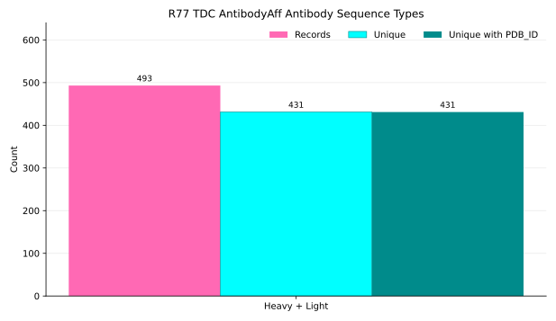
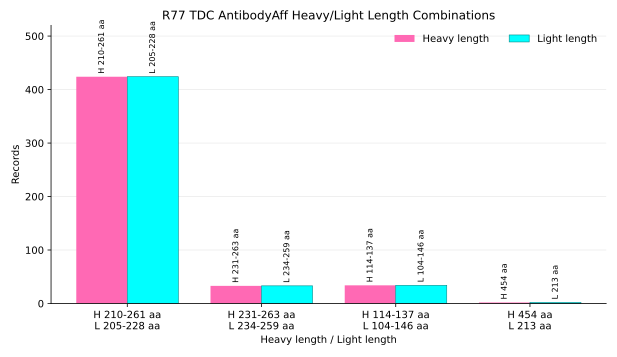
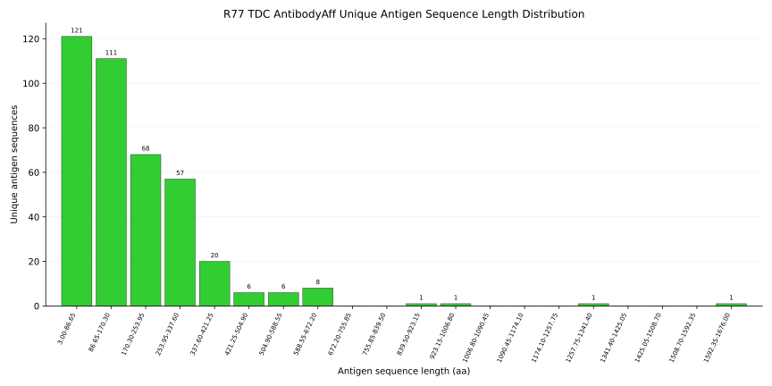

---
- tags:
  - context
---

# SRC-76 TDC AntibodyAff

> 每条 data 统一建模为 `((ab, ag), label, assay, condition, replicate, source)`.
> 本地快照 `G:\abag-datasets\SRC_R77_TDC_ANTIBODYAFF\dataverse-v105`, `protein_sabdab.csv` 493 行、6 列.
> `Unique` 为 `(X1 抗体链序列对, X2 抗原序列)` 精确去重.

## Antibody

> 有 Heavy 和 Light 的 `Unique` 字段是 `(heavy, light)` 二元组精确去重. `Unique with PDB_ID` 是按 Unique 后的 sequence 计数.
> Total Unique 计数方式为统一转 string, 如果有 Heavy 和 Light 用 `/` 拼接成 string.

| Key | 含义 | 说明 |
| --- | --- | --- |
| Sequence Type | 抗体序列类型 | 根据原始数据字段、链槽位及已有构建体标签划分的类别. |
| Records | 原始记录数 | 原始数据中的记录数量, 同一序列可能重复出现. |
| Unique | 唯一序列数 | 按对应数据集定义的去重规则统计. |
| Unique with PDB_ID | 关联 PDB 的唯一序列数 | 去重后具有关联 PDB_ID 的序列数量, 不等同于具有可用实验结构监督的序列数量. |
| Description | 类型说明 | 描述分类依据、序列槽位特征及分类限制. |

| Sequence Type | Records | Unique | Unique with PDB_ID | Description |
| --- | --- | --- | --- | --- |
| Heavy + Light | 493 | 431 | 431 | `X1` 每行均为两元素列表, 按 [重链, 轻链] 排列; 源表无独立 construct type 字段, 不能判定 IgG / Fab / Fv. 长度呈双峰: H 210-261 aa + L 205-228 aa 为主簇 (424 行), H 114-137 aa + L 104-146 aa 为纯可变区量级 (34 行). |
| Total | 493 | 431 | 431 | |

> `ID1` 齐备且 493 行互不重复, 故每个 unique 抗体对都至少挂 1 个 PDB entry; 该列是行级结构锚点, 不是逐行解出的抗体结构. 493 个 ID 中 491 个可取得 RCSB FASTA/mmCIF, `3RVV` 与 `3RVW` 已于 2022-04-27 撤销并分别并入 `5VPL`、`5VPG` (两个替代条目本身也在锚点集内), 原表 493 行不变.
>
> `X1` 有 21 行两个槽位序列完全相同, 其中 15 行含 `GGGGSGGGGSGGGGS` linker, 是上游把单链构建体同时写入两个槽位的结果; 源表未标 `scFv`, 按槽位形状归入 `Heavy + Light`, 不据此改判构建体.

| Heavy Length | Light Length | Records | Description |
| --- | --- | --- | ---: |
| 210-261 aa | 205-228 aa | 424 | 主簇, 占 86.0%: 双链均达 VH-CH1 / VL-CL 量级, 源表未标构建体. |
| 114-137 aa | 104-146 aa | 34 | 纯可变区量级双链, 对应 SAbDab 中以 Fv 形式存储的条目 (1BVK、1VFB、3A6C 等), 但不能仅凭长度判定 Fv. |
| 231-263 aa | 234-259 aa | 33 | 双链均超过常规 Fab 量级; 其中 21 行两槽位为同一条含 linker 的单链, 15 行含 `GGGGSGGGGSGGGGS`. |
| 454 aa | 213 aa | 2 | `6D6U`、`6D6T` 的 GABA-A receptor 抗体, 重链含完整 CH1-CH2-CH3 量级序列, 轻链为常规 VL-CL. |

## Antigen

> Antigen 统计以 source-native antigen entity 为核心单位. 优先使用原始 antigen ID/name、construct 和 antigen chain 定义实体; 存在可靠序列时再统计唯一抗原序列.
> 结构、序列和数据库注释压缩到同一张表中, `PDB / UniProt` 采用唯一抗原实体粒度统计 2 × 2 覆盖结果.
> 长度图基于唯一抗原序列, 按该源实际范围平均切分 20 bins.

| Records | Unique ag entity | Unique ag sequence | PDB / UniProt coverage | Antigen Length | Antigen Evidence / Provenance | Description |
| --- | --- | --- | --- | --- | --- | --- |
| 493 | 313 | 401 | PDB=1/UniProt=0: 313; PDB=0/UniProt=0: 0 | 3-1,676 aa; median 144 aa; 214 unique lengths | Direct sequence / Source-native | `protein_sabdab.csv` 逐行带 `ID2` (源抗原名, hemagglutinin, gp120, EGFR, lysozyme c 等) 与 `X2` (直接序列). 唯一抗原实体按 `ID2` 计 313 个; 唯一抗原序列 401 条 (同名可挂多条序列, 同序列可对多个抗体行). 每行 `ID1` 是抗体侧 PDB 锚点, 抗原侧无独立 PDB 字段, 抗原结构证据依赖所在复合物. 长度 3-1,676 aa, median 144 aa. |

## Affinity

> 去重口径: 按 **(X1 抗体链序列对, X2 抗原序列)** 去重; 493 行, 476 唯一 pair, 14 对重复 2 次 + 1 对重复 4 次. 无 replicate 字段, 全记 `unknown`.
>
> `protein_sabdab.csv` 493 行, 6 列 (含 1 个 pandas 索引列). `X1` = 抗体 (重链, 轻链) 两元素列表, `X2` = 抗原序列, `ID1` = PDB 条目, `ID2` = 抗原名, `Y` = 亲和力值 4e-13~2e-4 (Kd, M 量级, 383 个不同值). 无单位字段与 assay 字段, 数值越小结合越强. 同 SRC-77 Akbar 同源.

| Label | Assay | Condition | Replicate | Record pairs | Unique pairs | Description |
| --- | --- | --- | --- | --- | --- | --- |
| `Kd_M` | `unknown` | `protein_sabdab (493 行)` | `unknown:493` | 493 | 476 | `Y` 亲和力 4e-13~2e-4 (M), 无单位/方法字段, 量级为 Kd; 14 对重复 2 次, 1 对重复 4 次. |
