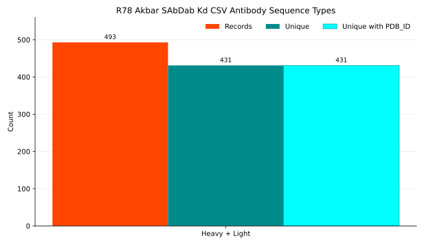
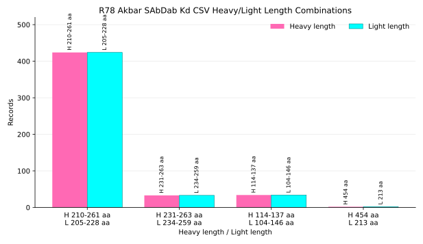
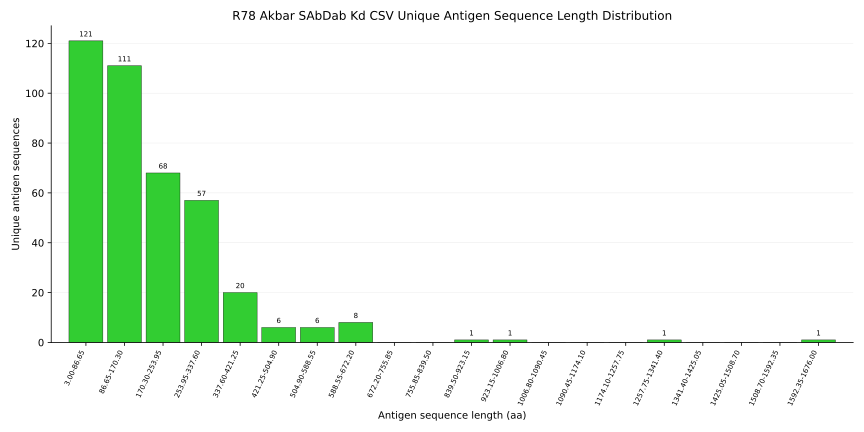

---
tags:
  - context
---

# [SRC-77 Akbar SAbDab Kd CSV](../2026-10-29-3a-src-readme/src-77-akbar-sabdab-kd-readme.md)

> 每条 data 统一建模为 `((ab, ag), label, assay, condition, replicate, source)`.
> 本地快照 `G:\abag-datasets\SRC_R78_AKBAR_SABDAB_KD\zenodo-13120765`, `antibody_affinity_protein_sabdab.csv` 493 行、5 列.
> `Unique` 为 `(Antibody 序列对, Antigen 序列)` 精确去重.

## Antibody

> 有 Heavy 和 Light 的 `Unique` 字段是 `(heavy, light)` 二元组精确去重. `Unique with PDB_ID` 是按 Unique 后的 sequence 计数.
> Total Unique 计数方式为统一转 string, 如果有 Heavy 和 Light 用 `/` 拼接成 string.

| Key | 含义 | 说明 |
| --- | --- | --- |
| Sequence Type | 抗体序列类型 | 根据原始数据字段、链槽位及已有构建体标签划分的类别. |
| Records | 原始记录数 | 原始数据中的记录数量, 同一序列可能重复出现. |
| Unique | 唯一序列数 | 按对应数据集定义的去重规则统计. |
| Unique with PDB_ID | 关联 PDB 的唯一序列数 | 去重后具有关联 PDB_ID 的序列数量, 不等同于具有可用实验结构监督的序列数量. |
| Description | 类型说明 | 描述分类依据、序列槽位特征及分类限制. |

| Sequence Type | Records | Unique | Unique with PDB_ID | Description |
| --- | --- | --- | --- | --- |
| Heavy + Light | 493 | 431 | 431 | `Antibody` 为两元素 `[heavy, light]` 列表字符串; 源表无 construct type 字段, 不能判定 IgG / Fab / Fv. 长度呈双峰: H 210-261 aa + L 205-228 aa 为主簇 (424 行), H 114-137 aa + L 104-146 aa 为纯可变区量级 (34 行). |
| Total | 493 | 431 | 431 | |

| Heavy Length | Light Length | Records | Description |
| --- | --- | --- | --- |
| 210-261 aa | 205-228 aa | 424 | 主簇, 占 86.0%: 双链均达 VH-CH1 / VL-CL 量级, 源表未标构建体. |
| 114-137 aa | 104-146 aa | 34 | 纯可变区量级双链, 不能仅凭长度判定 Fv. |
| 231-263 aa | 234-259 aa | 33 | 双链均超过常规 Fab 量级; 其中 21 行两槽位为同一条含 linker 的单链. |
| 454 aa | 213 aa | 2 | 重链含完整 CH1-CH2-CH3 量级序列, 轻链为常规 VL-CL. |

## Antigen

> Antigen 统计以 source-native antigen entity 为核心单位. 优先使用原始 antigen ID/name、construct 和 antigen chain 定义实体; 存在可靠序列时再统计唯一抗原序列.
> 结构、序列和数据库注释压缩到同一张表中, `PDB / UniProt` 采用唯一抗原实体粒度统计 2 × 2 覆盖结果.
> 长度图基于唯一抗原序列, 按该源实际范围平均切分 20 bins.

| Records | Unique ag entity | Unique ag sequence | PDB / UniProt coverage | Antigen Length | Antigen Evidence / Provenance | Description |
| --- | --- | --- | --- | --- | --- | --- |
| 493 | 313 | 401 | PDB=1/UniProt=0: 313; PDB=0/UniProt=0: 0 | 3-1,676 aa; median 144 aa; 214 unique lengths | Direct sequence / Source-native | 与 SRC-76 同源 (同一批 TDC/Akbar protein_sabdab 测量, SRC-76 为 dataverse v105 版, SRC-77 为 zenodo 版, 行数与 ID 全同). 逐行带 `Antigen_ID` (313 个唯一名) 与 `Antigen` 直接序列 (401 条唯一). 每行 `Antibody_ID` 是抗体侧 PDB 锚点, 抗原侧结构证据依赖所在复合物. 长度 3-1,676 aa, median 144 aa. 跨源汇总时 SRC-76/SRC-77 应按测量身份去重. |

## Affinity

> 去重口径: 按 **(Antibody 序列对, Antigen 序列)** 去重; 493 行, 476 唯一 pair (14 对重复 2 次 + 1 对重复 4 次). 无 replicate 字段, 全记 `unknown`.
>
> `antibody_affinity_protein_sabdab.csv` 493 行, 5 列: `Antibody_ID` (PDB 条目), `Antibody` (重链, 轻链 两元素), `Antigen_ID` (抗原名), `Antigen` (序列), `Y` (亲和力 4e-13~2e-4 M). 与 SRC-76 TDC 同源同 493 行, 此版本列名更干净 (无 pandas 索引列), 同 SRC-76 的 Y 值逐一相同 (`1hh6/pep-4 1e-07` 等).

| Label | Assay | Condition | Replicate | Record pairs | Unique pairs | Description |
| --- | --- | --- | --- | --- | --- | --- |
| `Kd_M` | `unknown` | `protein_sabdab (493 行)` | `unknown:493` | 493 | 476 | `Y` 亲和力 4e-13~2e-4 (M), 同 SRC-76; 无单位/方法字段. |
