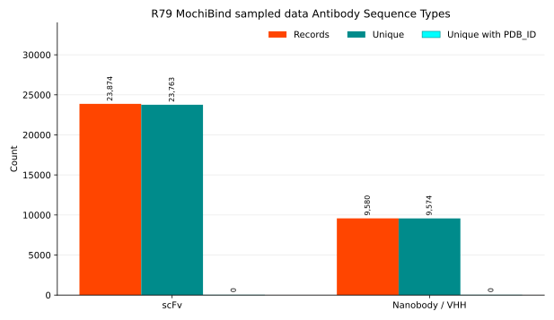
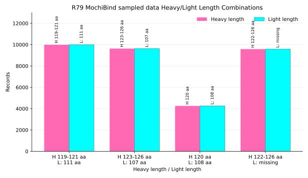
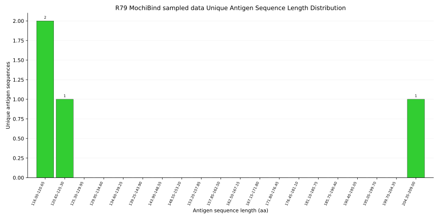

---
tags:
  - context
---

# [SRC-78 MochiBind sampled data](../2026-10-29-3a-src-readme/src-78-mochibind-readme.md)

> 每条 data 统一建模为 `((ab, ag), label, assay, condition, replicate, source)`.
> 本地快照 `G:\abag-datasets\SRC_R79_MOCHIBIND\snapshot-2026-05-19`, `ab-binding-eval/data/` 7 张 AlphaSeq 采样 CSV, 共 33,454 行.
> `Unique` 为 `(mata_description, matalpha_description)` PPI 身份去重.

## Antibody

> 有 Heavy 和 Light 的 `Unique` 字段是 `(heavy, light)` 二元组精确去重. `Unique with PDB_ID` 是按 Unique 后的 sequence 计数.
> Total Unique 计数方式为统一转 string, 如果有 Heavy 和 Light 用 `/` 拼接成 string.

| Key | 含义 | 说明 |
| --- | --- | --- |
| Sequence Type | 抗体序列类型 | 根据原始数据字段、链槽位及已有构建体标签划分的类别. |
| Records | 原始记录数 | 原始数据中的记录数量, 同一序列可能重复出现. |
| Unique | 唯一序列数 | 按对应数据集定义的去重规则统计. |
| Unique with PDB_ID | 关联 PDB 的唯一序列数 | 去重后具有关联 PDB_ID 的序列数量, 不等同于具有可用实验结构监督的序列数量. |
| Description | 类型说明 | 描述分类依据、序列槽位特征及分类限制. |

| Sequence Type | Records | Unique | Unique with PDB_ID | Description |
| --- | --- | --- | --- | --- |
| scFv | 23,874 | 23,763 | 0 | `mata_sequence` 逐行等于 `hc` + `GGGGSGGGGSGGGGS` + `lc`, 23,874 行全部成立; 源 README 称该字段为完整 scFv 序列。无逐行 construct 字段, 其它构建体不并入本类。 |
| Nanobody / VHH | 9,580 | 9,574 | 0 | VHH72 系列表既无 `lc` 槽位也无 linker, `mata_sequence` 与 `hc` 完全相同 (9,580 行)。`Nanobody / VHH` 来自 `df_vhh72_*` 系列表与 `vhh72.pt` 的体系级命名, 是 parent-level 属性, 不是逐行字段。 |
| Total | 33,454 | 33,337 | 0 | |

| Heavy Length | Light Length | Records | Description |
| --- | --- | --- | --- |
| 119-121 aa | 111 aa | 9,990 | PEM 系: 轻链 111 aa 恒定, 重链 119-121 aa, 主峰 120 aa (9,939 行)。 |
| 120 aa | 108 aa | 4,254 | TRA 系: 重链长度单一 120 aa, 轻链 108 aa 恒定。 |
| 123-126 aa | 107 aa | 9,630 | PP489 系: 轻链 107 aa 恒定, 重链 123-126 aa, 主峰 125 aa (8,930 行)。 |
| 122-126 aa | missing | 9,580 | VHH72 系: 只有重链槽位, 源表无轻链列, 记 missing。 |

## Antigen

> Antigen 统计以 source-native antigen entity 为核心单位. 优先使用原始 antigen ID/name、construct 和 antigen chain 定义实体; 存在可靠序列时再统计唯一抗原序列.
> 结构、序列和数据库注释压缩到同一张表中, `PDB / UniProt` 采用唯一抗原实体粒度统计 2 × 2 覆盖结果.
> 长度图基于唯一抗原序列, 按该源实际范围平均切分 20 bins.

| Records | Unique ag entity | Unique ag sequence | PDB / UniProt coverage | Antigen Length | Antigen Evidence / Provenance | Description |
| --- | --- | --- | --- | --- | --- | --- |
| 33,454 | 4 | 4 | Reference PDB: 4; UniProt=unavailable | 116-209 aa | Direct sequence / Fixed target | 7 张表对应 4 个活动, 每活动一个固定抗原 (`antigen` 列逐行恒值, 直接序列): pem (PD-1, 123 aa, 9,990 行), pp489 (TIGIT_22-137, 116 aa, 9,630 行), tra (HER2 胞外域片段, 120 aa, 4,254 行), vhh72 (SARS-CoV-2 RBD, 209 aa, 9,580 行). 抗原序列逐行直接给出, 是活动级固定构建体. 参考结构锚点 (6LZG 等) 非逐行复合物. 与 SRC-79 的 AlphaSeq 上游数据共享同一批测量, 跨源应去重. |

## Affinity

> 去重口径: 按 **(mata_description, matalpha_description)** PPI 身份去重, 文件内基本 1:1 (序列重复 ≤12 行). 无 replicate 字段, 全记 `unknown`.
>
> `ab-binding-eval/data/` 7 张 AlphaSeq 采样 CSV (3 个 fine-tuning 采样 + 4 个 validation 采样), 每张 5,000 行左右, 是 SRC-79 AlphaBind 各 campaign 的 5k 随机采样, 单抗原 (每文件一个 `antigen` 序列). `alphaseq_affinity` = log10(Kd nM) 实验读出; validation 表另有 `predicted_affinity` (5 个模型) 同行. 同 SRC-79 / SRC-23 / SRC-09 AlphaSeq 系列, 跨源去重按测量身份.

| Label | Assay | Condition | Replicate | Record pairs | Unique pairs | Description |
| --- | --- | --- | --- | --- | --- | --- |
| `log_Kd` | `NGS_seq` | `pem fine-tuning 5k` | `unknown:4990` | 4,990 | 4,990 | log10(Kd nM) 1.11~6.55, pembrolizumab ECD 靶. |
| `log_Kd` | `NGS_seq` | `pem validation 5k` | `unknown:5000` | 5,000 | 5,000 | log10(Kd nM) 0.66~5.68; 同表另有 `predicted` 行. |
| `log_Kd` | `NGS_seq` | `pp489 fine-tuning 5k` | `unknown:4630` | 4,630 | 4,630 | log10(Kd nM) −0.66~4.16, pp489 靶. |
| `log_Kd` | `NGS_seq` | `pp489 validation 5k` | `unknown:5000` | 5,000 | 5,000 | log10(Kd nM) −0.12~4.94; 同表另有 `predicted` 行. |
| `log_Kd` | `NGS_seq` | `trastuzumab fine-tuning 5k` | `unknown:4254` | 4,254 | 4,254 | log10(Kd nM) 1.06~7.25, HER2; 此表同时带 `predicted_affinity` (alphabind). |
| `log_Kd` | `NGS_seq` | `vhh72 fine-tuning 5k` | `unknown:4580` | 4,580 | 4,580 | log10(Kd nM) 0.86~4.97, SARS-CoV-2 RBD, 仅重链. |
| `log_Kd` | `NGS_seq` | `vhh72 validation 5k` | `unknown:5000` | 5,000 | 5,000 | log10(Kd nM) 0.48~5.24; 同表另有 `predicted` 行. |
| `predicted` | `computational` | `pem validation 5k` | `unknown:4990` | 4,990 | 5,000 | `predicted_affinity`, 模型 ohe_cold/ohe_warm/esm_cold/esm_warm/alphabind 混合, 10 行空. |
| `predicted` | `computational` | `pp489 validation 5k` | `unknown:4984` | 4,984 | 5,000 | 同上, 16 行空. |
| `predicted` | `computational` | `trastuzumab fine-tuning 5k` | `unknown:4254` | 4,254 | 4,254 | 全为 alphabind 模型预测. |
| `predicted` | `computational` | `vhh72 validation 5k` | `unknown:4996` | 4,996 | 5,000 | 同上, 4 行空. |
