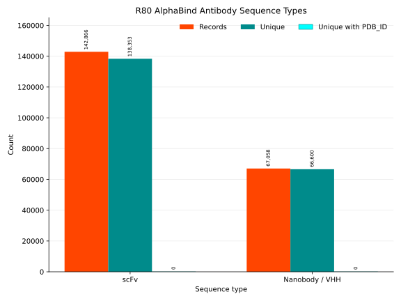
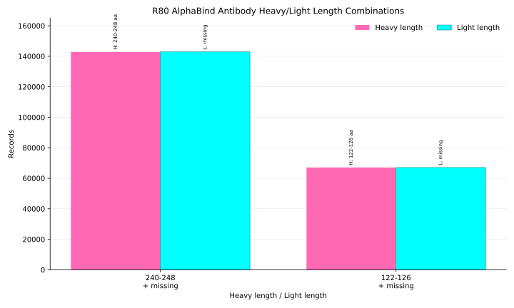

---
tags:
  - context
---

# [SRC-79 AlphaBind public experiments](../2026-10-29-3a-src-readme/src-79-alphabind-readme.md)

> 每条 data 统一建模为 `((ab, ag), label, assay, condition, replicate, source)`.
> 本地快照 `G:\abag-datasets\SRC_R80_ALPHABIND\snapshot-2025-07-24`, `manuscript/data/alphaseq/` 8 张 AlphaSeq CSV (3 fine-tuning + 5 validation).
> `Unique` 为 PPI 身份 `(mata_description, matalpha_description)` 去重.

## Antibody

> 有 Heavy 和 Light 的 `Unique` 字段是 `(heavy, light)` 二元组精确去重. `Unique with PDB_ID` 是按 Unique 后的 sequence 计数.
> Total Unique 计数方式为统一转 string, 如果有 Heavy 和 Light 用 `/` 拼接成 string.

| Key | 含义 | 说明 |
| --- | --- | --- |
| Sequence Type | 抗体序列类型 | 根据原始数据字段、链槽位及已有构建体标签划分的类别. |
| Records | 原始记录数 | 原始数据中的记录数量, 同一序列可能重复出现. |
| Unique | 唯一序列数 | 按对应数据集定义的去重规则统计. |
| Unique with PDB_ID | 关联 PDB 的唯一序列数 | 去重后具有关联 PDB_ID 的序列数量, 不等同于具有可用实验结构监督的序列数量. |
| Description | 类型说明 | 描述分类依据、序列槽位特征及分类限制. |

> 逐行没有 antibody PDB_ID. 5 个参考 PDB (`1N8Z`、`3UDW`、`5JXE`、`6LZG`、`6WAQ`) 是活动级参考结构, 不是逐行抗体结构.

| Sequence Type | Records | Unique | Unique with PDB_ID | Description |
| --- | --- | --- | --- | --- |
| scFv | 142,866 | 138,353 | 0 | `aab-pp489`、`pembrolizumab-scfv`、`trastuzumab-scfv-cdr/full` 四个活动；`mata_sequence` 为含 linker 的完整 scFv 单链, 只占一个序列槽位, 构建体名取自文件名与论文文本. |
| Nanobody / VHH | 67,058 | 66,600 | 0 | `vhh72` fine-tuning 与 validation 两个活动；原始数据显式标注为 camelid single-domain VHH. |
| Total | 209,924 | 204,953 | 0 | |

| Heavy Length | Light Length | Records | Description |
| --- | --- | --- | --- |
| 240-248 aa | missing | 142,866 | scFv 单链: aab-pp489 244-248 aa (64,259), pembrolizumab 245-247 aa (67,386), trastuzumab 240-245 aa (11,221). |
| 122-126 aa | missing | 67,058 | VHH 单域: 主峰 125 aa (52,750), 126 aa (10,488). |

## Antigen

> Antigen 统计以 source-native antigen entity 为核心单位. 优先使用原始 antigen ID/name、construct 和 antigen chain 定义实体; 存在可靠序列时再统计唯一抗原序列.
> 结构、序列和数据库注释压缩到同一张表中, `PDB / UniProt` 采用唯一抗原实体粒度统计 2 × 2 覆盖结果.

| Records | Unique ag entity | Unique ag sequence | PDB / UniProt coverage | Antigen Length | Antigen Evidence / Provenance | Description |
| --- | --- | --- | --- | --- | --- | --- |
| 209,924 | 4 | unavailable | Reference PDB: 4; UniProt=unavailable | unavailable | Reference PDB / Fixed target | 8 张表 (3 fine-tuning + 5 validation) 属于 4 个抗体活动, 每个活动一个固定 Mat-Alpha 目标 (`matalpha_description` 恒值): TIGIT_22-137 (aab-pp489), huPD-1 (pembrolizumab), SARS-CoV2_RBD (vhh72), HER2-OPT (trastuzumab, 2 张 validation). 表内无目标序列字段 (README 指向 Table S1), 目标为活动级固定构建体. 参考结构锚点 6LZG 等属共享参考, 非逐行复合物. |

> 连逐行名字都没有, 抗原是活动级固定构建体 (TIGIT_22-137 等), 序列在 README 指向的 Table S1 补充材料, 不在数据包内.

## Affinity

> 去重口径: 按 **(mata_description, matalpha_description)** PPI 身份去重, 每行一个 PPI, 文件内 1:1. 无 replicate 字段, 全记 `unknown`.
>
> `manuscript/data/alphaseq/` 8 张 AlphaSeq CSV (3 fine-tuning + 5 validation), 每张一个抗体 campaign. `alphaseq_affinity` = `log10(Kd (nM))` 实验读出 (NGS_seq). validation 表另有 `predicted_affinity` (模型预测, 与 `alphaseq_affinity` 同行). `mata_sequence` 为可变抗体序列, `matalpha` 靶构造每 campaign 不变, 未逐行给出. 同 SRC-23/SRC-09 AlphaSeq 系列, 跨源去重按测量身份.

| Label | Assay | Condition | Replicate | Record pairs | Unique pairs | Description |
| --- | --- | --- | --- | --- | --- | --- |
| `log_Kd` | `NGS_seq` | `aab-pp489 fine-tuning` | `unknown:24539` | 24,539 | 26,913 | `alphaseq_affinity` log10(Kd nM) −1.02~4.34, 2,374 行无值. |
| `log_Kd` | `NGS_seq` | `pembrolizumab-scfv fine-tuning` | `unknown:29812` | 29,812 | 29,897 | log10(Kd nM) 1.00~6.68, 85 行无值. |
| `log_Kd` | `NGS_seq` | `vhh72 fine-tuning` | `unknown:27508` | 27,508 | 29,988 | log10(Kd nM) 0.51~5.22, 2,480 行无值. |
| `log_Kd` | `NGS_seq` | `aab-pp489 validation` | `unknown:37288` | 37,288 | 37,346 | log10(Kd nM) −0.75~4.95, 58 行无值; 同表另有 `predicted` 行. |
| `log_Kd` | `NGS_seq` | `pembrolizumab-scfv validation` | `unknown:37459` | 37,459 | 37,489 | log10(Kd nM) 0.42~5.89; 同表另有 `predicted` 行. |
| `log_Kd` | `NGS_seq` | `trastuzumab-scfv-cdr validation` | `unknown:3680` | 3,680 | 3,681 | log10(Kd nM) 1.39~6.20, CDR 区扰动. |
| `log_Kd` | `NGS_seq` | `trastuzumab-scfv-full validation` | `unknown:7533` | 7,533 | 7,540 | log10(Kd nM) 1.06~7.25, 全长扰动. |
| `log_Kd` | `NGS_seq` | `vhh72 validation` | `unknown:33868` | 33,868 | 37,070 | log10(Kd nM) 0.28~5.39, 3,202 行无值. |
| `predicted` | `computational` | `aab-pp489 validation` | `unknown:37296` | 37,296 | 37,346 | `predicted_affinity` 模型预测, 与实验行同 PPI; 模型 ohe_cold/ohe_warm/esm_cold/esm_warm/alphabind 混合. |
| `predicted` | `computational` | `pembrolizumab-scfv validation` | `unknown:37440` | 37,440 | 37,489 | 同上. |
| `predicted` | `computational` | `trastuzumab-scfv-cdr validation` | `unknown:3631` | 3,631 | 3,681 | 同上. |
| `predicted` | `computational` | `trastuzumab-scfv-full validation` | `unknown:7490` | 7,490 | 7,540 | 同上. |
| `predicted` | `computational` | `vhh72 validation` | `unknown:37020` | 37,020 | 37,070 | 同上. |
