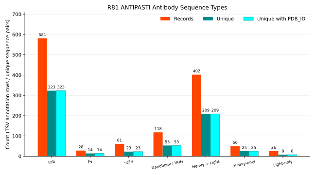
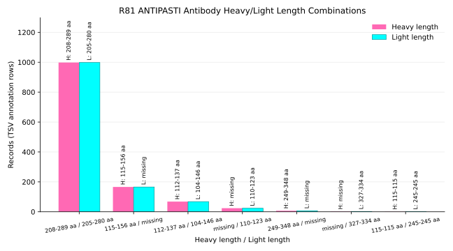
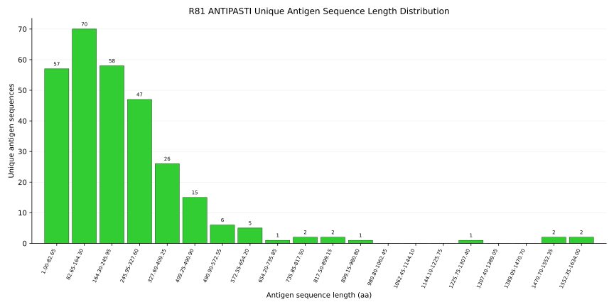

---
- tags:
  - context
---

# SRC-80 ANTIPASTI

> 每条 data 统一建模为 `((ab, ag), label, assay, condition, replicate, source)`.
> 本地快照 `G:\abag-datasets\SRC_R81_ANTIPASTI\v1`, `ANTIPASTI/data/sabdab_summary_all.tsv` 1,266 行、30 列, 本地 mendeley 结构 2,268 个 PDB 文件.
> `Unique` 为 `(heavy, light)` 二元组精确去重; pair 级去重键为 `(pdb, Hchain, Lchain, antigen_chain)`.

## Antibody

> 有 Heavy 和 Light 的 `Unique` 字段是 `(heavy, light)` 二元组精确去重. `Unique with PDB_ID` 是按 Unique 后的 sequence 计数.
> Total Unique 计数方式为统一转 string, 如果有 Heavy 和 Light 用 `/` 拼接成 string.

| Key | 含义 | 说明 |
| --- | --- | --- |
| Sequence Type | 抗体序列类型 | 根据原始数据字段、链槽位及已有构建体标签划分的类别. |
| Records | 原始记录数 | 原始数据中的记录数量, 同一序列可能重复出现. |
| Unique | 唯一序列数 | 按对应数据集定义的去重规则统计. |
| Unique with PDB_ID | 关联 PDB 的唯一序列数 | 去重后具有关联 PDB_ID 的序列数量, 不等同于具有可用实验结构监督的序列数量. |
| Description | 类型说明 | 描述分类依据、序列槽位特征及分类限制. |

| Sequence Type | Records | Unique | Unique with PDB_ID | Description |
| --- | ---: | ---: | ---: | --- |
| Fab | 581 | 323 | 323 | 链槽位 entity 名含 FAB 表述; 双链为主, 长度多为 VH-CH1 / VL-CL 量级. |
| Fv | 28 | 14 | 14 | entity 标 FV / VH FRAGMENT + VL FRAGMENT; 双链均只覆盖可变区 (H 112–137, L 104–119). |
| scFv | 61 | 23 | 23 | TSV 原始 scFv=True flag; 完整单链序列仅能从对应 PDB 解析, 含 4kv5、5kve、4lar. |
| Nanobody / VHH | 118 | 53 | 53 | H-only 行; Nanobody / VHH / camelid 等来自 entry entity 名称, 是 PDB 级属性, 不是逐行字段. |
| Heavy + Light | 402 | 209 | 209 | 双链槽位齐备, 无构建体标签, 不能判定 IgG / Fab / Fv. |
| Heavy-only | 50 | 25 | 25 | 只有 H 槽位; 多为 VHH 量级, 保留槽位形状, 不从长度反推 Nanobody. |
| Light-only | 26 | 8 | 8 | 只有 L 槽位; 如 3lrh anti-huntingtin VL domain, 4k3h Immunoglobulin lambda variable domain. |
| Total | 1,266 | 648 | 648 | |

> 1,266 行中 26 行缺 H 槽位、168 行缺 L 槽位, 另 5 行链 ID 无法解析; 因此不能把全部行转成完整 H/L 字符串. 每行自带其 PDB entry, Unique with PDB_ID 是结构 entry 粒度: 一个 PDB 可有多行 (1–12), 不证明每行都是独立结构.

| Heavy Length | Light Length | Records | Description |
| --- | --- | ---: | --- |
| 208–289 aa | 205–280 aa | 998 | 主簇: 双链均达 VH-CH1 / VL-CL 量级, 覆盖 Fab 574、scFv 60 与大多数 Heavy + Light 行. |
| 115–156 aa | missing | 166 | 单重链 VHH 量级; 源表无 L 槽位, 记 missing. |
| 112–137 aa | 104–146 aa | 68 | 纯可变区量级双链: Fv 与部分 Fv 量级 Fab; 不凭长度定构建体. |
| missing | 110–123 aa | 24 | 只有轻链: 8 条 VL domain 与 16 条 Ig lambda variable domain; H 槽位缺失. |
| 249–348 aa | missing | 7 | 重链偏长, 含 3l5y / 3rvv / 3rvw 的旧条目; L 槽位缺失. |
| missing | 327–334 aa | 2 | 轻链含 CH 量级 (327 / 334 aa); 4k3h, H 槽位缺失. |
| 115–115 aa | 245–245 aa | 1 | 单行 5kve 尾链: H 115 aa 短重链 + L 245 aa, 源 scFv=False, 保留槽位形状. |

## Antigen

> Antigen 统计以 source-native antigen entity 为核心单位. 优先使用原始 antigen ID/name、construct 和 antigen chain 定义实体; 存在可靠序列时再统计唯一抗原序列.
> 结构、序列和数据库注释压缩到同一张表中, `PDB / UniProt` 采用唯一抗原实体粒度统计 2 × 2 覆盖结果.
> 长度图基于唯一抗原序列, 按该源实际范围平均切分 20 bins.

| Records | Unique ag entity | Unique ag sequence | PDB / UniProt coverage | Antigen Length | Antigen Evidence / Provenance | Description |
| --- | --- | --- | --- | --- | --- | --- |
| 1,266 | 911 | 656 | PDB=1/UniProt=0: 911; PDB=0/UniProt=0: 0 | 1-1,634 aa; median 141 aa; 295 unique lengths | PDB-derived sequence / Source-native | `sabdab_summary_all.tsv` 逐行带 `antigen_name` 与 `antigen_chain` (结构内链号), 唯一实体按 (antigen_name, antigen_chain) 计 911 个 (仅按名称去重 441 个). 表内无抗原序列字段; 抗原序列按 (PDB, antigen_chain) 从本地 mendeley 结构 (2,268 个 PDB 文件) 按链重建, 897 个实体可重建、656 条唯一序列 (长度 1-1,634 aa, median 141 aa). 序列属 PDB-derived, 非逐行独立解出的抗原结构. 无 UniProt 字段. |

> 本 dataset sequence length 需通过 structure 重建 sequence 计算. 14 个实体无法重建 sequence length, 为 NA 链或 DNA/RNA 抗原 (4YHP, 5GKR, 6DB9, 2FR4, 6B3K, 6B14, 2R8S 等), 无蛋白链可提取.

## Affinity

> 去重口径: 按 **(pdb, Hchain, Lchain, antigen_chain)** 去重, 全表 1:1 唯一 (1,266/1,266). 无 replicate 字段, 全记 `unknown`.
>
> `ANTIPASTI/data/sabdab_summary_all.tsv` 1,266 行, 30 列. `affinity` (M, 4e-13~2e-4) 与 `delta_g` (kcal/mol, 由 Kd 换算) 两列全行有值, 同一行的双 label. `affinity_method` 标 10+ 种, 但含错误混入 (373 Unknown, 41 TBD, 15 个 PMID 数字当方法, 32 行 temperature 列错填 SPR/BLI 方法名); 方法字段不可靠, 大类可取 SPR 622 / ITC 64 / BLI 32 / ELISA 12 / 余 ~536 混杂. `temperature` 976 行 NA, 122 行 25 °C. 同 SRC-20 SAbDab 的亲和力标注层, 同 SRC-13 ANDD 的 SabDab 行同源.

| Label | Assay | Condition | Replicate | Record pairs | Unique pairs | Description |
| --- | --- | --- | --- | --- | --- | --- |
| `Kd_M` | `unknown` | `sabdab_summary_all (1,266 行)` | `unknown:1266` | 1,266 | 1,266 | `affinity` 4e-13~2e-4 M, 全行有值; 方法字段混杂 (SPR 622 / ITC 64 / BLI 32 / ELISA 12 / Unknown 373 / TBD 41 / PMID 错填 15 / 余). |
| `ddG` | `unknown` | `sabdab_summary_all (1,266 行)` | `unknown:1266` | 1,266 | 1,266 | `delta_g` kcal/mol 由 Kd 换算, 与上 Kd 同行, 每行双 label 并存. |
